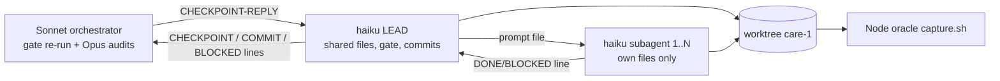

<!--
RULES — read before writing or implementing:
1. FORMAT: Bullets, tables, code, diagrams ONLY — no prose paragraphs
2. REQUIREMENTS: One crisp line each — no verbose descriptions
3. CHECKLIST: Mark items [x] as you complete them — this is your persistent todo list
4. READING TIME: Optimize for fast human scanning — if it's hard to skim, rewrite it
-->

# Plan: claude-master — everything that remains, in one ordered run

> Standing goal: FULL parity + FULL feature set vs npm 0.94.0; only technically impossible items may remain, each with a written reason in `porting/parity/DECISIONS-FOR-USER.md`.

**Branch:** `feat/rust-port` · **Status:** Pending · **PRD:** skip
**Scratch (S):** `/private/tmp/claude-501/-Users-gb--vibe-station-projects-claude-acp-rust-eval-worktrees-care-1/5645c96c-b7c3-4262-abc5-87d07ff3c56c/scratchpad`
**Pinned upstream (U):** `S/upstream-wt/v0.94.0` (read `U/src/*.ts`, `U/src/tests/*.test.ts`, `U/docs/*.md`) · info only: `S/upstream-wt/main` · compiled oracle: `rust/target/upstream/0.94.0/node_modules/@agentclientprotocol/claude-agent-acp/dist` (never delete/modify)
**Codex sibling (read-only):** `/Users/gb/code/fastestdevalive/codex-acp-rust` (`docs/parity/FEATURES.md`, `README.md`, `scripts/parity/*`)
**Common brief (READ FIRST, every session and every subagent prompt copies its "Hard repo rules"):** `S/prompts/lead-common.md`

---

## Problem & Concept

- Rust port mirrors 0.94.0 but ROADMAP counts 49 missing + 33 partial source modules and 62 open packages; STATUS criteria 1-5 are open.
- Success = FEATURES.md has zero PARTIAL/MISSING (or a DECISIONS-FOR-USER reason), TEST-MAP zero `missing`, MODULE-MAP complete, shared corpus replayed, concurrency decision + race suite done, fresh-Opus audit finds nothing, vst verifier sees zero divergences.
- This plan fixes ORDER, PARALLELISM, FILE OWNERSHIP, CHECKPOINTS and ACCEPTANCE; scope text of each F-package is the ROADMAP section 3 card (cited, not repeated).

## Out of Scope

- Bumping the pin past 0.94.0 (main-branch delta stays "information only", `porting/parity/STATUS.md` delta note).
- Anything under root `src/`, `package.json`, `scripts/`, `.github/`, `docs/` (guard G7); `porting/record-real.sh` (human-only).
- Impossible items (ROADMAP section 7 rows 1-2: JS function options, in-process SDK MCP servers) — only their DECISIONS entries are written.

## Requirements

| # | Requirement |
|---|-------------|
| 1 | Stage order in "Execution order" is binding; a stage starts only when the previous stage's exit gate is met |
| 2 | Hazardous group (F7a/b, F12-F18, F25, F24, F19-F22 + A-AG3 3.2, F35, F39) strictly sequential, one `OPUS-DIFF` checkpoint each |
| 3 | Parallelise only disjoint-file leaf work; shared files edited by the LEAD only |
| 4 | Every commit: full gate green (plain + polluted), one commit per integrated sub-package, STATUS.md + FEATURES.md rows updated in the same commit |
| 5 | Wire-visible behaviour proved by a Node-captured differential corpus scenario, else hermetic unit tests (non-vacuous: fail without the fix) |
| 6 | Repos stay structurally consistent in names with codex port (`FEATURES/TEST-MAP/MODULE-MAP/CONCURRENCY/CORPUS/STATUS/DECISIONS-FOR-USER` under `porting/parity`, scripts under `rust/scripts/parity`, decision D1) |

---

## Change Map

```
porting/parity/
  FEATURES.md            + complete upstream feature checklist (stage 1)
  STATUS.md              ~ criteria, open count, model log (every commit)
  CONCURRENCY.md         + runtime decision, audit table, race results
  CORPUS.md              + scenario manifest, normaliser justifications
  TEST-MAP.md / MODULE-MAP.md / MISSING.md / PARITY-PROGRAM.md / README.md  + parity-infra
  DECISIONS-FOR-USER.md  ~ impossible-item reasons
porting/corpus/          + ~250 Node-captured scenarios (scripts)
porting/fixtures/        ~ regenerated ONLY via capture.sh
rust/scripts/parity/     + test-map-check, module-map-check, fetch-upstream.sh, gate-parity.sh
rust/claude-agent-acp-rs/src/
  (31 .rs files today)   ~ every stage; new modules per package card
  turn.rs session.rs map.rs dispatch.rs   ~ HAZARD, LEAD-only
rust/claude-agent-acp-rs/tests/  + parity_maps, race_suite, live_smoke, shutdown, ...
.vibekit/feature-plans/pending/  + sub-package plan files (parity-closeout, per-stage)
```

| Today | After this plan |
|-------|-----------------|
| No feature checklist; ROADMAP is the only gap list | `porting/parity/FEATURES.md` audited by independent Opus, rows flip with their fixing commit |
| 82 source modules partial/missing, 49 corpus scenarios | all modules DONE, ~250 scenarios, 23 shared names replayed |
| Multi-thread tokio, no race tests, no panic policy | measured runtime decision, shared-state audit, 7 race tests x>=200 iterations, documented exit policy |

---

## Research (cited by Key Decisions)

- ROADMAP `.vibekit/feature-plans/pending/parity-roadmap/ROADMAP.md`: sec 1 module table, sec 2 hazards O/I/E/H/S/EAT, sec 3 cards F1..F46, sec 4 order, sec 5 shared corpus map, sec 6 scripted-frame sources, sec 7 impossible items, sec 9 capability/RPC matrix.
- `.vibekit/feature-plans/pending/parity-closeout/parked-exit-plan/exit-plan-{auto,default}.{acp.json,transcript.jsonl,argv.json,frames.jsonl}`: parked scripts; Rust tool_call title `Ready to code?` + plan-text content vs Node `Approve Plan`.
- `porting/parity/STATUS.md` criteria 1-5 and open-item list are the completion contract.
- Codex `docs/parity/FEATURES.md`: 272 lines, sections 1-8, row = `ID | feature | upstream file(s) | status | Rust evidence | note`, status `DONE|PARTIAL|MISSING`.
- Upstream layout: 91 `src/*.ts` modules (+`permissions/`, `permissions/options/`, `tool-calls/`, `tool-calls/reporters/`, `session-index/`, `v2/`), 58 test files, `docs/{air-extensions,model-configuration}.md`.

---

## Key Decisions

| # | Decision | Where | Why |
|---|----------|-------|-----|
| K1 | Stages in fixed order: 0 baseline, 1 FEATURES, 2 closeout+infra-machinery, 3 live-divergences, 4 air-gaps P3, 5 foundations, 6 rendering, 7 hazard sequence, 8 elicitation, 9 sessions, 10 auth+subagents, 11 v2, 12 programs (TEST-MAP burn-down, corpus, live smoke, race suite), 13 final audit | this file, Execution order | user order (a)-(d) + ROADMAP sec 4 |
| K2 | parity-infra machinery (its Phase 1) is pulled into stage 2 as a parallel leaf (scripts/docs only, no `src/`); its TEST-MAP burn-down (Phases 2-3 = F45) runs in stage 12 | `plan-parity-infra.md` | ROADMAP step 1: ids traceable early; burn-down needs features to exist |
| K3 | Concurrency is split: CONC-1 (benchmark + runtime decision + panic policy, `porting/parity/CONCURRENCY.md`) in stage 5; CONC-2 (audit table finish + race suite) in stage 12. DEVIATION from ROADMAP F43 (which sits after the hazard sequence) | stage 5 / 12 | decide the runtime flavour BEFORE hazardous work so race tests are written once against the final runtime |
| K4 | `turn.rs`-touching packages (list in "Hazard implementation protocol") are NOT implemented by the haiku lead: lead writes failing tests, orchestrator implements with a stronger model; all other hot-file edits are LEAD-only | Hazard implementation protocol | M1: weak-model risk on O/I/E/H/S/EAT |
| K5 | Checkpoints never block-poll: the lead prints the line, commits, ENDS ITS TURN; the reply arrives as its next user message | Checkpoint protocol | a terminal lead cannot poll its channel |
| K8 | Progress persists in git: the lead commits the master-table Status column + package checkboxes with every integrated package; restart = RESUME section | RESUME | context exhaustion over ~140 lead turns |
| K9 | ALL new generated caches/exports/captures live under `rust/target/parity/` (`src-<ver>`, `final`, `captures`, `listings`); NEVER under `rust/target/upstream/<ver>` (the oracle) | "Generated-cache path" | M4 one sanctioned path |
| K10 | Hot files (`session.rs`, `agent.rs`, `map.rs`, `tools.rs`, `permission*.rs`, `turn.rs`, `dispatch.rs`, `process.rs`, `bin/*`, `control.rs`, `session_ext.rs`) have ONE owner at a time per package; rule text in "File-ownership rule" | File-ownership rule | M2 |
| K11 | Deferral closure: any `pending` row in PARITY.md keeps its FEATURES row non-DONE with `[pkg:<id>]`; "ported with gaps" is NOT DONE and counts as open in every audit | STATUS rules | M6 |
| K12 | Orchestrator gates each commit in a DETACHED worktree, never in the lead's tree | Checkpoint protocol | M3 |
| K13 | `agentInfo.version` (`<crate>+upstream.<pin>`, D12) is an explicit user decision recorded in `DECISIONS-FOR-USER.md` (stage 13) | stage 13 | ROADMAP sec 7 / Decision 3 |
| K6 | A FEATURES row with no owning package gets a new package `FX-n` appended to the table (same card format) before FINAL-AUDIT | stage 1 exit | "nothing left over however small" |
| K7 | Fixture rule: Node capture authoritative; every Node-vs-Rust divergence in a regenerated fixture is ported, never ignored | lead-common | no new `JsonPath::new` |

---

## Architecture Diagram



---

## Roles, protocols

### Lead loop (per package)

1. Read `rust/AGENTS.md`, the package card (below), ROADMAP card, the named upstream files.
2. Write partition file `S/partitions/<pkg>.md` (subagent -> files); write one prompt file per subagent `S/prompts/<pkg>-<sa>.md` (copy "Hard repo rules" + files + tests-first + done-condition).
3. Spawn subagents (`vst agent create "$VST_WORKTREE" --mode=mode-1789474690627-p55ag --channel=tmux --parent="$VST_SESSION" --prompt-file=<file>`), wait 30-60 s between polls, consume `DONE:`/`BLOCKED:` lines, terminate consumed ones.
4. Integrate: lead edits shared files + wiring, runs captures serially, gate, ticks the package checkbox + master-table Status + STATUS.md, commits with explicit paths (all in ONE commit), prints `COMMIT: <sha> <pkg>`.
5. Continue with the next package. Orchestrator messages (`REJECT`, `CHECKPOINT-REPLY`, `UNBLOCKED`) arrive as the lead's next USER message; the lead handles any pending message BEFORE starting new work.

### MASTER-MODE override (the orchestrator APPENDS this exact text to `S/prompts/lead-common.md`)

```text
## MASTER-MODE OVERRIDE (applies to the claude-master run; wins over the one-package wording above)
- You are NOT a one-package lead. Execute `.vibekit/feature-plans/pending/claude-master/plan-claude-master.md` stage by stage, package by package, in its order.
- Do NOT print `DONE: <package>` after a package; print `COMMIT: <sha> <pkg>` instead. Print `DONE: claude-master <HEAD sha>` ONLY after the orchestrator has replied `CHECKPOINT-REPLY: CANDIDATE-HEAD OK`.
- You cannot poll. At every `CHECKPOINT: <name>` line: commit first, print the line plus a 3-line summary (commit range, test counts, open questions), then END YOUR TURN. The reply arrives as your next user message.
- On start or restart read the plan's RESUME section and follow it exactly.
- Edit only files your current package's ownership table gives you; hot files are serialised (File-ownership rule in the plan).
- Packages marked HAZARD-IMPL are implemented by the orchestrator, not by you (Hazard implementation protocol in the plan).
```

### Checkpoint protocol (exact strings; no polling by the lead)

| Direction | String | Meaning |
|-----------|--------|---------|
| lead -> orch | `CHECKPOINT: <NAME>` (own line, then 3-line summary), after committing | lead ENDS ITS TURN |
| lead -> orch | `CHECKPOINT: <NAME> (round N)` | re-submit after applying corrections, then END TURN |
| orch -> lead | `CHECKPOINT-REPLY: <NAME> OK` (next user message via `vst agent send`) | proceed past the checkpoint |
| orch -> lead | `CHECKPOINT-REPLY: <NAME> FIX <absolute path of corrections file>` (or an inline correction list) | apply every item as new commit(s), re-submit round N+1 |
| lead -> orch | `COMMIT: <sha> <pkg>` | non-blocking; orchestrator gates it (below) |
| orch -> lead | `REJECT: <sha> <reason>` | next user message; fix with a new commit (never amend/reset) before anything else |
| lead -> orch | `BLOCKED: <pkg> <reason>` | package failed twice (see escalation), then END TURN |
| orch -> lead | `UNBLOCKED: <pkg> <note>` | resume (orchestrator or agy-medium finished/changed the package) |
| lead -> orch | `DONE: claude-master <sha>` | only after `CANDIDATE-HEAD OK` |

- Checkpoint names: `FEATURES-AUDIT`, `HAZARD-IMPL:<pkg>`, `OPUS-DIFF:<pkg>`, `LIVE-MATRIX:<n>`, `STAGE-END:<n>`, `PROGRAMS-AUDIT`, `FINAL-AUDIT`, `CANDIDATE-HEAD`.
- If the lead is idle with no pending message and nothing left in the current stage, it must be at a checkpoint; if not, the orchestrator sends `CONTINUE`.
- Orchestrator gate (K12): `git worktree add --detach $S/gate-wt <sha>` (reused, `git -C $S/gate-wt checkout --detach <sha>`), `CARGO_TARGET_DIR=$S/target-gate` kept across runs, `UPSTREAM_CACHE_DIR` pointing at the main worktree's read-only oracle cache `rust/target/upstream`; never gates inside the lead's tree.

### Hazard implementation protocol (HAZARD-IMPL packages)

- Applies to: F12, F13, F16a, F16b, F16c, F19, F21, F22, F39, AG-2 (sessionFailure / `TurnEvent::Failed`), and ANY other package whose diff would edit `turn.rs`, `turn/turn_tests.rs` or the settle path (F14, F17, F18, F25, F24, F20 edit `turn.rs` only if their tests demand it: if so they switch to this protocol).
- Step 1 (lead): author all failing tests first (units in new test files, transcripts, expected `capture.sh` names), run them to prove they FAIL for the right reason, run `--lib turn` baseline log to `$S/hazard/<pkg>/turn-before.log`, commit tests-only (`chore(sdlc): claude-master <pkg> failing tests`, gate relaxed ONLY for the named failing tests), print `CHECKPOINT: HAZARD-IMPL:<pkg>`, END TURN.
- Step 2 (orchestrator): implements with agy-medium `mode-1784608587031-sd4sy` while its limits allow, else an in-harness Sonnet subagent; NOT committed yet.
- Step 3 OPUS-DIFF receives: (a) `git diff <tests-commit>` of the UNCOMMITTED tree (patch file), (b) `turn-before.log` and `turn-after.log` (`--lib turn`), (c) the package card + upstream line ranges, (d) full-gate log; asked: orchestrator-order hazards O/I/E/H/S/EAT, existing `inv_16|23|29|30|31|steer_*` unmodified, no new `JsonPath::new`.
- Step 4 (orchestrator): applies Opus corrections, commits, replies `CHECKPOINT-REPLY: HAZARD-IMPL:<pkg> OK <sha>`; lead then pulls (it IS the same worktree), re-runs the gate, flips FEATURES/STATUS rows, commits docs, and continues.
- Pure new modules and transcripts for these packages are still authored by lead+subagents BEFORE step 1.

### Generated-cache path (K9; OVERRIDES the paths in sub-plans)

- Layout: `rust/target/parity/src-<ver>/` (upstream export), `rust/target/parity/final/` (clean-cache capture), `rust/target/parity/captures/`, `rust/target/parity/listings/`; git-ignored; the oracle `rust/target/upstream/<ver>` is read-only forever.
- Affected lines to patch (orchestrator edits these files):

| File | Lines |
|------|-------|
| `pending/parity-infra/plan-parity-infra.md` | 61, 123, 154, 222, 288, 298, 303, 325, 326, 345, 346, 347 |
| `pending/parity-closeout/plan-parity-closeout.md` | 51 (PC-4.2) |
| `pending/rust-live-divergences/plan-rust-live-divergences.md` | 329 (3.7 `upstream-fresh`) |
| `pending/rust-air-gaps/plan-rust-air-gaps.md` | 272 (3.T5 `rm -rf rust/target/upstream/0.94.0`) |
| `pending/rust-parity-fixes/plan-rust-parity-fixes.md` | 440 (3.8) |
| this plan | Stage 13.4 |

- Until patched, the lead uses `rust/target/parity/...` wherever those plans say `rust/target/upstream/{src-*,final,fresh}` and NEVER runs `rm -rf` on `rust/target/upstream/`.

### File-ownership rule (M2)

- ONE package per file at a time; the lead does not touch a subagent-owned file until that subagent is integrated (consumed + terminated).
- Serialised hot files with one owner at a time, named per package in its ownership table: `session.rs`, `agent.rs`, `map.rs`, `tools.rs`, `permission.rs`, `permission_options.rs`, `turn.rs`, `dispatch.rs`, `process.rs`, `control.rs`, `session_ext.rs`, `bin/*`.
- Two packages never run concurrently if their ownership tables share any such file; where a table lists `tools.rs` for a subagent AND the lead, they take turns: subagent writes a NEW file, lead merges into `tools.rs` after integration.
- Stage 2 packages PC-1..PC-3 run one after another; stage 5 lanes: `bin/*` and `process.rs` belong to ONE package at a time in this order F2b -> F41 -> CONC-1 -> F5a.

### Escalation rule

- A package that fails its acceptance or gate twice (two fresh attempts, second with narrower subagent prompts) -> lead prints `BLOCKED: <pkg> <reason + what was tried + log path>`.
- Orchestrator escalates to agy-medium `mode-1784608587031-sd4sy` or does the package itself, then sends `UNBLOCKED`.
- While blocked, the lead may continue ONLY with packages that are in a different stage-lane, disjoint from the blocked package's files, and not in the hazardous sequence; otherwise it waits.

### STATUS.md update rules (lead, every commit)

- Update `porting/parity/STATUS.md`: tick criteria checklist boxes honestly; recompute `Open-item count` (= count of PARTIAL+MISSING rows in FEATURES.md once it exists, plus open packages); set `Current work package` and `Last commit`; append model-log row `<pkg> | haiku-terminal lead + N haiku-terminal subagents`.
- Flip FEATURES.md rows (`DONE` + Rust evidence file:line) in the SAME commit that fixes them; update PARITY.md / INVARIANTS.md ("ported" or "ported with gaps" + precise `pending` rows with consequences).
- STATUS.md edits are LEAD-only (shared file).
- Deferral closure (K11): a PARITY.md `pending` row keeps the matching FEATURES row PARTIAL/MISSING with `[pkg:<id>]` (an existing or new FX package); "ported with gaps" is NOT DONE; every audit counts these as open.

### RESUME (restart protocol; K8)

- The lead COMMITS the master-table Status column and the package checkboxes with every integrated package, so git is the progress record.
- On start or after any restart the lead, in order: (1) reads the master table Status column + checkboxes; (2) `git log --grep claude-master --oneline`; (3) STATUS.md "Current work package"; (4) `git status` (uncommitted work of the interrupted package: finish it or, if it cannot be trusted, leave it and report); (5) `vst agent list` and for every leftover subagent: `vst agent info <id>`, consume its `DONE:`/`BLOCKED:` line, then `vst agent terminate <id>`; `S/partitions/<pkg>.md` is the record of who owned which files; (6) resumes at the first unchecked package; (7) if it was waiting at a checkpoint, re-prints `CHECKPOINT: <name> (round N)` only if no reply is in its inbox, then ends its turn.
- `.sdlc-state.yaml` (this directory) is orchestrator metadata only (`feature: claude-master`, one `root` subfeature, `mode: implementing`, `awaiting_phase: plan`); the lead never edits it and never relies on it for progress.
- Orchestrator: restarts a lead that ran out of context with the fixed prompt below (new session in mode `mode-1789474690627-p55ag`, channel tmux, `--prompt-file`).

```text
You are the RESTARTED haiku LEAD of the claude-master run. Worktree: /Users/gb/.vibe-station/projects/claude-acp-rust-eval/worktrees/care-1 (branch feat/rust-port).
Read, in order: $S/prompts/lead-common.md (including its MASTER-MODE OVERRIDE), rust/AGENTS.md, .vibekit/feature-plans/pending/claude-master/plan-claude-master.md (especially "RESUME", "Checkpoint protocol", "Hazard implementation protocol", "File-ownership rule").
Then follow the plan's RESUME section exactly: read the master-table Status column and checkboxes, `git log --grep claude-master --oneline`, porting/parity/STATUS.md "Current work package", `git status`, `vst agent list` (consume + terminate leftover subagents using $S/partitions/*).
Continue from the first unchecked package. Do not redo committed work. Do not print DONE until CANDIDATE-HEAD OK. S=/private/tmp/claude-501/-Users-gb--vibe-station-projects-claude-acp-rust-eval-worktrees-care-1/5645c96c-b7c3-4262-abc5-87d07ff3c56c/scratchpad
```

### Gate (copy from lead-common.md; lead runs serially before each commit)

```sh
cargo fmt --manifest-path rust/Cargo.toml --all
cargo clippy --manifest-path rust/Cargo.toml --workspace --all-targets -- -D warnings          # no #[allow]
for i in 1 2 3; do cargo test --manifest-path rust/Cargo.toml -p claude-agent-acp-rs --test differential 2>&1 | grep -E "test result|FAILED"; done
cargo test --manifest-path rust/Cargo.toml --workspace 2>&1 | grep -E "test result|FAILED"
env CLAUDE_CODE_ARTIFACT=1 ANTHROPIC_MODEL=opus CLAUDE_AGENT_SDK_VERSION=9.9.9 CLAUDE_CODE_ENTRYPOINT=host-test CLAUDE_CODE_EXECUTABLE=/nonexistent CLAUDE_CODE_MESSAGING_SOCKET=/nonexistent IS_SANDBOX=1 NO_BROWSER=1 SSH_CONNECTION=x MAX_THINKING_TOKENS=1 CLAUDE_CONFIG_DIR=/nonexistent cargo test --manifest-path rust/Cargo.toml --workspace 2>&1 | grep -E "test result|FAILED"
bash rust/scripts/rust-gate.sh > $S/gate.log 2>&1; tail -4 $S/gate.log                             # must end ==> gate OK; repeat under the same polluted env prefix
git diff --stat -- . ':!rust' ':!porting' ':!.vibekit' ':!.gitignore'                              # G7: empty
git diff -U0 455c146 -- rust/claude-agent-acp-rs/tests rust/acp-recorder rust/fake-claude | grep '^+' | grep -c 'JsonPath::new'   # 0
```

- Hazardous packages add: `cargo test --manifest-path rust/Cargo.toml -p claude-agent-acp-rs --lib turn` BEFORE and AFTER; `turn_tests.rs` gets only added lines/mechanical fields; STOP -> `BLOCKED` if an `inv_16|23|29|30|31|steer_*` test needs a non-mechanical edit.

### Acceptance command convention (M7: no acceptance without a command)

| Acceptance form | Runnable command (lead writes the exact line into the subagent prompt and the commit body) | Pass criterion |
|-----------------|-----------------------------------------------------------------------------------------------|----------------|
| New/ported unit tests | `cargo test --manifest-path rust/Cargo.toml -p claude-agent-acp-rs --lib <module_filter> 2>&1 \| grep -E "test result\|FAILED"` | `ok. N passed` with N >= the count stated in the prompt (N = number of upstream cases ported, from `grep -c` of the upstream file or the card's "(NN)") |
| Corpus scenario | `bash porting/capture.sh <name>` then `cargo test --manifest-path rust/Cargo.toml -p claude-agent-acp-rs --test differential inv_24_<snake_name>` | `ok. 1 passed`, fixture dir `porting/fixtures/<name>.*` exists, JsonPath count 0 |
| Several scenarios | same, one `inv_24_*` filter per name; whole `--test differential` 3x | all `ok` |
| Goldens from Node | `node -e` importing the compiled `dist/*.js` writes `$S/golden/<name>.json`; unit loads it | `--lib <filter>` ok, N cases |
| TEST-MAP delta | `bash rust/scripts/parity/test-map-check --upstream rust/target/parity/src-0.94.0 --tag v0.94.0 --summary` | `missing` count falls by the number of rows the package claims |
| Docs/rows | `grep -c '<id>' porting/PARITY.md` and the FEATURES row flip | no `0` |

- Vague wording in any table below ("fixtures equal Node", "N ported", "unit cases", "goldens equal") is shorthand for the matching row of this table with the package's names/counts; the lead MUST expand it before dispatch and the orchestrator checks the expanded command in the commit body.

### H-pattern (fan-out for hazardous and wiring-heavy packages)

| Who | May edit | Never |
|-----|----------|-------|
| SA-pure | one NEW module `src/<name>.rs` + its `#[cfg(test)]` units | `lib.rs` (`mod` line is LEAD) |
| SA-script | NEW `porting/corpus/<names>.acp.json` + `.transcript.jsonl` assigned by the lead (authored from the cited upstream test lines) | running `capture.sh` (LEAD serial) |
| SA-port-tests | NEW `rust/claude-agent-acp-rs/tests/<name>.rs` or `#[cfg(test)]` file of its own module: ported upstream test cases | existing tests |
| LEAD | `lib.rs`, `Cargo.toml`, `turn.rs` (never for HAZARD-IMPL packages: orchestrator), `session.rs`, `map.rs`, `dispatch.rs`, `agent.rs`, `session_ext.rs`, STATUS/PARITY/INVARIANTS/FEATURES, captures, gate, commits | — |

---

## Execution order and parallelism

| Stage | Content | Packages | Max parallel subagents | Opus checkpoints |
|-------|---------|----------|------------------------|------------------|
| 0 | Baseline | B0 | 0 | — |
| 1 | (a) FEATURES.md | FEAT-1..FEAT-3 | 12 (read-only) | `FEATURES-AUDIT` (>=1 round) |
| 2 | Parity Phase 3 closeout (PC-1 -> PC-2 -> PC-3 -> PC-4, SEQUENTIAL) + infra machinery (parallel lane) | PC-1..PC-4 ∥ INFRA-1 | 2 (one PC at a time) + 3 (INFRA) | `OPUS-DIFF:PC-1`, `OPUS-DIFF:PC-2`, `LIVE-MATRIX:1` |
| 3 | rust-live-divergences | LD-1..LD-3 | 4 | `LIVE-MATRIX:2`, `OPUS-DIFF:LD-3` |
| 4 | air-gaps Phase 3 | AG-1 goal, AG-3 file report, AG-4 /mcp, AG-2 sessionFailure | 4 pure, wiring serial | `HAZARD-IMPL:AG-2`, `OPUS-DIFF:AG-2` |
| 5 | Foundations | F1, F3a, F2a-c, F3b, F4a-b, F5a-b, F42, F41, CONC-1 | 5 | `STAGE-END:5` |
| 6 | Rendering/config | F6b, F6a, F8, F9, F10, F11 | 4 | `STAGE-END:6` |
| 7 | Hazard sequence (17 pkgs) | F7a F7b F12 F13 F14 F15 F16a F16b F16c F17 F18 F25 F24 F19 F20 F21 F22 | 3 per pkg (H-pattern) | `OPUS-DIFF:<pkg>` x17; `HAZARD-IMPL:<pkg>` for F12 F13 F16a-c F19 F21 F22 |
| 8 | Elicitation | F23a, F23b, F23c | 3 | `OPUS-DIFF:F23b` |
| 9 | Sessions | F26a, F26b, F27a, F27b, F28, F29, F30, F31 | 6 (F26a) | `STAGE-END:9` |
| 10 | Auth + subagents | F32, F33, F34, F35a-c, F36, F37 | 4 | `OPUS-DIFF:F34`, `OPUS-DIFF:F35b`, `OPUS-DIFF:F36` |
| 11 | ACP v2 | F38a, F38b, F39, F40 | 4 | `HAZARD-IMPL:F39`, `OPUS-DIFF:F39` |
| 12 | Programs (c) | INFRA-2/3 (= F45), F44, CONC-2, SHARED corpus | 8 (TEST-MAP batches) | `PROGRAMS-AUDIT` |
| 13 | (d) final audit | FINAL-1..n | per finding | `FINAL-AUDIT` rounds, `CANDIDATE-HEAD` |

- Stage exit gate: all stage packages DONE, full gate green on the integrated tree, `git status` clean except `.gitignore`, STATUS.md current.
- Stage 2 lane rule: PC-1..PC-3 run strictly one after another (they share `session.rs`/`map.rs`/`tools.rs`); PC-* own `src/`+corpus; INFRA-1 owns only `rust/scripts/parity/**`, `porting/parity/{TEST-MAP,MODULE-MAP,MISSING,PARITY-PROGRAM,README}.md`, `rust/claude-agent-acp-rs/tests/parity_maps.rs`.
- Stages 5-6 pairing rule: at most 2 packages concurrently, and only when their ownership tables (File-ownership rule) share no file; pure NEW-file modules always parallel.
- Honest sizing: ~95 integrated commits; ROADMAP estimate ~250 weak-model turns; with fan-out the lead needs ~140 lead turns plus ~300 subagent runs; hazardous stage 7 is the critical path (17 sequential packages x (implement + gate + Opus-diff wait)).

---

## Work packages (master table; lead ticks Status)

Status column vocabulary: `todo` | `wip` | `commit <sha>` | `opus-ok` | `blocked`. The `[ ]` in the Id cell is flipped to `[x]` in the SAME commit as the package; this table is committed with every package (RESUME). Stages 0, 1, 13 additionally have the task checklists below.

| Id | Stage | Plan / card | Subagents | Turns | Checkpoint | Status |
|----|-------|-------------|-----------|-------|------------|--------|
| B0 | 0 | stage 0 | 0 | 1 | — | commit (see `git log --grep "claude-master B0"`) |
| FEAT-1 | 1 | stage 1 | 12 | 2 | — | commit (12 in-harness read-only audits G1..G11, G2a/G2b; 871 rows; vst subagents were terminated and replaced by in-harness subagents) |
| FEAT-2 | 1 | stage 1 | 0 | 1 | — | commit (10 sections; 942 rows; 20 dedupe pairs; owners on every non-DONE row; FX-1..FX-6; WB-01..WB-12 tracked) |
| FEAT-2 | 1 | stage 1 | 0 | 1 | — | todo |
| FEAT-3 | 1 | stage 1 | 0 | 2 | FEATURES-AUDIT | todo |
| [ ] PC-1 hooks + Task* plan (closeout findings 5, 6, 9) | 2 | `pending/parity-closeout/plan-parity-closeout.md` PC-1 + `closeout-findings.md` | 2 | 3 | OPUS-DIFF:PC-1 | todo |
| [ ] PC-2 session/load replay (finding 7) | 2 | same, PC-2 | 2 | 3 | OPUS-DIFF:PC-2 | todo |
| [ ] PC-3 ExitPlanMode rendering + parked corpus (findings 1, 4) | 2 | same, PC-3 (parked scripts: `pending/parity-closeout/parked-exit-plan/`) | 2 | 3 | — | todo |
| [ ] PC-4 docs + final verification (finding 8) | 2 | same, PC-4 | 0 | 2 | LIVE-MATRIX:1 | todo |
| [ ] INFRA-1 parity-infra Phase 1 (PARITY-PROGRAM.md written by orchestrator in advance) | 2 | `pending/parity-infra/plan-parity-infra.md` Ph1 | 3 | 5 | — | todo |
| [ ] LD-1 (D1 D9 D11 D5 D10 D17) | 3 | `pending/rust-live-divergences/plan-rust-live-divergences.md` Ph1 | 3 | 4 | — | todo |
| [ ] LD-2 (D3 D4 D14 D15 D16 G-deny G-cancel) | 3 | same Ph2 | 3 | 4 | — | todo |
| [ ] LD-3 (D2 D7 D8 D6) | 3 | same Ph3 | 3 | 4 | LIVE-MATRIX:2, OPUS-DIFF:LD-3 | todo |
| [ ] AG-1 goal | 4 | `pending/rust-air-gaps/plan-rust-air-gaps.md` Ph3 item 3.1 | 1 | 2 | — | todo |
| [ ] AG-3 file-change report | 4 | same 3.3 | 1 | 2 | — | todo |
| [ ] AG-4 /mcp | 4 | same 3.4 | 1 | 2 | — | todo |
| [ ] AG-2 sessionFailure (HAZARD-IMPL) | 4 | same 3.2 (touches `TurnEvent::Failed`) | 2 | 3 | HAZARD-IMPL:AG-2, OPUS-DIFF:AG-2 | todo |
| [ ] F1 | 5 | ROADMAP F1 | 3 | 2 | — | todo |
| [ ] F3a | 5 | ROADMAP F3a | 2 | 2 | — | todo |
| [ ] F2a | 5 | ROADMAP F2 | 2 | 2 | — | todo |
| [ ] F2b | 5 | ROADMAP F2 | 2 | 2 | — | todo |
| [ ] F2c | 5 | ROADMAP F2 | 1 | 2 | — | todo |
| [ ] F3b | 5 | ROADMAP F3b | 2 | 2 | — | todo |
| [ ] F4a | 5 | ROADMAP F4 | 2 | 2 | — | todo |
| [ ] F4b | 5 | ROADMAP F4 | 2 | 2 | — | todo |
| [ ] F5a | 5 | ROADMAP F5 | 2 | 2 | — | todo |
| [ ] F5b | 5 | ROADMAP F5 | 2 | 2 | — | todo |
| [ ] F41 | 5 | ROADMAP F41 | 1 | 2 | — | todo |
| [ ] F42 | 5 | ROADMAP F42 (BEFORE stage 7) | 1 | 2 | — | todo |
| [ ] CONC-1 | 5 | stage 5 card | 2 | 3 | STAGE-END:5 | todo |
| [ ] F6b | 6 | ROADMAP F6 | 2 | 2 | — | todo |
| [ ] F6a | 6 | ROADMAP F6 | 3 | 3 | — | todo |
| [ ] F8 | 6 | ROADMAP F8 | 2 | 2 | — | todo |
| [ ] F9 | 6 | ROADMAP F9 | 2 | 2 | — | todo |
| [ ] F10 | 6 | ROADMAP F10 | 2 | 3 | — | todo |
| [ ] F11 | 6 | ROADMAP F11 | 2 | 2 | STAGE-END:6 | todo |
| [ ] F7a | 7 | ROADMAP F7 | 3 | 2 | OPUS-DIFF:F7a | todo |
| [ ] F7b | 7 | ROADMAP F7 | 3 | 3 | OPUS-DIFF:F7b | todo |
| [ ] F12 (HAZARD-IMPL) | 7 | ROADMAP F12 | 3 | 4 | HAZARD-IMPL:F12, OPUS-DIFF:F12 | todo |
| [ ] F13 (HAZARD-IMPL) | 7 | ROADMAP F13 | 3 | 4 | HAZARD-IMPL:F13, OPUS-DIFF:F13 | todo |
| [ ] F14 | 7 | ROADMAP F14 | 3 | 4 | OPUS-DIFF:F14 | todo |
| [ ] F15 | 7 | ROADMAP F15 | 3 | 3 | OPUS-DIFF:F15 | todo |
| [ ] F16a (HAZARD-IMPL) | 7 | ROADMAP F16 | 3 | 3 | HAZARD-IMPL:F16a, OPUS-DIFF:F16a | todo |
| [ ] F16b (HAZARD-IMPL) | 7 | ROADMAP F16 | 3 | 3 | HAZARD-IMPL:F16b, OPUS-DIFF:F16b | todo |
| [ ] F16c (HAZARD-IMPL) | 7 | ROADMAP F16 | 3 | 2 | HAZARD-IMPL:F16c, OPUS-DIFF:F16c | todo |
| [ ] F17 | 7 | ROADMAP F17 | 3 | 3 | OPUS-DIFF:F17 | todo |
| [ ] F18 | 7 | ROADMAP F18 | 3 | 3 | OPUS-DIFF:F18 | todo |
| [ ] F25 | 7 | ROADMAP F25 | 3 | 3 | OPUS-DIFF:F25 | todo |
| [ ] F24 | 7 | ROADMAP F24 | 3 | 5 | OPUS-DIFF:F24 | todo |
| [ ] F19 (HAZARD-IMPL) | 7 | ROADMAP F19 | 3 | 4 | HAZARD-IMPL:F19, OPUS-DIFF:F19 | todo |
| [ ] F20 | 7 | ROADMAP F20 | 3 | 4 | OPUS-DIFF:F20 | todo |
| [ ] F21 (HAZARD-IMPL) | 7 | ROADMAP F21 | 3 | 4 | HAZARD-IMPL:F21, OPUS-DIFF:F21 | todo |
| [ ] F22 (HAZARD-IMPL) | 7 | ROADMAP F22 | 3 | 5 | HAZARD-IMPL:F22, OPUS-DIFF:F22 | todo |
| [ ] F23a | 8 | ROADMAP F23 | 3 | 2 | — | todo |
| [ ] F23b | 8 | ROADMAP F23 | 3 | 3 | OPUS-DIFF:F23b | todo |
| [ ] F23c | 8 | ROADMAP F23 | 2 | 2 | — | todo |
| [ ] F26a | 9 | ROADMAP F26 | 6 | 3 | — | todo |
| [ ] F26b | 9 | ROADMAP F26 | 3 | 2 | — | todo |
| [ ] F27a | 9 | ROADMAP F27 | 2 | 3 | — | todo |
| [ ] F27b | 9 | ROADMAP F27 | 2 | 3 | — | todo |
| [ ] F28 | 9 | ROADMAP F28 | 2 | 3 | — | todo |
| [ ] F29 | 9 | ROADMAP F29 | 2 | 3 | — | todo |
| [ ] F30 | 9 | ROADMAP F30 | 1 | 3 | — | todo |
| [ ] F31 | 9 | ROADMAP F31 | 2 | 2 | STAGE-END:9 | todo |
| [ ] F32 | 10 | ROADMAP F32 | 2 | 4 | — | todo |
| [ ] F33 | 10 | ROADMAP F33 | 1 | 3 | — | todo |
| [ ] F34 | 10 | ROADMAP F34 | 1 | 5 | OPUS-DIFF:F34 | todo |
| [ ] F35a | 10 | ROADMAP F35 | 3 | 3 | — | todo |
| [ ] F35b | 10 | ROADMAP F35 | 2 | 3 | OPUS-DIFF:F35b | todo |
| [ ] F35c | 10 | ROADMAP F35 | 1 | 2 | — | todo |
| [ ] F36 | 10 | ROADMAP F36 | 2 | 3 | OPUS-DIFF:F36 | todo |
| [ ] F37 | 10 | ROADMAP F37 | 2 | 2 | — | todo |
| [ ] F38a | 11 | ROADMAP F38 | 3 | 3 | — | todo |
| [ ] F38b | 11 | ROADMAP F38 | 2 | 2 | — | todo |
| [ ] F39 (HAZARD-IMPL) | 11 | ROADMAP F39 | 2 | 4 | HAZARD-IMPL:F39, OPUS-DIFF:F39 | todo |
| [ ] F40 | 11 | ROADMAP F40 | 5 | 3 | — | todo |
| [ ] INFRA-2 (= F45 B1-B2) | 12 | parity-infra Ph2 | 3 | 6 | — | todo |
| [ ] INFRA-3 (= F45 B3-B5, final flip) | 12 | parity-infra Ph3 | 5 | 12 | — | todo |
| [ ] F44 shared corpus + live smoke | 12 | ROADMAP F44 + Stage 12 card | 3 | 4 | — | todo |
| [ ] CONC-2 | 12 | Stage 12 card | 4 | 5 | PROGRAMS-AUDIT | todo |
| [ ] FX-1 argv flags not emitted (`--continue`, `--task-budget`, `--json-schema`, `--debug`/`--debug-file`, `--session-mirror`, `--channels`) | 1 (K6) | FEATURES O-108, O-119, O-120, O-121, O-126, O-127, O-132 (7 rows) | 2 | 2 | — | todo |
| [ ] FX-2 permission option-builder gaps (sort order, Bash path labels, Glob/Grep cwd default, path suffix, WebFetch hostname) | 1 (K6) | FEATURES P-18, P-20, P-23, P-24, P-25, Q-27..Q-31 (10 rows) | 2 | 2 | — | todo |
| [ ] FX-3 stream bookkeeping (user chunk message-id grouping; `content_block_stop` drops only its own block) | 1 (K6) | FEATURES M-51, N-48 | 1 | 2 | — | todo |
| [ ] FX-4 public library export surface (`lib.rs`) + readTextFile/writeTextFile passthrough | 1 (K6) | FEATURES O-83, Q-19, O-138 | 1 | 1 | — | todo |
| [ ] FX-5 versioned model display names | 1 (K6) | FEATURES O-37 | 1 | 1 | — | todo |
| [ ] FINAL-n | 13 | Stage 13 | per finding | n | FINAL-AUDIT, CANDIDATE-HEAD | todo |

### Wire-bug owners (FEAT-2.3; each bug is tracked by its owner package and acceptance test, listed in FEATURES.md "WIRE BUGS")

| WB | Owner | Acceptance |
|----|-------|------------|
| WB-01 providers advertised, unserved | F32 | corpus `providers-*`; exact -32602 units |
| WB-02 AIR session/delete -32601 (must archive) | F27b | corpus `session-delete-air-archive` |
| WB-03 orphan tool_call_update (TodoWrite, untracked results) | F6b | corpus `todo-write-result`; unit no-update-for-unseen-id |
| WB-04 initialize authMethods always [] (only for clients declaring auth.terminal / _meta.terminal-auth / auth._meta.gateway) | F2a | corpus `initialize-capabilities` auth variants |
| WB-05 `$/cancel_request` unhandled | F2c | unit `inv_NN_cancel_request_handled` |
| WB-07 nativeSubagentSessions advertised, not served | F35b | corpus `subagent-native-sessions` |
| WB-08a tool_progress frame dropped | F7a | corpus `frame-tool-progress` |
| WB-08b system/local_command_output dropped (N-10) | F24 | corpus `local-command-usage` |
| WB-08c top-level auth_status frame dropped (clears auth_required failures) | F25 | unit: auth_status frame clears an auth_required failure |
| WB-08d top-level conversation_reset dropped; system api_retry, model_refusal_* unhandled | F7b | corpus `frame-api-retry`, `frame-refusal-fallback`, `conversation-reset` |
| WB-08e background_tasks_changed unhandled | F14 | corpus `background-tasks-changed` |
| WB-08f elicitation_complete unhandled | F23b | corpus `elicitation-complete` |
| WB-08g worker_shutting_down unhandled | F25 | corpus `session-failure-worker-shutdown` |
| WB-09 cancel leaves tool calls open | F17 | corpus `cancel-open-tool-closed` |
| WB-10 commands_changed reads frame, not latched init | LD-1 (D5) | corpus `terminal-commands` |
| WB-11 session/fork with AIR fork point -32602 | F29 | corpus `session-fork-at-message` |
| WB-12 session/load unknown id; resume without transcript | F31 | unit `resume_missing_transcript`; corpus `session-load-replay` |
| WB-13 ACP mcpServers silently dropped although http/sse advertised | F4a | corpus `mcp_stdio` (shared name) + `mcp-config-http`; unit: mcpServers reach SDK options and `--mcp-config` |
| WB-14 `_session/goal` advertised to AIR clients but returns -32601 | AG-1 | corpus `goal-set-clear` |

---

## Stage 0 — Baseline (B0)

- [x] 0.1 Read `rust/AGENTS.md`, `S/prompts/lead-common.md`, this plan, `porting/parity/STATUS.md`, ROADMAP sections 2-4.
- [x] 0.2 `git status` (only `.gitignore`), `git log -3` shows aff399a or later; run the gate once, record test counts in STATUS.md (baseline row). Baseline: plain gate `==> gate OK`; polluted gate `==> gate OK`; workspace 398 passed, 0 failed.
- [x] 0.3 Create dirs `S/partitions`, `S/feat-rows`; confirm `U` and the compiled oracle exist.
- [x] 0.4 Sub-package plan files exist: parity-infra, rust-live-divergences, rust-air-gaps, parity-closeout (plan + closeout-findings + parked-exit-plan).
- [x] 0.5 `porting/parity/PARITY-PROGRAM.md` exists with the 3-line header (orchestrator-written).
- [ ] 0.6 OPEN: `grep -c 'MASTER-MODE OVERRIDE' $S/prompts/lead-common.md` prints 0 (the lead brief has a `## MASTER MODE` section instead). Reported to the orchestrator at STAGE-0; not blocking because the work order itself carries the same rules.
- [x] 0.7 Commit this plan's master-table edits only via package commits (RESUME).

## Stage 1 — (a) FEATURES.md

Format (aligned with codex): header lines, then sections; row `ID | feature | upstream file(s) | status | Rust evidence | note`; status `DONE|PARTIAL|MISSING`; note ends with `[pkg:<id>]` for every non-DONE row; a `WIRE BUGS FOUND` block at the top; baseline commit named in the title.

| Section | Row prefix | Content | Source groups |
|---------|-----------|---------|---------------|
| 1 ACP agent methods (inbound) | M | every method incl. `_session/*`, `providers/*`, `$/cancel_request`, v2 methods | G1 G3 G7 G8 G10 |
| 2 Agent->client calls/notifications | U | each `sessionUpdate` kind, `notice`, `compaction_update`, ext notifications (`_claude/sdkMessage`, `_session/list/changes`, `_auth/status_update`), `elicitation/*`, `fs/*`, `session/request_permission` | G2 G5 G7 G9 |
| 3 Capabilities and `_meta` advertised | C | every `initialize` field, AIR capability list, client-capability parse (`tool-calls/client-capabilities.ts`) | G1 G8 G10 |
| 4 Config options, env vars, CLI, spawn args | O | `process.env.*` reads, `index.ts` flags, `_meta.claudeCode.options.*`, SDK argv, config options (model/mode/effort/fast/agent) | G11 G4 |
| 5 Slash commands / local commands | S | `/usage`, `/mcp`, `/goal`, `/remote-control`, `/context`, skills, MCP prompts | G7 G11 |
| 6 Claude control protocol and stream frames | A (outbound control subtype), R (inbound control request), N (stream frame/system subtype), B (behaviour: lanes, cancel, steer, close, replay) | `sdk.mjs` + `runConsumer` | G2 G3 G11 |
| 7 Tool rendering and permissions | T (tool reporter/shape), P (permission option/effect/presentation) | `tool-calls/**`, `permissions/**`, `diff.ts`, `tools.ts` | G5 G6 |
| 8 Recovery, supervision, teardown | V | process death, close, dispose, EOF, panic, signals | G3 G11 |
| 9 Upstream modules | Q | one row per `src/*.ts` (91) = MODULE-MAP view | all |
| 10 Extension specs | D | each section of `U/docs/air-extensions.md`, `U/docs/model-configuration.md`, README options | G10 |

### Subagent groups (read-only; each writes `S/feat-rows/<G>.md` with rows in the format above; may NOT touch the repo)

| Group | Reads (U = upstream src) | Compares against (Rust) |
|-------|--------------------------|--------------------------|
| G1 | `acp-agent.ts` 1-4426, `index.ts`, `managed-policy.ts`, `session-notices.ts`, `session-timing.ts`, `tool-calls/client-capabilities.ts` | `agent.rs`, `session_methods.rs`, `bin/*`, `process.rs` |
| G2a | `acp-agent.ts` 4427-6410 (runConsumer first half) | `session.rs`, `turn.rs`, `dispatch.rs` |
| G2b | `acp-agent.ts` 6411-8334 | `session.rs`, `map.rs`, `dispatch.rs` |
| G3 | `acp-agent.ts` 8335-9789, `turn-events.ts`, `resumed-session.ts`, `fork-session.ts` | `session.rs`, `session_store.rs`, `transcript.rs`, `resumed_session.rs` |
| G4 | `acp-agent.ts` 9790-12669, `settings.ts`, `session-mode.ts`, `session-model.ts`, `session-effort.ts`, `session-config-ids.ts` | `session_config.rs`, `settings.rs`, `permission.rs`, `usage.rs` |
| G5 | `acp-agent.ts` 12670-13804, `tool-calls/**`, `tools.ts`, `diff.ts`, `tool-result-meta.ts` | `map.rs`, `tools.rs`, `meta_filter.rs`, `unfinished.rs` |
| G6 | `permissions/**`, `elicitation.ts`, `exit-plan.ts`, `clear-context-coordinator.ts` | `permission.rs`, `permission_options.rs`, `permission_mode.rs`, `hooks.rs` |
| G7 | `session-index/**`, `session-titles.ts`, `prompt-suggestions.ts`, `usage-markdown.ts`, `mcp-command.ts`, `goal-extension.ts`, `file-change-audit.ts`, `session-failure-extension.ts` | `session_store.rs`, `session_methods.rs`, `session_ext.rs` |
| G8 | `auth-status.ts`, `hide-claude-auth.ts`, `gateway-models.ts`, `air-extension.ts`, `client-system-prompt.ts`, providers code in `acp-agent.ts` 3239-3764 | `auth_status.rs`, `air.rs`, `system_prompt.rs`, `agent.rs` |
| G9 | `native-subagents.ts`, `acp-subagents.ts`, `subagent-history.ts`, `subagent-replay.ts`, `async-tasks.ts`, `context-compaction*.ts` | `async_tasks.rs`, `session.rs` |
| G10 | `v2/**`, `serve.ts`, `lib.ts`, `U/docs/*.md`, `U/README.md`, `U/CLAUDE.md` | `bin/*`, `lib.rs` |
| G11 | cross-cutting greps: `process.env.` in `U/src`, `sdk.mjs` argv + control subtypes (`rust/target/upstream/0.94.0/node_modules/@anthropic-ai/claude-agent-sdk/sdk.mjs`), slash-command code, all `sessionUpdate:` literals | `sdk_options.rs`, `control.rs`, `process.rs`, `env_snapshot.rs` |

Test files not covered by a "matching module" rule (each is ALSO read by the named group, whose rows must include the behaviours these tests assert):

| Test file (`U/src/tests/`) | Group |
|----------------------------|-------|
| `additional-roots.test.ts` | G1 |
| `acp-agent-settings.test.ts`, `settings-api-key-helper.test.ts` | G4 |
| `model-resolution.test.ts`, `model-presentation.test.ts`, `session-config-options.test.ts`, `resolve-permission-mode.test.ts` | G4 |
| `permission-normalization.test.ts`, `permission-options.test.ts`, `session-permission.test.ts` | G6 |
| `file-change-audit-integration.test.ts` | G7 |
| `folded-prompt-scenario.test.ts`, `acp-scenarios-compare.test.ts` | G2b |
| `acp-scenarios-v2.test.ts` | G10 |
| `live-capability-session-audit.test.ts` | G3 |
| `live-capability-events-audit.test.ts` | G2b |
| `session-hooks.test.ts`, `session-doubles.ts`, `helpers.ts`, `setup-no-network.ts`, `fixtures/**`, `acp-scenarios/**` | G11 |

- Lead check: `ls U/src/tests/*.test.ts | wc -l` equals the number of files named across the group prompts plus this table (print the diff list to `S/feat-test-coverage.txt`; must be empty).
- Every subagent prompt states: rows MUST cite upstream `file:line` and Rust `file:line` evidence (or `none`); status by grep AND by reading code; seed from ROADMAP section 1 tables (reuse statuses, re-verify); include test-only behaviours seen in the matching `U/src/tests/*.test.ts`; output sorted by prefix+number with temporary ids `<G>-nn` (lead renumbers).

### Tasks

- [ ] FEAT-1.1 Lead writes 12 prompt files + `S/partitions/FEAT.md` (output file per group; no repo files owned).
- [ ] FEAT-1.2 Spawn all 12 subagents in one batch; poll; respawn stalled ones narrower (max 2 attempts).
- [ ] FEAT-2.1 Lead merges into `porting/parity/FEATURES.md`: dedupe across groups, renumber per prefix, WIRE BUGS block from `porting/parity/LIVE-FINDINGS-2026-10-23.md` + ROADMAP, count line `DONE n / PARTIAL n / MISSING n`.
- [ ] FEAT-2.2 Every PARTIAL/MISSING row carries `[pkg:<id>]` from the master table; unowned rows -> new `FX-n` packages (K6) appended to the table with a card.
- [ ] FEAT-2.3 Cross-check: every ROADMAP section-1 row and STATUS criteria 1-2 item has >= 1 FEATURES row (script-free grep list in `S/feat-crosscheck.txt`).
- [ ] FEAT-3.1 Commit `chore(sdlc): claude-master FEATURES.md baseline` (docs only; gate = fmt/clippy/workspace tests quick pass + G7).
- [ ] FEAT-3.2 `CHECKPOINT: FEATURES-AUDIT` — orchestrator runs an independent Opus given ONLY `U` and the repo; reply `FIX <file>` lists missed features/wrong statuses; lead applies as new commits, re-submits `(round N)` until `OK`.

**Verify stage 1:** FEATURES.md has sections 1-10, `grep -c '^[A-Z]*[0-9]* |'` >= 400 rows, no row without `[pkg:]` when not DONE, audit `OK`.

## Stage 2 — Parity Phase 3 closeout (PC-*) ∥ INFRA-1

### PC-1..PC-4 — authoritative files (no card copy here)

- Plan: `.vibekit/feature-plans/pending/parity-closeout/plan-parity-closeout.md` (PC-1 hooks + Task*, PC-2 replay, PC-3 ExitPlanMode rendering + parked corpus, PC-4 docs/final verification); findings: `.vibekit/feature-plans/pending/parity-closeout/closeout-findings.md`; parked scripts: `.vibekit/feature-plans/pending/parity-closeout/parked-exit-plan/`.
- Lead executes the plan's own items in its own order; this plan adds only: sequential order PC-1 -> PC-2 -> PC-3 -> PC-4 (shared hot files), fan-out partitions written per the File-ownership rule into `S/partitions/PC-n.md` from the files each PC section names, `OPUS-DIFF:PC-1` and `OPUS-DIFF:PC-2` checkpoints (the plan's Commit boundaries), `LIVE-MATRIX:1` after PC-4, and the K9 path override for PC-4.2 (`rust/target/parity/final`).
- PC-4 must resolve closeout finding 4 by PORTING the SandboxNetworkAccess / computer-use branches or leaving a `pending` row that keeps the FEATURES row non-DONE with `[pkg:FX-n]` (K11).

### INFRA-1 (parity-infra Phase 1: items 1.0-1.11, verify 1.T1-1.T8)

| Subagent | Files it may edit |
|----------|-------------------|
| SA-1 | `rust/scripts/parity/fetch-upstream.sh`, `scan_tests.awk`, `selftest/fixture.test.ts`, `test-map-check` |
| SA-2 | `rust/scripts/parity/module-map-check`, `gate-parity.sh` |
| SA-3 | `porting/parity/{README,MISSING}.md` drafts (`PARITY-PROGRAM.md` already written by the orchestrator, read-only for the lead) + `rust/claude-agent-acp-rs/tests/parity_maps.rs` |
| LEAD | `rust/scripts/rust-gate.sh` wiring, `MODULE-MAP.md` (17 `acp-agent.ts` sections), seeds, snapshots, STATUS |

- Read first: `plan-parity-infra.md` Key Decisions 1-11 + both format tables; codex `scripts/parity/*`.
- MODULE-MAP/TEST-MAP rows map to F-ids of this plan (`MISSING.md` ids = F-ids; use FEATURES `[pkg:]`).

**Verify stage 2:** `test -f porting/corpus/exit-plan-auto.acp.json -a -f porting/corpus/exit-plan-default.acp.json`; `cargo test --manifest-path rust/Cargo.toml -p claude-agent-acp-rs --test differential inv_24_exit_plan` prints `test result: ok. 2 passed`; `bash rust/scripts/parity/test-map-check --selftest | tail -1` and `bash rust/scripts/parity/module-map-check --selftest | tail -1` print `SELFTEST: PASS`; `cargo test ... --test parity_maps` ok; full gate; `LIVE-MATRIX:1` reply `OK`.

## Stage 3 — rust-live-divergences (LD-1..LD-3)

- Plan: `.vibekit/feature-plans/pending/rust-live-divergences/plan-rust-live-divergences.md` (Decisions 1-14, items 1.0-3.9). Input: `porting/parity/LIVE-FINDINGS-2026-10-23.md`.
- Constraint: `turn.rs` NOT edited (its 1.T3/2.T3 checks); PRECONDITION (plan §Precondition) = PC-* committed.

| Pkg | Items | Upstream to read (dist = compiled oracle) | Partition | Acceptance |
|-----|-------|-------------------------------------------|-----------|------------|
| LD-1 | D1 `usage::raw_max_tokens`, D9 SDK version latch, D11 result uuid, D5 terminal_slash_commands, D10+D17 auth schedule | `U/src/acp-agent.ts` 10477-10499, 4064-4075 area (`system/init`), 3263-3502; `U/src/auth-status.ts`; `U/src/tests/auth-status.test.ts`, `acp-agent.test.ts` usage cases | SA-A `usage.rs`+units (D1); SA-B `process.rs` env defaults+units (D9, only file owner of process.rs); SA-C `auth_status.rs`+units (D10/D17); LEAD `agent.rs`, `session.rs`, `map.rs` wiring (D11, D5), scripts+captures | 1.T1-1.T7 of the plan; corpus `usage-context-refresh`, `local-command-message-id`, `terminal-commands`, `auth-schedule` |
| LD-2 | D3 `display_path`, D4 structured Read/Bash results, D14 parent stamp, D15 `nonExecutionKind`/`userFeedback`, D16 verify, G-deny, G-cancel | `U/src/tool-calls/content.ts`, `reporters/{read,bash,file-edit}.ts`, `tool-result-meta.ts`, `U/src/tests/tools.test.ts` (3768 area), `incomplete-tools.test.ts` | SA-A `tools.rs` fns (D3, D4) + units; SA-B new `tool_meta.rs` (D14/D15 pure) + units; SA-C scripts `cancel-during-tool*`, `deny-edit`, `read-structured-result`; LEAD `map.rs`, `session.rs` | 2.T1-2.T7; fixtures byte-equal Node |
| LD-3 | D2 typed-update defaults, D7 request ids, D8 `oldText:null`, D6 session titles, normaliser deletion, final matrix | `U/src/session-titles.ts`, `U/src/tests/session-titles.test.ts`, `acp-agent.test.ts` permission-id cases | SA-A `session_titles.rs` + units (D6); SA-B `WireNormalizer` in new `wire_normalizer.rs` + units (D7/D2/D8); LEAD `agent.rs`, `Cargo.toml` (`futures`), delete normalisers, captures | 3.T1-3.T8; `normalize_*` greps print 0; `LIVE-MATRIX:2`; Opus-diff (blast radius: every frame) |

- Absorbed overlap: session titles D6 here is the F30 first cut; F30 later adds generation-trigger parity (stage 9) — keep `session_titles.rs` as the shared file.
- Commit boundary: one commit per LD-n; PARITY rows + INVARIANTS INV-70..INV-80 in the same commit.

## Stage 4 — rust-air-gaps Phase 3

- Plan: `.vibekit/feature-plans/pending/rust-air-gaps/plan-rust-air-gaps.md` Phase 3 (Decisions 16-17, 20-21, 26; Contract C; verify 3.T1-3.T7). Order fixed by ROADMAP: goal, file report, `/mcp`, THEN sessionFailure last.

| Pkg | Upstream to read | Partition | Acceptance | Hazard |
|-----|------------------|-----------|------------|--------|
| AG-1 goal | `U/src/goal-extension.ts`, `acp-agent.ts` 4185-4313, 5938, `U/src/tests/acp-agent.test.ts` goal cases | SA-A new `goal.rs`+`inv_53_*`; LEAD `session.rs`, `session_methods.rs` `_session/goal` arm, `session_ext.rs`; script `goal-set-clear` | Contract C fixtures equal Node | none |
| AG-3 file report | `U/src/file-change-audit.ts`, `U/src/tests/file-change-audit*.test.ts` | SA-A new `file_report.rs`+`inv_55_*`; LEAD `session.rs`, `control.rs` (`rewind_files`), scripts `file-change-report`, `-cancel-wins` | cancel-wins fixture | settle path: LEAD only |
| AG-4 /mcp | `U/src/mcp-command.ts`, `U/src/tests/mcp-command.test.ts` | SA-A new `mcp_command.rs`+`inv_56_*` goldens via `node -e` on `dist/mcp-command.js`; SA-B scripts `mcp-status`, `mcp-reconnect`; LEAD wiring | goldens equal | none |
| AG-2 sessionFailure | `U/src/session-failure-extension.ts` 1-486, `acp-agent.ts` 4659-4721, 5554-5596, `U/src/tests/incomplete-tools.test.ts`, `acp-agent.test.ts` usage-limit cases | SA-A new `session_failure.rs`+`inv_54_*`; SA-B scripts `session-failure-*`; HAZARD-IMPL (orchestrator) `turn.rs` (`TurnEvent::Failed.usage`), `unfinished.rs`; LEAD `session.rs` wiring after | `--lib turn` before/after logs; `git diff <tests-commit> -- rust/claude-agent-acp-rs/src/turn/turn_tests.rs` shows only added lines | HAZARD O/I/E/H: HAZARD-IMPL + Opus-diff |

## Stage 5 — Foundations (ROADMAP F1, F3a, F2, F3b, F4, F5, F41, F42) + CONC-1

| Pkg | Upstream to read | Partition (SA -> files) | Acceptance (corpus / units) |
|-----|------------------|-------------------------|------------------------------|
| F1 | `sdk.mjs` `processControlRequest`, `acp-agent.ts` 536-575, `session-titles.ts` 32-82 | SA-A `rust/acp-recorder/src/{script,recorder}.rs`; SA-B `rust/fake-claude/src/{lib,main}.rs`; SA-C `porting/evidence/CONTROL-SUBTYPES.md`; LEAD `capture.sh`, `record-real.sh` untouched | recorder/fake unit tests; smoke capture drives elicitation client |
| F3a | `sdk.mjs` `processControlRequest`/`handleControlRequest`/`Z4`, `acp-agent.ts` 10366-10403, `acp-agent.test.ts` 753 | SA-A new `control_layer.rs` (pure routing rules + units); LEAD `control.rs`, `session.rs`, `agent.rs::session_error_to_rpc`; SA-B scripts `sdkctl-*` (5) | fixtures `sdkctl-dialog-silent`, `-z4-silent`, `-elicitation-decline`, `-unknown-subtype-error`, `-duplicate-request` |
| F2a | `index.ts`, `acp-agent.ts` 2829-3034, `tool-calls/client-capabilities.ts`, `session-notices.ts` | SA-A new `client_caps.rs`; SA-B new `notices.rs`; LEAD `agent.rs` (`initialize_response`), `air.rs` | `initialize-capabilities` variants (plain, `auth.terminal`, `_meta.terminal-auth`, `auth._meta.gateway`, `NO_BROWSER`, notices, AIR) |
| F2b | `index.ts` 10-108, `managed-policy.ts`, `session-timing.ts`, `utils.ts` | SA-A new `logger.rs`; SA-B new `cli_passthrough.rs` (arg parse + signal forwarding fns) + `tests/shutdown.rs`; LEAD (sole owner of `bin/*`, `process.rs` (G9 cfg), `settings.rs` in this package) | `cargo test ... --test shutdown` prints `test result: ok. 2 passed` (SIGINT, `--cli` with fake `claude`) |
| F2c | `acp-agent.ts` 13532-13550; ndJsonStream behaviour in compiled oracle | SA-A new `wire_codec.rs` (id numbers, parse-error shape) + units; LEAD `codec.rs`/`agent.rs` | request ids numeric; malformed-line error equal Node (note LD-3 D7 overlap: reuse `wire_normalizer.rs`) |
| F3b | `acp-agent.ts` 2372-2517, 9547-9634, 9790-9858, 11960-11985 | SA-A new `user_inputs.rs`; LEAD `agent.rs`, `session.rs` Steer arm, `session_ext.rs` | `inv_NN_open_user_inputs_*`; steer `later` only for foreground-blocking |
| F4a | `acp-agent.ts` 11021-11133, 1731-1773, `create-session-options.test.ts` | SA-A `sdk_options.rs`; SA-B new `mcp_config.rs`; LEAD `agent.rs`, `process.rs` | corpus `mcp-config-{stdio,http}`, `spawn-{settings-object,plugins,sandbox,thinking,persist-false}`; `inv_57`/`inv_39` green |
| F4b | `acp-agent.ts` 2036-2086, 10947-10953, 11226-11330, 11431-11450, `client-system-prompt.ts` | SA-A `system_prompt.rs`; SA-B new `cli_path.rs`; LEAD `agent.rs`, `control.rs` | corpus `system-prompt-meta-{string,preset}`; `_claude/sdkMessage` filter units |
| F5a | `settings.ts`, `managed-policy.ts`, `sdk.mjs` `resolveSettings` | SA-A `settings.rs` watcher+tiers (notify); SA-B new `managed_policy.rs` (platform code only via `process.rs` hooks owned by LEAD); LEAD `Cargo.toml` | temp-dir units (one `on_change`) |
| F5b | `session-model.ts` 211-608, `acp-agent.ts` 10477-10499, 13647-13755, 11487-11541, `create-session-options.test.ts` 1548 | SA-A new `model_policy.rs`; SA-B `usage.rs` context-window cache; LEAD `session_config.rs`, `agent.rs` | corpus `config-model-{allowlist,overrides,denied}` |
| F41 | ROADMAP F41 | SA-A new `reaper.rs` (pure reaper logic + units); LEAD sole owner of `process.rs` (G9 cfg wiring) and `bin/*` in this package; runs ONLY when F2b and F5a are integrated | `cargo test ... inv_28 ` all ok incl. new `inv_28_sigkill_host_reaps_grandchild` (grandchild gone, `ESRCH` within 2 s) |
| F42 | ROADMAP F42 | SA-A `rust/fake-claude`, `porting/corpus/permission-*` | `for i in $(seq 20); do cargo test ... --test differential 2>&1 \| grep -E "test result\|FAILED"; done` prints 20 `ok`, 0 `FAILED` |
| CONC-1 | `U/src/utils.ts` (EventLoopYielder), `acp-agent.ts` 5650-5662, `U/src/tests/event-loop-yield.test.ts` | SA-A benchmark harness `rust/claude-agent-acp-rs/tests/bench_runtime.rs` (ignored by default, prints numbers); SA-B audit table draft `porting/parity/CONCURRENCY.md` (every `Arc<Mutex/RwLock>`, atomic, channel -> Node variable -> safety); LEAD sole owner of `bin/*` runtime builder and `Cargo.toml` profile in this package (after F2b, F41 are integrated) | `grep -c 'current_thread\|multi_thread' porting/parity/CONCURRENCY.md` >= 4 and CONCURRENCY.md contains: measured numbers for current_thread vs multi_thread (throughput, streaming-chunk latency p50/p99, steering latency), the decision with data (if multi-thread kept: guards listed), single stdout writer + single child-stdin writer (INV-8) shown in code, "no lock held across .await" grep list, `panic`/exit policy (see stage 12 CONC-2) |

- Stage 5 order (binding): F1 -> F3a -> F2a -> F2b -> F2c -> F3b -> F4a -> F4b -> F5a -> F41 -> F5b -> CONC-1; F42 any time (touches only fake-claude/corpus). Two packages may overlap ONLY if their ownership tables share no hot file (File-ownership rule): allowed pairs are {F1, F42}, {F2a pure modules, F3a pure module}, {F4a pure `mcp_config.rs`, F5a pure `managed_policy.rs`}; everything touching `agent.rs`/`process.rs`/`bin/*` is serial in the order above.
- Each package: one commit; F2a-c, F4a-b, F5a-b are separate commits.
- CONC-1 decision implementation: if `current_thread`/LocalSet chosen, switch in `bin/*` builder in the SAME package, gate green, `STAGE-END:5` checkpoint (Opus reads CONCURRENCY.md + diff).

## Stage 6 — Rendering and config (F6b, F6a, F8, F9, F10, F11)

| Pkg | Upstream to read | Partition | Acceptance |
|-----|------------------|-----------|------------|
| F6b | `acp-agent.ts` 12806-12945, 13176-13330, 13480, 1899, 1911; `tools.test.ts`, `tool-call-contract.test.ts` | SA-A new `tool_result_fixes.rs` (pure) + units; SA-B scripts `todo-write-result`, `task-tools-stream`, `subagent-nested-tool`, `edit-error-result`, `subagent-text-transcript`; LEAD sole owner of `tools.rs`, `map.rs`, `session.rs` | `cargo test ... --test differential inv_24_todo_write_result inv_24_task_tools_stream inv_24_subagent_nested_tool inv_24_edit_error_result inv_24_subagent_text_transcript` -> 5 passed (run each name); SA-A `--lib tool_result_fixes` expected count N written in the prompt |
| F6a | `tool-calls/reporters/*.ts`, `tool-calls/content.ts`, `facts.ts`, `renderer.ts` 206-231 | SA-A new `tool_reporters_core.rs` (agent/bash/read); SA-B new `tool_content.rs` (block types); SA-C new `tool_reporters_extra.rs` (PowerShell, SendMessage, TaskStop, ListAgents, Monitor, search/web, interaction); LEAD (after all three are integrated) sole owner of `tools.rs` dispatch merge, `map.rs`, `permission.rs` | `tool-shapes` corpus (one tool_use per tool) + `tools.test.ts` cases ported |
| F8 | `diff.ts` 1-748, `reporters/file-edit.ts`, `U/src/tests/diff-patch.test.ts`, `diff-memo.test.ts` | SA-A new `diff.rs` (jsdiff Myers port, goldens from `node -e` on compiled `dist/diff.js`); SA-B `diff_patch_tests.rs` ported cases; LEAD `tools.rs`, `map.rs`, `hooks.rs` | goldens many cases; corpus `edit-diff`, `write-new`, `write-existing` |
| F9 | `tool-calls/renderer.ts`, `field-tracker.ts`, `acp-agent.ts` 9868-10031, `field-tracker.test.ts` | SA-A new `field_tracker.rs`+9 ported tests; SA-B AIR `diffPatch/planFile/rawInputRendering` in new `air_render.rs`; LEAD `map.rs`, `permission.rs`, `meta_filter.rs` | AIR corpus `air-edit-diffpatch`, `air-write-existing-hook`, `air-plan-file`, `air-raw-input-rendering` |
| F10 | `permissions/{effects,response,presentation}.ts`, `session-mode.ts` 150-215, `acp-agent.ts` 9790-10268, `permission-{effects,presentation}.test.ts` | SA-A new `permission_presentation.rs`; SA-B new `permission_effects.rs`; LEAD `permission.rs`, `session.rs::handle_permission`, `session_config.rs` | corpus `permission-{air-meta,aborted,mcp-server,blocked-path,auto-fallback}`; 39 ported tests |
| F11 | `acp-agent.ts` 10441-10857, 12324-12550, 11577-11661; `session-effort.ts`; `fast-mode-config.test.ts`, `recommended-config-values.test.ts`, `agent-discovery.test.ts` | SA-A new `fast_mode.rs`; SA-B new `agents.rs` (discoverCustomAgents); LEAD `session_config.rs`, `session.rs`, `agent.rs` | corpus `config-set-agent`, `config-set-fast-mode`, `config-recommended-value`, `config-fast-mode-state`, `config-model-switch-external` |

- Order: F6b, F6a, F8, F9, F10, F11; F8's `diff.rs` (SA-A) may start during F6a (new file, no overlap); LEAD serialises wiring.
- Each package one commit; fixtures that change are re-captured (`capture.sh <names>`) and every divergence ported.

## Stage 7 — Hazardous settle-path sequence (strictly sequential)

- Rules: nothing else edits `session.rs`/`turn.rs`/`map.rs`/`dispatch.rs`/`agent.rs`; `cargo test -p claude-agent-acp-rs --lib turn` before AND after; one commit per package; after the commit print `COMMIT:` then `CHECKPOINT: OPUS-DIFF:<pkg>` and END THE TURN; the next package starts only after `CHECKPOINT-REPLY: OPUS-DIFF:<pkg> OK`; hazard glossary = ROADMAP section 2.
- HAZARD-IMPL packages (F12, F13, F16a, F16b, F16c, F19, F21, F22): the "LEAD edits" column naming `turn.rs`/`session.rs` hazard wiring is executed by the ORCHESTRATOR under the Hazard implementation protocol; the lead delivers only the SA-pure module, transcripts, ported tests and the failing-test commit; after the orchestrator's reply the lead runs the gate, flips rows, commits docs.
- Non-HAZARD-IMPL packages (F7a, F7b, F14, F15, F17, F18, F25, F24, F20): lead implements; if a diff would touch `turn.rs`, `turn/turn_tests.rs` or the settle path, the package switches to HAZARD-IMPL (print `CHECKPOINT: HAZARD-IMPL:<pkg>` instead).
- Frames are AUTHORED from the cited upstream test lines (ROADMAP section 6); no package waits on a real recording.
- Every package uses the H-pattern; the per-package row names the NEW files for SA-pure and the transcripts for SA-script.

| Pkg | Upstream to read (src + tests) | SA-pure / SA-script / SA-port-tests | LEAD edits | Acceptance (corpus + units) | Hazard |
|-----|--------------------------------|--------------------------------------|------------|-----------------------------|--------|
| F7a | `acp-agent.ts` 6259-6411, 8125-8176, `tool-result-meta.ts`, `renderer.ts` 542-723; `acp-agent.test.ts` 6290, 7935, 17720, 27588 | `frames.rs` (parsers for tool_progress/memory_recall/permission_denied) / `frame-{tool-progress,memory-recall,permission-denied}`, `structured-{bash,read}-result` | `dispatch.rs`, `session.rs`, `map.rs` | each frame cannot reach `ensure_active_turn` ahead of a queued head (unit) | E |
| F7b | `acp-agent.ts` 6070-6087, 6354-6406, 6576-6732, 8177-8232, 7253-7272, 7873-7881; `acp-agent.test.ts` 17067, 10840, 12135, 352, 2368; `acp-scenarios/scenarios.ts` 452, 1081, 1100 | `frames_b.rs` / `frame-{informational,api-retry,refusal-fallback,conversation-reset,local-command-output}` | same | + EAT gate for informational (#453) | E, EAT |
| F12 | `acp-agent.ts` 4843-4981, 5516-5541, 5730, 5796, 6094-6226, 6839-6852, 6918; `turn-events.test.ts`, `acp-agent.test.ts` 141, 155 | n/a (turn.rs) / `idle-sdk-host-only`, `steer-result-names-steer`, `eof-mid-steer`, `model-usage-resume-first`, `result-text-fallback-held` / failing-first `turn_tests` additions in NEW `turn/turn_tests_f12.rs` | `turn.rs`, `session.rs`, `dispatch.rs` | failing-first units; Node-captured fixtures | O I E H S EAT |
| F13 | `acp-agent.ts` 366-380, 4930-5061, 5690-5722, 5839-5933, 7177-7209, 8335, 8554-8611, 8754-8787; `acp-agent.test.ts` 21274, `turn-events.test.ts` 157 | new `lifecycle.rs` (per-uuid map) / `lifecycle-coalesced`, `lifecycle-cancel-orphan`, `empty-interruption-diagnostic` | `turn.rs`, `session.rs`, `dispatch.rs` | `inv_30|inv_23` unmodified green | O I E |
| F14 | `acp-agent.ts` 444-480, 4821-4832, 5093-5215, 6412-6575, 6733-6777; `async-tasks.test.ts`, `acp-agent.test.ts` 21063, 6803 | new `live_tasks.rs` / `background-after-prompt`, `background-tasks-changed`, `ended-per-level`, `subagent-{drain,followup}-real` | `turn.rs`, `async_tasks.rs`, `session.rs` | `inv_16` unchanged | I |
| F15 | `async-tasks.ts` 142-195, 326-490, 785-960, `tool-calls/background.ts`, `renderer.ts` 384-433, 675-690, `reporters/bash.ts`; `async-tasks.test.ts` (45) | `async_tasks_air.rs`, `terminal.rs` / `async-task-bash-structured`, `async-task-level`, `bash-terminal-air`, `bash-background-air` | `async_tasks.rs`, `map.rs`, `session.rs` | 45 ported cases | I |
| F16a | `acp-agent.ts` 5979-6020, 7026-7166, 8630-8696, 11886-12033; `acp-agent.test.ts` 155, 7337 | new `cancel_family.rs` / `cancel-held-live-followup`, `cancel-aborted-result` | `turn.rs`, `session.rs` | O I E H S | HIGHEST |
| F16b | `acp-agent.ts` 7610-7631, 7818-7831, 9636-9788 | `stream_drop.rs` / `cancel-stream-drop`, `cancel-before-turn`, `cancel-mid-tool` | `session.rs`, `map.rs` | shared names `cancel_before_turn`, `cancel_mid_tool` | HIGH |
| F16c | `acp-agent.ts` 8383-8435, 9636-9788, 11886-12033 | extends `cancel_family.rs` / `autonomous-cycle-*` | `turn.rs`, `session.rs` | `num_turns===0` hold, `stopBackgroundWorkflows` | HIGH |
| F17 | `acp-agent.ts` 5222-5405, 5480-5484, 7336-7368; `incomplete-tools.test.ts` (48) | `tool_closing.rs` / `cancel-open-tool-closed`, `cancel-subagent-tool-closed`, `cycle-abandoned-tool` | `unfinished.rs`, `session.rs`, `map.rs` | 48 ported | H |
| F18 | `acp-agent.ts` 8824-8930; `event-loop-yield.test.ts` | `teardown.rs` / `session-close-with-turn`, `prompt-after-eof` | `session.rs`, `agent.rs`, `bin/*` | `inv_NN_close_*`, `tests/shutdown.rs` | EOF settle |
| F25 | `session-failure-extension.ts` 329-486, `acp-agent.ts` 5554-5596, 5749-5768, 8240-8318; `acp-agent.test.ts` 11757, `live-capability-events-audit.test.ts` 273 | extends `session_failure.rs` / `session-failure-{worker-shutdown,transport-lost,advisory}` | `session.rs`, `agent.rs` | 3 fixtures | O I E |
| F24 | `usage-markdown.ts`, `prompt-suggestions.ts`, `acp-agent.ts` 485-534, 567-629, 3723-3764, 3865-3992, 4220-4240, 12560-12760; `remote-control.test.ts`, `prompt-suggestions.test.ts`, `mcp-command.test.ts` | `usage_markdown.rs`, `remote_control.rs`, `prompt_suggestions.rs` / `local-command-usage`, `remote-control-{on,off,busy}`, `prompt-suggestion-air`, `slash-commands-skills`, `prompt-mcp-rewrite` | `session.rs`, `agent.rs`, `map.rs`, `control.rs` | shared name `slash_commands_skills` | E, H |
| F19 | `acp-agent.ts` 1595-1730, 10859-11003, 4080-4184, 11724-11841; `clear-context-coordinator.ts` 105-164 | `fingerprint.rs` / two-process `recreate-same-id`, `resume-live-fingerprint-{same,changed}` | `session.rs`, `turn.rs`, `agent.rs`, `process.rs` | turn units rebase/seed | all |
| F20 | `context-compaction.ts`, `context-compaction-meta.ts`, `reporters/compaction.ts`, `acp-agent.ts` 4542-4650, 6019-6060, 7470-7515, 7842-7848; `context-compaction.test.ts` | `context_compaction.rs` / `compaction-{tool-call,update,failed,air,cancelled,legacy}` | `session.rs`, `map.rs`, `air.rs` | 32 ported | I E |
| F21 | `exit-plan.ts` 12-169, `permissions/effects.ts` 110-159, `acp-agent.ts` 6802-7250, 13317-13369 | `exit_plan.rs` / `exit-plan-{accept-mode,reject-interrupt,plan-update}` | `session.rs`, `turn.rs` (intercept before `on_result`), `permission.rs` | interruption result intercepted before `owed_trailing_idles += 1` | E I |
| F22 | `clear-context-coordinator.ts`, `exit-plan.ts` 171-272, `acp-agent.ts` 2777-2818, 4781-4790, 11400; `clear-context-coordinator.test.ts` (11) | `clear_context.rs` / `exit-plan-clear-context{,-held}` | `session.rs`, `turn.rs`, `session_store.rs` | 11 ported + 2 fixtures | ALL |

- Commit boundary: F16a/b/c, F7a/b, each separate commits; PARITY/INVARIANTS rows added per package (next free INV number).

## Stage 8 — Elicitation (F23a, F23b, F23c)

| Pkg | Upstream to read | Partition | Acceptance |
|-----|------------------|-----------|------------|
| F23a | `elicitation.ts` 1-476, `acp-agent.ts` 8384, 11116-11124, 10091-10113, `elicitation.test.ts` (36) | SA-A new `elicitation.rs` (AskUserQuestion form builders, pure) + 36 ported; SA-B scripts `ask-user-question-{form,decline,no-form}`; LEAD `sdk_options.rs` (disallowedTools), `session.rs`, `agent.rs`, recorder `elicit_reply` (F1) | form accept/decline/cancel fixtures; `--disallowedTools=AskUserQuestion` only without `elicitation.form` |
| F23b | `acp-agent.ts` 10270-10403, 6586-6600, 9849-9858 | SA-A `elicitation.rs` MCP + refusal fallback fns; SA-B scripts `mcp-elicitation-{form,url}`, `refusal-fallback`, `elicitation-complete`, `steer-during-form`; LEAD `control.rs`, `session.rs` | `steer-during-form` priority `later`; Opus-diff (steer decision) |
| F23c | `acp-agent.ts` 2518-2681, `mcp-command.test.ts` 153, 717 | SA-A new `mcp_oauth.rs`; SA-B script `mcp-oauth-url`; LEAD `session.rs`, `control.rs` | 1 s poll / 10 min bounds (paused-time units) |

## Stage 9 — Sessions (F26a, F26b, F27a, F27b, F28, F29, F30, F31)

| Pkg | Upstream to read | Partition (new files under `src/session_index/`) | Acceptance |
|-----|------------------|--------------------------------------------------|------------|
| F26a | `session-index/{project-dirs,transcript-scan,first-prompt,archive-title,worktrees,dir-listing}.ts`; `session-index-units.test.ts` (49) | SA-1..SA-6: one scanner file each (`project_dirs.rs`, `transcript_scan.rs`, `first_prompt.rs`, `archive_title.rs`, `worktrees.rs`, `dir_listing.rs`) + its ported units; LEAD `session_index/mod.rs`, `lib.rs` | 49 ported cases |
| F26b | `session-index/{session-index,service:1-350,session-info,activity,live-registry}.ts`, `air-extension.ts` 15-45 | SA-1 `list.rs` (cursor v5); SA-2 `session_info.rs`+`activity.rs`; SA-3 `live_registry.rs`; LEAD `agent.rs`, `air.rs`, `session_store.rs` | corpus `session-index-{list,archived-filter,worktrees}` |
| F27a | `session-index/{service:305-754,connection,explicit-title}.ts`, `session-index.test.ts` 226, 320 | SA-1 `explicit_title.rs`; SA-2 `rename.rs`; LEAD `control.rs`, `session_methods.rs`, `process.rs` (0600/0700 helper) | corpus `session-rename` (on-disk bytes) |
| F27b | same + `acp-agent.ts` 3205-3225, 8932 | SA-1 `archive.rs`; SA-2 `delete.rs`; LEAD `session.rs`, `agent.rs` | corpus `session-{archive,unarchive,delete-air-archive,delete-index-real}`; 168 ported in batches (with INFRA-2) |
| F28 | `session-index/list-subscriptions.ts`, `service.ts` 454-754 | SA-1 `list_subscriptions.rs` (paused-time units); SA-2 watcher on `notify`; LEAD `Cargo.toml`, `agent.rs` | 128 cap, 1 row/s, 150 ms debounce, 10 s rescan |
| F29 | `fork-session.ts` 74-239, `acp-agent.ts` 3113-3143, 12766-12805 | SA-1 `fork_point.rs`; SA-2 `session_store.rs` chain rewrite; LEAD `session_methods.rs`, `map.rs` | corpus `session-fork-{at-message,compacted}` |
| F30 | `session-titles.ts`, `acp-agent.ts` 4408-4640, 6168, `session-titles.test.ts` | SA-1 extends `session_titles.rs` (generation trigger, explicit-title latch); LEAD `session.rs` | corpus `session-title-{generated,explicit-blocks-generated}` (after F22) |
| F31 | `acp-agent.ts` 2087-2371, 9037-9545, `resumed-session.ts`, `session-load.test.ts` | SA-1 `transcript.rs` extras; SA-2 scripts `session-load-replay-{air,compaction,usage-limit}`; LEAD `agent.rs`, `map.rs` | upstream scenario snapshots air/plain/zed |

## Stage 10 — Auth, providers, subagents

| Pkg | Upstream to read | Partition | Acceptance |
|-----|------------------|-----------|------------|
| F32 | `acp-agent.ts` 1774-1845, 3226-3262, 3503-3722, 11174-11245, 12214-12310, `providers.test.ts` (34) | SA-A new `providers.rs` + 34 ported; SA-B `auth_status.rs`; LEAD `agent.rs`, `process.rs` | exact -32602 messages; corpus `providers-*`, `authenticate-gateway`, `logout-clears-provider` |
| F33 | `gateway-models.ts`, `acp-agent.ts` 11724-11841, `gateway-models.test.ts` (28) | SA-A new `gateway_models.rs` (HTTP crate, local stub server units); LEAD `agent.rs`, `session.rs`, `Cargo.toml` | corpus `providers-set-recreates-sessions` |
| F34 | `hide-claude-auth.ts`, `acp-agent.ts` 3263-3502, 3993-4184, `authorization.test.ts`, `auth-status.test.ts` | SA-A new `hide_claude_auth.rs` (verdict tables); LEAD `session.rs`, `agent.rs`, `bin/*` | 3-verdict fixtures; Opus-diff |
| F35a | `native-subagents.ts` 127-660, 890-1260, `native-subagents.test.ts` (71) | SA-A new `native_subagents.rs` (registry/generations/buffering/route/finishTask, no wiring); SA-B ported tests batch 1; SA-C batch 2 | unit cases |
| F35b | `native-subagents.ts`, `acp-subagents.ts`, `acp-agent.ts` 4506-4640 | SA-A new `acp_subagents.rs` (AIR builders); SA-B scripts from `acp-scenarios` `subagent-native-sessions`, `-nested`, `-late-child-update`, `-agent-async`; LEAD `session.rs`, `map.rs` | AIR snapshots; child output must not set EAT/`had_usage`; Opus-diff |
| F35c | `acp-agent.ts` 9940-9967, 9868-9938 | SA-A child permission/question routing in `native_subagents.rs`; LEAD `permission.rs`, `async_tasks.rs` | `routeOf` into async tasks |
| F36 | `native-subagents.ts` 401-660, 1284-1400, `acp-agent.ts` 8396-8502 | SA-A RFD builders `rfd_subagents.rs`; SA-B scripts with `subagents:{}`; LEAD `session.rs`, `agent.rs` | `__snapshots__/v2/subagent-*` shapes; Opus-diff (cancel family) |
| F37 | `subagent-history.ts`, `subagent-replay.ts`, `native-subagents.ts` 667-880, `subagent-history.test.ts` | SA-A new `subagent_history.rs`; SA-B `subagent_replay.rs`; LEAD `transcript.rs` | corpus `session-load-replay-subagents` |

## Stage 11 — ACP v2 (F38a, F38b, F39, F40)

- Rust crate `agent-client-protocol` stays 2.1.0 (G10); enable only its `unstable_protocol_v2` feature; gate env `CLAUDE_AGENT_ACP_EXPERIMENTAL_V2=1` read via `env_snapshot.rs`.

| Pkg | Upstream to read | Partition (new `src/v2/`) | Acceptance |
|-----|------------------|---------------------------|------------|
| F38a | `serve.ts`, `v2/{initialize,session,agent}.ts`, `index.ts` 75, `acp-v2.test.ts` (126) | SA-A `v2/initialize.rs`; SA-B `v2/session.rs`; SA-C `v2/agent.rs`; LEAD `v2/mod.rs`, `Cargo.toml`, `bin/*` | pure Value->Value unit batches |
| F38b | same | SA-A recorder v2 variant (`rust/acp-recorder`); SA-B `acp-v2.test.ts` batch units; LEAD `agent.rs` | v2 recorder vs Node |
| F39 | `v2/prompt.ts`, `turn-events.ts`, `acp-agent.ts` 9636-9788 | SA-A `v2/prompt.rs`; SA-B `v2/foreground_events.rs`; LEAD `session.rs`, `turn.rs` (HAZARD) | 40 `__snapshots__/v2` scenarios as expected output; Opus-diff |
| F40 | `v2/{session-update,tool-call,tool-call-meta,terminal,permission}.ts`, `diff.ts` v2 | SA-A..SA-E one translator file each; LEAD `map.rs` | replay all `__snapshots__/v2/*.jsonl` |

## Stage 12 — (c) parity + concurrency programs

### PART A (parity-infra Phases 2-3 = F45) — TEST-MAP / MODULE-MAP

| Item | Content | Partition |
|------|---------|-----------|
| INFRA-2 | `upstream-diff.sh --src-only`, `UPSTREAM-BUMP.md` steps, batches B1-B2 | SA-1 script + doc; SA-2..SA-3 B1/B2 classification (rows in a scratch rows file; LEAD merges into TEST-MAP.md) |
| INFRA-3 | batches B3-B5, final flip `--forbid-unclassified`, README of cross-repo mismatches | one SA per batch file group: B1 `acp-agent.test.ts` (621), B2 scenarios (53), B3 tools/diffs (~400), B4 permissions/config (~300), B5 sessions/subagents/providers/rest (~600) |
| Rule | every `missing:` row either `ported:`/`covered:` with a real Rust test or corpus scenario (checker greps), or `different:` with a true reason; spot-check by orchestrator (10%) |
| Done | `bash rust/scripts/parity/test-map-check --upstream rust/target/parity/src-0.94.0 --tag v0.94.0 --forbid-unclassified --map \| tail -1` = `TEST-MAP CHECK: PASS`, `--summary` shows `missing: 0`; `bash rust/scripts/parity/module-map-check --upstream rust/target/parity/src-0.94.0 --tag v0.94.0 --map \| tail -1` = `MODULE-MAP CHECK: PASS` and `--summary` `not ported: 0`; `scripts/next-preview-version.test.mjs` rows `different:` |
| Per-batch acceptance | after each batch `--summary` `missing` falls by the batch's row count (recorded in the commit body); orchestrator spot-checks 10% |

### F44 — shared corpus completion and gated live smoke

| Shared scenario names (23) | Existing -> action (ROADMAP sec 5) |
|----------------------------|------------------------------------|
| plain, tools_shell, edit_diff, write_new, permission_allow, permission_deny, cancel_mid_tool, cancel_before_turn, steer_mid_turn, queued_prompt, resume_recall, session_load_replay, config_options_model_mode, set_config_option, image_input, slash_commands_skills, usage_update, background_after_prompt, auth_failure, session_list_close_delete_fork, initialize_capabilities, mcp_stdio, subagent | map each to existing `porting/corpus` scripts in `porting/corpus/SHARED.md` (shared name -> script names, record/replay status); add only the missing ones (`queued-prompt`, `resume-recall`, aliases `edit_diff`/`write_new`) |

- Live smoke: `rust/claude-agent-acp-rs/tests/live_smoke.rs`, `PARITY_LIVE=1` gated, skipped (not failed) when `claude` is absent; test names identical to codex `tests/live_smoke*` (read codex repo first to copy the names); steps initialize, new, tiny prompt, cancel, resume; haiku model only.
- Each shared scenario: Node fixture + Rust differential + (where the Node repo has a replay test) name parity; Node fixtures committed, replay tests green.
- Acceptance commands: one `cargo test ... --test differential inv_24_<script>` per mapped script, all `ok`; `ls porting/corpus/SHARED.md` lists exactly the 23 shared names; `PARITY_LIVE=1 cargo test --manifest-path rust/Cargo.toml -p claude-agent-acp-rs --test live_smoke 2>&1 \| grep -E "test result\|FAILED"` ok when `claude` exists, and `cargo test ... --test live_smoke` (without the env var) prints tests `ignored`/skipped, never failed.

### CONC-2 — concurrency fidelity finish

| Item | Content | Upstream cite (Node source) |
|------|---------|-----------------------------|
| Structure | per-session state changes through ONE ordered queue/actor; one stdout writer; one child-stdin writer (INV-8); no lock held across `.await` (clippy `await_holding_lock` already on; add grep test) | `acp-agent.ts` single-threaded event loop; `utils.ts` Pushable |
| Audit table | every `Arc<Mutex|RwLock>`, atomic, channel -> Node counterpart variable -> why safe (completes CONC-1 draft) | per row |
| Race 1 | cancel vs result | `acp-agent.ts` 7026-7166, 8437-8470 |
| Race 2 | steer vs end-of-turn | 6188-6226, 6839-6852 |
| Race 3 | close during prompt | 8824-8930 |
| Race 4 | permission reply timing (reply after cancel / after close) | 10033-10268 |
| Race 5 | notification ordering (update sequence stable across runs) | `sendUpdate` 4408-4640 |
| Race 6 | late/duplicate responses | sdk.mjs `processControlRequest`, 9790-9858 |
| Race 7 | child exits mid-turn | 8240-8318, 5749-5817 |
| Harness | `tests/race_suite.rs`: each race a deterministic test, >= 200 iterations, `#[tokio::test(start_paused = true)]` / loom-style where possible, asserts the SAME outcome Node produces (cite lines in comments); results (iterations, pass) written to CONCURRENCY.md and STATUS.md |
| Panic/exit policy | check workspace `[profile.*]` for `panic` setting; decide + document: one panicking session task must not kill other sessions (catch at session-task boundary) OR process aborts cleanly; whichever is chosen, vibe-station receives a JSON-RPC error / closed pipe (never a silent hang) when the adapter dies mid-turn: test `adapter_death_mid_turn_yields_error` with a killed child + a panic injected in a session task |
| Upstream seed | `U/src/tests/event-loop-yield.test.ts` (10 cases) ported; `inv_NN_cancel_not_starved_by_backlog` |

- `CHECKPOINT: PROGRAMS-AUDIT` — Opus reviews TEST-MAP spot sample, CONCURRENCY.md numbers vs code, race suite vs Node lines.

## Stage 13 — (d) final audit rounds

- [ ] 13.1 Lead: FEATURES.md has zero PARTIAL/MISSING (each remaining row is `DONE` or listed in DECISIONS-FOR-USER with a technical reason: ROADMAP sec 7 items 1-2 only); TEST-MAP zero `missing`; MODULE-MAP complete; STATUS criteria 1-4 prepared; `git status` clean except `.gitignore`.
- [ ] 13.2 `CHECKPOINT: FINAL-AUDIT` — orchestrator spawns a FRESH Opus given only `U` and the repo to enumerate every upstream feature/behaviour/capability/RPC method/config option/ext notification and check each against code and tests; reply `FIX <file>` with findings.
- [ ] 13.3 Lead fixes every finding (one commit per fix group, FX packages if sizeable, full gate each), flips FEATURES rows, re-submits `CHECKPOINT: FINAL-AUDIT (round N)`; repeat until the orchestrator replies `OK` (a round with nothing real).
- [ ] 13.4 Lead: final docs (PARITY, INVARIANTS counts, STATUS criteria, CORPUS.md normaliser justifications, README); full gate plain+polluted; clean-cache reproduction into `rust/target/parity/final` (K9; `CAPTURE_OUT_DIR="$PWD/rust/target/parity/final" bash porting/capture.sh >/dev/null 2>&1; diff -r porting/fixtures rust/target/parity/final && echo STABLE` prints `STABLE`; never touch `rust/target/upstream/`).
- [ ] 13.4a Zero-open check: `grep -cE '\| (PARTIAL\|MISSING) \|' porting/parity/FEATURES.md` prints 0 (rows with an accepted DECISIONS-FOR-USER exception are marked `DONE*` with the D-number); `grep -c 'ported with gaps\|pending' porting/PARITY.md` rows each map to a FEATURES row that is NOT DONE (K11) or the count is 0.
- [ ] 13.4b Write the user decisions in `porting/parity/DECISIONS-FOR-USER.md`: impossible items (JS function options, in-process SDK MCP servers) with reasons; D12 `agentInfo.version = <crate>+upstream.<pin>` kept or changed to the plain npm version — listed as an explicit question for the user (K13), default = keep.
- [ ] 13.5 Commit, then print `CHECKPOINT: CANDIDATE-HEAD` with `git rev-parse HEAD` and END TURN; orchestrator tells the vibe-station verifier (criterion 5); the reply arrives as the next user message: `OK` -> print `DONE: claude-master <sha>`; `FIX <file>` (vst live-matrix findings become new FX packages) -> fix and re-submit.

---

## Risks / Open Questions

| # | Question | Recommendation |
|---|----------|----------------|
| 1 | Infra machinery in stage 2 vs user order (c) after (b)? | Keep pulled forward (scripts only, zero `src/` overlap); burn-down + programs stay in stage 12 |
| 2 | CONC-1 runtime switch before the hazard sequence? | Yes (K3): decide with data first; if current_thread, switch in stage 5 so all later tests run on it |
| 3 | Closeout inputs | Committed: `pending/parity-closeout/{plan-parity-closeout.md,closeout-findings.md,parked-exit-plan/}`; this plan holds no copy |
| 4 | Opus-diff waits in stage 7 serialise the run (the lead ENDS its turn at each) | Accepted; the orchestrator may pre-write the next package's prompts while waiting, never edit the lead's tree |
| 5 | Haiku reliability on `turn.rs` edits | Not asked of the haiku lead: HAZARD-IMPL protocol (orchestrator implements); two lead failures elsewhere -> BLOCKED |
| 6 | Real-CLI evidence for F13/F16 timing ("asserted from observed CLI behavior") | Authored frames first; request human-run `record-real.sh` only if Opus-diff flags a timing gap (DECISION for user, not blocking) |
| 7 | jsdiff 100 ms timeout and MDM/registry tiers are platform/timing sensitive | Implemented per ROADMAP sec 7; if a piece proves technically impossible append the reason to DECISIONS-FOR-USER.md before marking DONE-with-exception |
| 8 | Live smoke names must exist in both repos | Read codex repo test names first (F44); if codex lacks them, use the cross-repo brief names and note in README |
| 9 | Disk/CPU contention from many `CARGO_TARGET_DIR`s | Cap concurrent compiling subagents at 4; lead deletes consumed `S/target-*` dirs |
| 10 | agentInfo.version deliberate divergence (D12) | Unchanged unless the user decides otherwise (ROADMAP sec 7) |

## Files & Phase Impact

| File | Status | Phase | Description / Contract Change |
|------|--------|-------|-------------------------------|
| `porting/parity/FEATURES.md` | **New** | Stage 1 | rows `ID \| feature \| upstream \| status \| evidence \| note [pkg:]`, flips with fixing commits |
| `porting/parity/STATUS.md` | **Modified** | every commit | criteria, open count, current package, last commit, model log |
| `porting/parity/CONCURRENCY.md` | **New** | Stage 5, 12 | benchmark, decision, audit table, race results, panic policy |
| `porting/parity/{TEST-MAP,MODULE-MAP,MISSING,PARITY-PROGRAM,README,CORPUS}.md`, `porting/corpus/SHARED.md` | **New** | Stage 2, 12 | parity-infra deliverables + shared-scenario manifest |
| `porting/parity/DECISIONS-FOR-USER.md` | **Modified** | Stage 13 | impossible-item reasons |
| `porting/PARITY.md`, `porting/INVARIANTS.md` | **Modified** | every package | ported / pending rows, INV numbers continue after INV-80 |
| `porting/corpus/*`, `porting/fixtures/*` | **New/Regenerated** | all | via `capture.sh` only |
| `rust/scripts/parity/**`, `rust/scripts/{rust-gate,upstream-diff}.sh` | **New/Modified** | Stage 2, 12 | checkers, gate wiring |
| `rust/claude-agent-acp-rs/src/*.rs` (+ new modules per stage tables) | **New/Modified** | Stages 2-11 | per package cards |
| `rust/claude-agent-acp-rs/tests/{parity_maps,race_suite,live_smoke,shutdown,bench_runtime}.rs` | **New** | Stages 2,5,12 | programs |
| `rust/{acp-recorder,fake-claude}/src/*` | **Modified** | Stage 5, 11 | elicitation reply, multi-spawn, v2 variant |
| `.vibekit/feature-plans/pending/claude-master/.sdlc-state.yaml` | **New** | now | master state |


---

## RE-PLAN v2 — five deepseek turns (SUPERSEDES stages 2-13 executor/parallelism; scope, order and acceptance text above still bind)

> User decision: every implementation turn is a deepseek vst subagent (`mode-1792593073043-0d981`); no haiku, no agy-medium, no implementation by the Sonnet orchestrator (hazard fixes and Opus-review fixes included). Orchestrator only: spawn/respawn, gate, re-run checks, commit, Opus review, STATUS.

### Rules for the five turns (revised after the Opus plan review, one round: `S/review-replan5.md`, 12 edits applied)

- **Turn** = one coherent package list. **EVERY group (commit unit) runs in its OWN FRESH deepseek subagent** (`vst agent create` per group, terminated after its result is consumed; never send a follow-up group to an old session; a stall = fresh respawn resuming at the first unticked checkpoint from `porting/parity/turn-N-progress.md` and the current tree state). User correction after T1-G1b. Every session id is logged in STATUS.md model log. (Orchestrator interpretation; stated to the user in chat.)
- **Groups** = commit units. After each group the subagent writes `READY:<group>` in `turn-N-progress.md` and ends its turn; the orchestrator gates + commits, then continues. `turn-N-progress.md` is committed with each group and deleted by the last commit of the turn.
- **Work-order per group** (written by the orchestrator, prompt-writing only): row IDs, upstream file:line, Rust file:line, failing-first test names, corpus names for `capture.sh`, exact acceptance commands, file scope from the card `rust:` line. Fixed prompt preamble `S/prompts/ds-common.md`.
- **Turns are sequential** T1 -> T5; **inside a turn up to 2 deepseek sessions run in parallel (user decision), each in its OWN isolated git worktree** (lane A = main tree, lane B = detached worktree outside the repo, no UUID in its path, Node oracle via `UPSTREAM_CACHE_DIR`), only for file-disjoint groups; lane subagents flip their FEATURES rows in place but never edit header counts/STATUS/turn-1-progress (the orchestrator recomputes and merges with `git apply --3way`, gates, commits one group at a time). "Primary files" below are NOT exclusive.
- **Failure accounting (per GROUP):** first attempt + ONE fresh respawn (not a nudge); a second failure of the same group => STOP and tell the user, no model switch. A red gate may be sent back at most 2 times; the 3rd red counts as a failure. **Stall rule:** no `READY` and no working-tree change for 15 min, or output containing tool-call-shaped text with no tool run => stall. Hazard rule "an `inv_16|23|29|30|31|steer_*` test needs a non-mechanical edit" => STOP and tell the user.
- **Stall mitigation in every prompt:** "run each command with the real tool and show its output; never print a tool call as text"; narrow file scope.
- **Subagent limits:** no git write commands; own `CARGO_TARGET_DIR` outside the repo (orchestrator detached gates run WITHOUT it, from a path with no UUID segment); no pkill by name; no env VALUES printed; `porting/record-real.sh` untouched.
- **Guards restated in prompts:** G7 only `rust/`, `porting/`, `skills/`, `.vibekit/`, root `.gitignore`; G9 platform `cfg` ONLY in `process.rs` (F2b signals, F5a MDM/registry, F41 PDEATHSIG/kqueue/Job Object); G10 `agent-client-protocol` stays 2.1.0 (v2 F38-F40 and F2c `$/cancel_request` are hand-rolled serde in `v2/**`/`agent.rs`, no crate bump); no new `JsonPath::new`; fixtures only via `bash porting/capture.sh`; NO new `#[ignore]` or corpus-exclusion list without a DECISIONS-FOR-USER entry (gate check); `PARITY_LIVE=1` is opt-in, run by orchestrator/user, never a fixture source, never `record-real.sh`.
- **Per group:** failing-first non-vacuous tests; Node-captured corpus scenario for wire behaviour; FEATURES.md rows + STATUS flipped in the same diff; each group ports the upstream test cases of the rows it flips and marks them in TEST-MAP in the same diff (T5 G3 handles only the residue).
- **Orchestrator per group:** full gate (plain + polluted, detached, no UUID path, no CARGO_TARGET_DIR) re-run by me, `JsonPath::new` count 0, G7/G9/G10, then commit. Hazard groups (all of T2, F23a/c, F36, F39): `--lib turn` before+after plus fresh-Opus review of the UNCOMMITTED diff before commit.
- **Turn boundary:** tell the user in chat; STATUS.md model log names the subagent id per turn/group.
- **Pre-T1 step (WIP):** the uncommitted PC-1 review fix (c) (`map.rs` finish_result_tool_tracker + test) and the `todo-perm-settle` corpus + `differential.rs` repro are committed as ONE separate PC-1 commit after T1-G0 makes them gate-green (fmt); T2-G1 deletes the `HAZARD_PENDING` exclusion and un-ignores `inv_24_todo_perm_settle`.
- **Honest sizing:** ~650 non-DONE rows (T1 ~220, T2 ~150, T3 ~180, T4 ~93, T5 programs); if a group cannot be finished it is split as a continuation of the same turn, never a 6th turn and never deferred; if infeasible the orchestrator reports to the user.

### Turn table (primary files are sequential, not exclusive)

| Turn | Packages (FEATURES `[pkg:]` tags) | Primary files | Groups (in order; each one commit unit) | Opus |
|------|-----------------------------------|---------------|------------------------------------------|------|
| **T1 Foundations + config + rendering** | PC-1 leftovers (U-26, T-22, T-23, T-25, T-77), PC-2, PC-3, PC-4, INFRA-1, LD-1..3, AG-1/3/4, F1, F2a-c, F3a, **F3b (all)**, F4a-b, F5a-b, F41, F42, CONC-1 (decision measured), F6a-b, FX-1/3/4/5 | `sdk_options.rs session_config.rs settings.rs permission*.rs tools.rs agent.rs control.rs process.rs env_snapshot.rs system_prompt.rs usage.rs quota.rs air.rs session.rs hooks.rs map.rs(render) bin/* fake-claude acp-recorder`, `rust/scripts/parity/**`, `porting/**` | G0 make WIP gate-green (fmt) -> G1 INFRA-1+F1 -> G2 PC-1 leftovers/PC-2/PC-3 -> G3 F3a -> G4 F2a/F2b/F2c(+LD-3 D7) -> G5 F3b -> G6 F4a/F4b+FX-1 -> G7 F5a/F41/F5b+FX-5 -> G8 CONC-1 -> G9 LD-1..3 -> G10 F6b/F6a+FX-3/FX-4 -> G11 AG-1/3/4 -> G12 F42 -> G13 PC-4 | `OPUS-DIFF` G5, G7 |
| **T2 Turn machine + settle path (HAZARD, one package per group)** | T-21, AG-2, F7a, F7b, F12, F13, F14, F15, F16a, F16b, F16c, F17, F18, F25, F24, F19, F20, F21, F22 (strict ROADMAP order) | `turn.rs session.rs unfinished.rs async_tasks.rs hooks.rs resumed_session.rs map.rs transcript.rs` | G1 T-21 (+delete HAZARD_PENDING, un-ignore) -> AG-2 -> F7a -> F7b -> F12 -> F13 -> F14 -> F15 -> F16a -> F16b -> F16c -> F17 -> F18 -> F25 -> F24 -> F19 -> F20 -> F21 -> F22 (each its own group) | fresh Opus on EVERY group + `--lib turn` before/after |
| **T3 Elicitation, sessions, auth, rendering rest** | F8, F9, F10, FX-2, F11, F23a-c, F26a-b, F27a-b, F28, F29, F30, F31, F32, F33, F34 | `session_store.rs session_methods.rs auth_status.rs transcript.rs agent.rs permission*.rs tools.rs map.rs(render) settings.rs` + new modules | G1 F8/F9 -> G2 F10+FX-2 -> G3 F11 -> G4 F23a -> G5 F23b -> G6 F23c -> G7 F26-F28 -> G8 F29-F31 -> G9 F32/F33 -> G10 F34 | `OPUS-DIFF` + `--lib turn` F23a, F23c; Opus F23b, F34 |
| **T4 Subagents + ACP v2** | F35a-c, F36, F37, F38a-b, F39, F40 | new `subagent*.rs`, `v2/**`, `async_tasks.rs`, `agent.rs` router hooks | G1 F35a -> G2 F35b -> G3 F35c -> G4 F36 -> G5 F37 -> G6 F38a -> G7 F38b -> G8 F39 (hazard) -> G9 F40 | Opus F35b, F36 (+turn), F39 (+turn) |
| **T5 Programs, corpus, final** | CONC-2 (B-17, B-63, Q-82), F43, F44, F45 residue, INFRA-2 (D-03), INFRA-3 (Q-01), MODULE-MAP, DECISIONS, F46 audit-fix continuations | `rust/**`, `porting/**`, `skills/**`, `.vibekit/**` only (G7) | G1 CONC-2 audit table + race suite >=200 (CONC-1 decided in T1) -> G2 corpus completion + gated `PARITY_LIVE=1` smoke (opt-in) -> G3 TEST-MAP residue + INFRA-2/3 -> G4 MODULE-MAP + docs + DECISIONS -> G5.. audit-fix continuations | `PROGRAMS-AUDIT`, `FINAL-AUDIT` fresh Opus rounds until clean, then `CANDIDATE-HEAD` to user + vst verifier |

### Acceptance (unchanged, binding)

- [ ] T1 done (`CHECKPOINT: TURN-1`) — session ids: ____
- [ ] T2 done — session ids: ____
- [ ] T3 done — session ids: ____
- [ ] T4 done — session ids: ____
- [ ] T5 done, FINAL-AUDIT clean, CANDIDATE-HEAD announced — session ids: ____
- [ ] Zero PARTIAL/MISSING in FEATURES.md except DECISIONS-FOR-USER (technically impossible) items
- [ ] No push / tag / squash; `.gitignore` never committed
