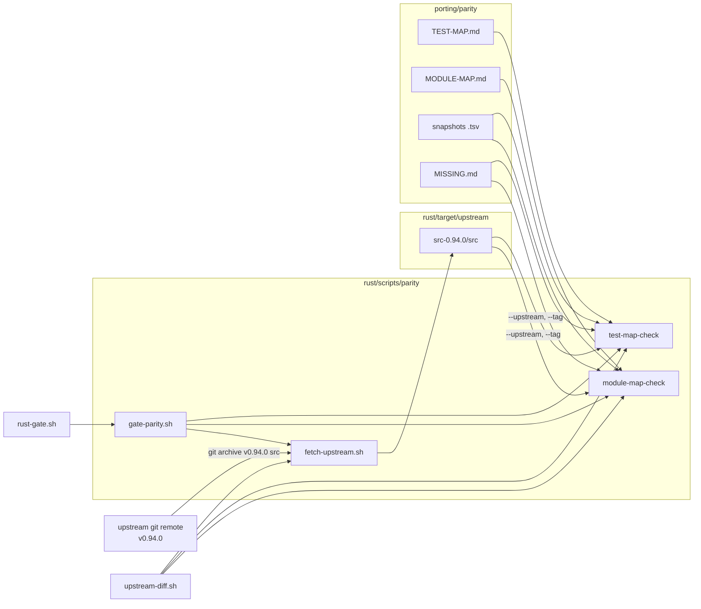

<!--
RULES — read before writing or implementing:
1. FORMAT: Bullets, tables, code, diagrams ONLY — no prose paragraphs
2. REQUIREMENTS: One crisp line each — no verbose descriptions
3. CHECKLIST: Mark items [x] as you complete them — this is your persistent todo list
4. READING TIME: Optimize for fast human scanning — if it's hard to skim, rewrite it
-->

# Plan: parity-infra

> Make "what upstream tests and modules does the Rust port cover" a machine-checked fact: a generated TEST-MAP (every 0.94.0 test case -> exactly one status), a MODULE-MAP (every 0.94.0 source module -> Rust module(s)), both enforced in `rust-gate.sh`, and an `upstream-diff.sh` bump flow that lists changed modules/tests with the Rust files to look at.

## Goal

- `porting/parity/TEST-MAP.md` covers each of the ~2,400 upstream test cases of tag v0.94.0 (2,336 `it`/`test` sites in 58 `src/tests/*.test.ts` + 24 in `scripts/next-preview-version.test.mjs` + 40 scenario rows), GENERATED then resolved by group; final state has no `missing:T-UNCLASSIFIED`.
- `rust/scripts/parity/test-map-check` FAILS on: unmapped upstream test, stale row (incl. a default row matching zero cases), `ported:` target that is not a live `#[test]`/`#[tokio::test]` fn, `covered:` scenario lacking its `.acp.json` or `.transcript.jsonl`, empty `different:` reason, `missing:` id without a ticket line, a missing snapshot, a scanner/grep count mismatch outside the allow-list, a file yielding zero rows; WARNS on every `missing:`.
- `porting/parity/MODULE-MAP.md` has one row per upstream module (91 files under `src/`, with `acp-agent.ts` split into 17 anchor-keyed sections = ~107 rows); `rust/scripts/parity/module-map-check` fails when a module has no row.
- `rust/scripts/upstream-diff.sh <from> <to>` prints, per changed upstream module, the Rust module(s) to look at, lists new/changed/removed upstream tests with their TEST-MAP status, and exits non-zero when a `<to>` module has no MODULE-MAP row.
- `rust/scripts/rust-gate.sh` runs both checks (offline against committed snapshots always; against a cached export of the tag when available; loud SKIP of the real-export half when the tag is unreachable).
- Done = 3 phases verified (`bash rust/scripts/rust-gate.sh` ends `==> gate OK` at each phase boundary), plus the counts reported in `porting/parity/STATUS.md`.

## Hard constraints (every phase)

- Implementers edit files ONLY with the Write / Edit tools — no `sed -i`, heredoc, redirect or `perl -pi` edits; read with Read. Scripts are authored with Write (then `chmod +x` through Bash is the only allowed file-mode change).
- G7: only `rust/`, `porting/`, `skills/`, `.vibekit/`, root `.gitignore` may change — NEVER `src/`, `dist/`, `package.json`, `scripts/`, `.github/`, `docs/`, root `*.md`; NEVER touch anything under `/Users/gb/.vibe-station/projects/vibe-station/worktrees/vs-275`; NEVER touch `~/code/fastestdevalive/claude-agent-acp-original` (v0.78.0) or the codex checkout (read-only reference).
- Never print env values; no commit / push / tag / `git stash`; no killing processes by name; cargo always `--manifest-path rust/Cargo.toml`, filter `grep -E "test result|FAILED"`; success = `test result: ok` / `==> gate OK`.
- Do NOT bump the pin (stay 0.94.0), never run `porting/record-real.sh`, never run `npm` in the repo root; the GATE never touches the network: `gate-parity.sh` always passes `--offline` to `fetch-upstream.sh` (only humans / `upstream-diff.sh` may let it `git fetch`).
- Dependency (M9): this plan starts only AFTER rust-parity-fixes Phase 2 is committed (`git log --oneline | grep -i "rust-parity-fixes/root implement phase 2"`), because MODULE-MAP rows name `session_config.rs`, `usage.rs`, `resumed_session.rs` that exist only uncommitted today; if the commit is missing STOP and report. Hand-off: when rust-parity-fixes Phase 3 lands, its implementer flips every `T-vst-P<n>` row (item 3.3).
- Scripts are bash 3.2 (macOS) + awk (BWK awk: no gawk extensions, no `declare -A`, no `mapfile`) + git + `shasum -a 256`; set `LC_ALL=C` around awk/sort; no node, no python in the checkers.
- The orchestrator's shell exports `CLAUDE_CODE_ARTIFACT=1`: new Rust tests must be hermetic (no dependence on that variable, on `$HOME`, on network, on the upstream export; they use the committed snapshots and temp dirs).
- New Rust tests are `inv_NN_<slug>` with NN = max existing + 1 (`grep -rhoE 'inv_[0-9]+' rust porting/INVARIANTS.md | sort -u | tail -1`; currently `inv_68`), each under the gate's 180 s timeout (G3), no `std::sync::Mutex|RwLock` (clippy.toml).
- A TEST-MAP row may be `ported:<rust test>` ONLY if the named Rust test exists (a real `#[test]`/`#[tokio::test]` fn, not `#[ignore]`d, not a helper) AND asserts the same behaviour (read both); `covered:<scenario>` ONLY if `porting/corpus/<scenario>.acp.json` AND `<scenario>.transcript.jsonl` exist and the transcript exercises it (`inv_24_full_corpus` runs every corpus file); never guess a status to turn a warning green.
- Wildcard rows (`*`, `<prefix> > *`) are allowed ONLY for `missing:<ticket>`; a `different:` wildcard is allowed only when `DECISIONS-FOR-USER.md` names that test file path; every other `different:`, `ported:`, `covered:` claim is per case.
- `missing:` is the honest default for behaviour the Rust port lacks: it needs a ticket line in `porting/parity/MISSING.md`, never `different:`; `different:` means the Rust port deliberately behaves/organises differently with equal observable behaviour (or the test only checks a TS-internal shape with no Rust counterpart).
- Early stop rule: if a turn ends early, the implementer finishes the item in progress, leaves later items unticked, and a fresh retry resumes at the first unticked box; resolution batches are independent and may be retried one by one.
- The orchestrator verifies every phase independently with the `**Verify phase N:**` commands.

## Requirements

| # | Requirement | Source | Phase |
|---|-------------|--------|-------|
| R-1 | TEST-MAP for every upstream test case, 4-status vocabulary, deterministic generated skeleton | program A1 | 1 (skeleton), 2-3 (resolution) |
| R-2 | `test-map-check --upstream <path> --tag <tag>`, fails on unmapped, warns on missing | program A1 | 1 |
| R-3 | every `missing` that affects behaviour vst relies on is resolved (ported/covered), others carry a ticket | program A1 + vst findings P1-P10 | 2, 3 |
| R-4 | MODULE-MAP, one row per upstream module, `acp-agent.ts` split by section | program 3b | 1 |
| R-5 | nothing stays `not ported` for convenience; unported modules are `missing:<id>` rows tied to the roadmap | standing goal | 1 |
| R-6 | `upstream-diff.sh` module -> Rust hints, fails on unmapped module | program 3b | 2 |
| R-7 | `upstream-diff.sh` diffs upstream TEST files between tags and lists new/changed/removed; `test-map-check` fails until mapped; `UPSTREAM-BUMP.md` updated | program 4 | 2 |
| R-8 | `porting/parity/PARITY-PROGRAM.md` = the program spec verbatim | program | 1 |
| R-9 | gate wiring with cached export under `rust/target/parity/src-<ver>`, offline-tolerant SKIP, fail on missing row | program | 1 |

## Change Map

```
rust/scripts/
  rust-gate.sh              ~ calls gate-parity.sh
  upstream-diff.sh          ~ module + test diff, exit 2
  parity/
    fetch-upstream.sh       + export tag from `upstream` remote
    scan_tests.awk          + it/test/describe title extractor
    test-map-check          + TEST-MAP checker (seed/list/map/summary/groups/diff/selftest)
    module-map-check        + MODULE-MAP checker (list/map/summary/sections/selftest)
    gate-parity.sh          + gate driver (offline + real-export halves)
    selftest/               + extractor + module fixtures
porting/
  UPSTREAM-BUMP.md          ~ test/module steps
  parity/
    PARITY-PROGRAM.md       + verbatim spec
    TEST-MAP.md             + generated then resolved
    MODULE-MAP.md           + ~107 rows
    MISSING.md              + ticket lines (T-nnn, M-nn)
    upstream-tests.v0.94.0.tsv    + committed snapshot
    upstream-modules.v0.94.0.tsv  + committed snapshot
    DECISIONS-FOR-USER.md, STATUS.md  ~ entries
rust/claude-agent-acp-rs/tests/
  (parity_maps.rs, listed in Files & Phase Impact only)
porting/parity/
  README.md, scan-allowlist.tsv   + (Files & Phase Impact only)
```

| Today | After this plan |
|-------|-----------------|
| nobody knows which of the 0.94.0 tests the Rust port covers | one row per test case, 4-status vocabulary, checked in the gate |
| unported upstream modules are discovered only by reading PARITY.md | one row per upstream module, `missing:<id>` rows are the work list for the roadmap |
| `upstream-diff.sh` diffs `dist/` + package.json only | also names Rust files per changed module and lists new/changed/removed tests |
| a bump can add upstream modules/tests silently | gate and `upstream-diff.sh` fail until the maps are updated |
| `porting/parity/` holds only STATUS + DECISIONS | + PARITY-PROGRAM, TEST-MAP, MODULE-MAP, MISSING, two snapshots |

## Research (evidence cited by the Decisions)

- R1 upstream tests (export of `v0.94.0`, `src/tests/`): 58 `*.test.ts` files; 2,336 `it(`/`test(` call sites (grep `^\s*(it|test)(\.[a-z]+)?(\(|\.each)`), of which 99 are `it.each` (each ONE row) and 4 `it.skipIf`; `describe` variants: 5 `describe.each` (`acp-scenarios.test.ts:330,343,369`, `permission-presentation.test.ts:238`, `folded-prompt-scenario.test.ts:199`), 10 `describe.skipIf`, 1 `describe.runIf`; no `.only/.todo/.concurrent/.for`; loop-generated tests: `create-session-options.test.ts:123-145` (2 sites, 6 runtime cases) and `session-hooks.test.ts:154-158` (describe title chosen inside a loop); regex `.test(` calls that are NOT cases: `mcp-command.test.ts:47`, `model-presentation.test.ts:178`; the codex `scan_tests.awk` run on this export gave 2,329 rows from 56 files: it silently DROPS both `live-capability-*-audit.test.ts` files (7 cases, `describe.skipIf` at `:191/:192`), emits spurious `[dynamic#1]` for the regex calls, an empty `>  >` segment for session-hooks, and is one row short for `acp-agent` and `tools`; `acp-agent.test.ts` alone is 27,866 lines / 621 cases / 70 describes.
- R2 test infrastructure that is NOT a test: `src/tests/{helpers,session-doubles,setup-no-network}.ts`, `src/tests/acp-scenarios/{harness,scenarios,schema,compare}.ts`, `src/tests/fixtures/usage-limit-session.jsonl`, `src/tests/.claude/commands/*.md`; vitest config includes `src/**/*.test.ts` and `scripts/**/*.test.mjs` (`vitest.config.ts`); `scripts/` holds ONE test file, `scripts/next-preview-version.test.mjs` (24 `it(`/`test(` lines), which the scanner also covers (Decision 1) so its rows are mapped, not just noted.
- R3 scenario snapshots: `src/tests/acp-scenarios/__snapshots__/{air,v2}/*.jsonl` and `origin-main/{plain,zed}/*.jsonl` carry 40 scenario names (same 40 in `air` and `v2`: `ask-user-question`, `bash-*`, `compaction-*`, `goal`, `subagent-*`, ... `write-new`); `acp-scenarios.test.ts` iterates them (`it.each`), so the scenario list is a second set of behaviours to map (Decision 3).
- R4 source modules of v0.94.0: 91 non-test `*.ts` files under `src/` (36,862 lines); `acp-agent.ts` is 13,804 lines (class `ClaudeAcpAgent` L2682-11841, `runConsumer` alone L4427-8334); subdirs `permissions/` (+`options/`), `session-index/` (13 files), `tool-calls/` (+`reporters/` 9 files), `v2/` (8 files).
- R5 Rust modules at the working tree (`rust/claude-agent-acp-rs/src/`): agent, air, async_tasks, auth_status, codec, control, dispatch, lib, map, meta_filter, permission, permission_mode, process, quota, resumed_session (WT), sdk_options, session, session_config (WT), session_ext, session_methods, session_store, settings, system_prompt, tools, turn (+turn_tests), unfinished, usage (WT), bin/claude-agent-acp-rs; the MODULE-MAP must name only paths that exist when the row is written (the checker enforces).
- R6 existing Rust test names the TEST-MAP can target: differential `inv_24_*` / `inv_57_argv_matches_node` (`tests/differential.rs`), `tests/agent.rs`, `tests/process_transport.rs`, `tests/control_transport.rs`, `tests/transport_parity.rs`, `tests/system_prompt.rs`, `src/turn/turn_tests.rs`, `fake-claude/tests/*.rs`, `acp-recorder/tests/recorder.rs`; corpus scenarios live in `porting/corpus/*.acp.json` (~65 names, e.g. `usage-update`, `config-set-model`, `spawn-vst-meta`, `image-prompt-echo`, `thinking-empty`, `session-close`).
- R7 codex template (`~/code/fastestdevalive/codex-acp-rust/scripts/parity/`): `scan_tests.awk` walks the whole file char-by-char (comments, strings, template literals, `.each`/`.skipIf` skip groups, nested describes, `[dynamic#n]`, `#n` duplicates); `test-map-check` has `--map|--list|--seed|--summary|--selftest`; `file | * | status` default rows; `fetch-upstream.sh` shallow-clones to a cache; TEST-MAP format `file | case title | status` with a `file | case title | status` header and `#` comment lines. Known weaknesses to fix here: titles containing `|`, `.js` import suffixes (claude tests import `./x.js`), `ported:` target grammar, no module map.
- R8 upstream-diff today (`rust/scripts/upstream-diff.sh:1-128`): exits non-zero only for bad args/pack failure, needs `npm pack` for both versions, last section prints hints `git diff v<from> v<to> -- src`; tags `v0.93.0` and `v0.94.0` are both fetched locally (`git diff --stat v0.93.0 v0.94.0 -- src` = 88 files), so a network-free dry run exists.
- R9 vst-relied behaviours (findings P1-P10, `.vibekit/feature-plans/pending/rust-parity-fixes/plan-rust-parity-fixes.md` Requirements table): spawn argv/env, AskUserQuestion disallow, image echo, `usage_update`, empty thoughts, configOptions/modes/set_*, `allow_always` options, hooks/`toolResponse`, `session/load` replay; Phase 1 of that plan is committed (4a54919), Phase 2 is in review (WT), Phase 3 is pending.

## Architecture Diagram



## System Boundaries

| Boundary | Contract |
|----------|----------|
| `fetch-upstream.sh [--ver V] [--offline]` -> stdout | prints the absolute export dir `rust/target/parity/src-<V>` (contains `src/**`, `scripts/**`, `package.json`, and files `.tag-name` = `v<V>` and `.tag-sha` = the commit sha); exit 0 ok, 3 tag unavailable (offline / no remote), 1 bad args; never prints anything else on stdout; WITHOUT `--offline` it may `git fetch upstream tag`; the gate always passes `--offline` |
| `test-map-check` modes | `--map` (default), `--list`, `--seed`, `--summary`, `--groups`, `--unresolved`, `--reconcile`, `--diff <old.tsv> <new.tsv>`, `--refresh-snapshot`, `--selftest`; options `--upstream <export dir> --tag <tag> --forbid-unclassified`; `--tag` is verified by comparing `<dir>/.tag-name` to `<tag>` and `<dir>/.tag-sha` to `git rev-parse <tag>^{commit}` (an export has no git history); exit 0 pass, 1 fail; stdout last line `TEST-MAP CHECK: PASS|FAIL (...)` |
| `module-map-check` modes | `--map` (default), `--list`, `--summary`, `--sections`, `--refresh-snapshot`, `--selftest`; options `--upstream <export dir> --tag <tag>` (verified via `.tag-name`/`.tag-sha` like above); last line `MODULE-MAP CHECK: PASS|FAIL (...)` |
| env overrides (tests only) | `TEST_MAP_FILE`, `TEST_SNAPSHOT_FILE`, `MODULE_MAP_FILE`, `MODULE_SNAPSHOT_FILE`, `MISSING_FILE`, `DECISIONS_FILE`, `ALLOWLIST_FILE`, `RUST_ROOT` (default `<repo>/rust`) — so Rust tests can run the checkers on mutated temp copies |
| `gate-parity.sh` -> `rust-gate.sh` | step wrapped in `run_timeout 180`; exit 0 pass (also when the real-export half was SKIPPED, with a loud `!!! PARITY REAL-EXPORT SKIPPED` banner, allowed ONLY when both committed snapshots exist); non-zero on a failed check or a missing snapshot |
| `upstream-diff.sh <from> [<to>] [--src-only]` | existing sections unchanged; NEW sections `== source modules`, `== source tests`, `== bump checks`; every list line is `  <M\|A\|D\|R> <path> ...` (two leading spaces); exit 2 when a `<to>` module has no MODULE-MAP row (all sections still printed), exit 1 bad args; `--src-only` skips the `npm pack` sections (offline dry run) |

### TEST-MAP file format (typed)

```
# TEST-MAP — claude-agent-acp upstream test mapping (snapshot v0.94.0)
# (comment lines start with `#`)

file | case title | status | note
src/tests/tools.test.ts | toAcpNotifications > converts a Bash tool_use | ported:tests/agent.rs::inv_12_x | 
src/tests/session-index.test.ts | listSessions > * | missing:T-014 | 
src/tests/diff-memo.test.ts | creates a memo | different:Rust builds diffs once per update, no memo | per-case, reviewed
```

| Field | Rule |
|-------|------|
| `file` | path relative to the export root, e.g. `src/tests/tools.test.ts`, `scripts/next-preview-version.test.mjs`; synthetic scenario rows use `src/tests/acp-scenarios/scenarios.ts` |
| `case title` | `<describe path joined by " > "> > <title>`; template/non-literal title -> `[dynamic#<n>]`, non-literal describe -> `[dynamic-describe#<n>]` (n per file, never an empty segment); duplicate full key -> `#2`, `#3`; `.each` site -> its literal title (one row); any `\|` in a title is replaced by `¦`; scenario rows: `scenario > <name>` |
| `case title` = `<prefix> > *` | describe-prefix default for every case whose title starts with `<prefix> > ` |
| `case title` = `*` | file default |
| precedence | exact row > longest prefix default > file default |
| `status` | `ported:<target>` / `covered:<scenario>[+<scenario>]` / `different:<reason>` / `missing:<id>`; seed value `missing:T-UNCLASSIFIED` |
| `note` | optional 4th column, no `\|`; REQUIRED (non-empty) on a `ported:`/`covered:` row for an `.each`/loop-generated site, stating that the Rust test covers all variants |
| `ported` target | `tests/<f>.rs::<fn>` or `src/<p>.rs::<fn>` (crate `claude-agent-acp-rs`), or `<crate-dir>/<path>.rs::<fn>` for `acp-recorder` / `fake-claude`; optional `::tests::` segment ignored; the checker requires `fn <fn>\b` in that file with a `#[test]` / `#[tokio::test]` attribute (possibly followed by other attributes) on it, rejects a fn marked `#[ignore]` and rejects a helper without a test attribute |
| `covered` target | each scenario -> BOTH `porting/corpus/<scenario>.acp.json` AND `porting/corpus/<scenario>.transcript.jsonl` exist (kebab-case names used as-is) |
| `different` | reason >= 15 chars, not `n/a`/`todo` |
| `missing` | id has a line `<id> \| <description> \| <work package>` in `MISSING.md`; `T-UNCLASSIFIED` allowed only until the final flip (Decision 7) |
| default rows | `*` and `<prefix> > *` may be `missing:<ticket>` ONLY; a `different:` default is allowed only for a file that `DECISIONS-FOR-USER.md` names by path; never `ported`/`covered`; a default row matching zero cases FAILS as stale |
| `--summary` | per status prints `explicit` and `default-covered` counts separately |

### MODULE-MAP file format (typed)

```
| upstream module | rust module(s) | relationship | note |
|---|---|---|---|
| tools.ts | tools.rs | 1:1 | |
| acp-agent.ts@runConsumer | session.rs, turn.rs, map.rs | split:session.rs | stream loop (L4427-8334 at v0.94.0) |
| elicitation.ts | - | missing:M-07 | AskUserQuestion forms |
```

| Column | Rule |
|--------|------|
| `upstream module` | path relative to `src/` (`permissions/options/shell.ts`); `acp-agent.ts@<symbol>` for a section (Decision 5) |
| `rust module(s)` | `, `-separated paths relative to `rust/claude-agent-acp-rs/src/` (optional `::fn_name` suffix, checked by grep `fn <name>\b`), or `-` for `missing`/`not ported` |
| `relationship` | `1:1` / `merged:<into>` / `split:<into>` / `different:<reason>` / `missing:<id>` / `not ported:<reason>` |
| `missing:<id>` | `<id>` is a roadmap work-package id (`F1..Fn`) when `ROADMAP.md` exists, else `M-nn`; line in `MISSING.md`; warns |
| `not ported:` | module path must also be named in `DECISIONS-FOR-USER.md` (technically impossible only) else FAIL |
| acp-agent.ts sections | keyed by ANCHOR SYMBOL, `acp-agent.ts@<symbol>` (first section `acp-agent.ts@top` = line 1); the checker computes each start line from the symbol (`^(export )?(async )?(function\|class) <sym>\b` or `^  (async )?<sym>\(` for class methods), requires sections in file order, each ends before the next start, last ends at the file's line count; an unresolvable anchor FAILS |

## Key Decisions

#### Decision 1: bash + awk checkers copied from the codex port, not a new dialect
- **Decision:** `test-map-check`, `scan_tests.awk`, `fetch-upstream.sh` are adapted copies of the codex files (same mode names, same row format); `module-map-check` follows the same CLI style.
- **Rationale:** program CONSISTENCY RULE; the codex scanner already handles multi-line `it(`, `.each`, `.skipIf`, template literals (R7).
- **Where:** `rust/scripts/parity/*`; the implementer READS `~/code/fastestdevalive/codex-acp-rust/scripts/parity/{test-map-check,scan_tests.awk,fetch-upstream.sh,selftest/fixture.test.ts}` and WRITES new files (never copies with `cp`, never edits the codex tree).
- Scanned files: `src/tests/*.test.ts` plus `scripts/next-preview-version.test.mjs` (R2).
- Adaptations (each has a selftest): read the file as ONE awk record (`BEGIN{RS="\001"}`; the codex `buf = buf $0 "\n"` is quadratic and took 36 s on this export; target cold `--list` < 60 s, warm < 5 s via the cache of Decision 11); recognise `it|test|describe` only as a bare identifier NOT preceded by `.` (so regex `.test(` is ignored) with modifiers `.each`, `.skip`, `.skipIf(..)`, `.runIf(..)`, `.only`, `.todo`, `.concurrent`, `.fails`, `.for`, and `describe.each/skipIf/runIf` (R1); a non-literal describe title is a path segment `[dynamic-describe#n]` (never empty); `|` -> `¦`; `.js`->`.ts` import resolution in the hash; prefix-default rows; `ported:` grammar of the System Boundaries table; `--groups`, `--unresolved`, `--reconcile`, `--diff`, `--forbid-unclassified`, env overrides.
- The selftest fixture covers EVERY construct above plus multi-line titles, template literals, nested describes, tests registered inside helper functions/loops, a comment and a string containing `it("x")`, and asserts no row has an empty or `>  >` path segment.

#### Decision 11: the scanner is proven against an independent count, never against a band
- **Decision:** `test-map-check --reconcile` compares, per file, the SET of case START LINES printed by the scanner (`scan_tests.awk` emits `file<TAB>line<TAB>title` per case, `--list` drops the line column) with the SET of lines from the independent `grep -nE '^\s*(it|test)(\.[A-Za-z]+(\([^)]*\))?)*\('` (a count match is NOT enough: a missed case plus a spurious row would cancel) and FAILS on (a) any scanned file yielding zero rows, (b) any line present in only one set and not listed in the committed allow-list `porting/parity/scan-allowlist.tsv` (`file<TAB>line<TAB>reason`, one entry per differing line, a stale entry whose line now matches also fails), (c) any `[dynamic#n]` / `[dynamic-describe#n]` row not allow-listed; `--reconcile` runs inside `--map --upstream` and in the Phase 1 verify.
- **Rationale:** the codex scanner silently dropped 7 cases and nothing noticed (R1); a total-count band cannot detect it.
- **Where:** `rust/scripts/parity/test-map-check`, `porting/parity/scan-allowlist.tsv` (explains loop-generated sites `create-session-options.test.ts:123-145`, `session-hooks.test.ts:154-158`, `.each` sites).
- Listing cache: `--list` output is cached in `rust/target/upstream/cache/tests-<tag-sha>-<scanner-script-sha>.tsv` and reused when both shas match; the gate step runs under `run_timeout 180`.

#### Decision 2: committed snapshots make the gate offline-safe
- **Decision:** `porting/parity/upstream-tests.v0.94.0.tsv` (`file<TAB>title<TAB>hash`) and `porting/parity/upstream-modules.v0.94.0.tsv` (`path<TAB>lines<TAB>sha256`) are committed; the checkers' default mode compares the maps to the snapshots only and FAILS (never skips) when the snapshot for the current pin is missing (e.g. right after a pin bump); with `--upstream --tag` they additionally regenerate from the export and require equality with the snapshot.
- **Rationale:** a missing map row must fail the gate even with no network/remote; a stale snapshot must also fail when the export is available.
- **Where:** `rust/scripts/parity/{test-map-check,module-map-check}`; snapshot hash per test file = sha256 of (file + its resolved relative imports, `.js`->`.ts`, + for the three `acp-scenarios*.test.ts` files the whole `src/tests/acp-scenarios/` tree).
- The snapshot filename embeds the pin; a bump regenerates it with `--refresh-snapshot` (Decision 6).

#### Decision 3: scenario names are rows too
- **Decision:** `test-map-check --list` appends one synthetic row per scenario basename found in `src/tests/acp-scenarios/__snapshots__/air/*.jsonl` (40 rows, file `src/tests/acp-scenarios/scenarios.ts`, title `scenario > <name>`, hash = sha256 of the three snapshot files `air|v2|origin-main/plain` of that name).
- **Rationale:** the snapshots assert the ACP update stream per scenario (R3); they map naturally to corpus scenarios (`covered:`).
- **Where:** `rust/scripts/parity/test-map-check` (`list_scenarios`); selftest uses a tiny fake tree.

#### Decision 4: defaults are the compression tool, explicit rows carry the claims
- **Decision:** the generated skeleton has one explicit row per case (`missing:T-UNCLASSIFIED`); resolution replaces runs of rows with `file | * | missing:<ticket>` or `file | <describe path> > * | missing:<ticket>` ONLY; `different:` is per case (file-level `different:` default only when `DECISIONS-FOR-USER.md` names that file); every `ported:`/`covered:` claim stays an explicit per-case row.
- **Rationale:** ~2,400 cases cannot be hand-edited one by one by a weak model, but only `missing` (an open ticket, warned on every gate run) may be bulk-claimed; `different:` and `ported:` must be individually reviewed.
- **Where:** `rust/scripts/parity/test-map-check` (`--groups` prints `file | top-level describe | n cases | n unresolved` to drive the editing; `--summary` expands defaults into per-case counts, so counts are always per test case).

#### Decision 5: module sections use line ranges at the pinned tag
- **Decision:** `acp-agent.ts` rows are keyed `acp-agent.ts@<anchor symbol>` (17 anchors, list in item 1.6); `module-map-check --sections` COMPUTES the line ranges from the anchors in the export (sections must appear in file order; the last ends at the line count) and prints them.
- **Rationale:** line ranges drift every bump while anchors survive; `upstream-diff.sh` maps old-side hunk lines (`git diff -U0 v<from> v<to>`, `@@ -a,b`) to a section using the ranges computed from the FROM export, so no number is ever hand-maintained.
- **Where:** `porting/parity/MODULE-MAP.md`, `rust/scripts/parity/module-map-check`, `rust/scripts/upstream-diff.sh`.

#### Decision 6: bump = refresh snapshots, then the checkers fail until the maps catch up
- **Decision:** after `printf '<new>\n' > porting/UPSTREAM_VERSION`, `test-map-check --upstream <new export> --tag v<new> --refresh-snapshot` and `module-map-check ... --refresh-snapshot` write the new snapshots; `--map` then fails on every new/removed test or module until the maps are edited; CHANGED tests (hash differs between old and new snapshot, and test FILES whose own content changed even if all case keys are equal) are listed by `--diff` and by `upstream-diff.sh` with their current status, and do not fail (informational re-verify list); renamed test files are detected with `git diff -M --name-status v<from> v<to> -- src/tests scripts` and `--diff` offers the old file's statuses as the starting point for re-mapping the new file.
- **Rationale:** program item 4 requires failure on unmapped; changed-but-mapped tests need human re-verification, not an automatic failure.
- **Where:** `rust/scripts/parity/*`, `rust/scripts/upstream-diff.sh`, `porting/UPSTREAM-BUMP.md`.

#### Decision 7: T-UNCLASSIFIED is a seed value with a deadline
- **Decision:** `missing:T-UNCLASSIFIED` is valid only while `rust-gate.sh` runs `gate-parity.sh` without `--forbid-unclassified`; the last item of Phase 3 flips the gate to pass `--forbid-unclassified` (the flag is a one-word change in `gate-parity.sh`), after which any remaining `T-UNCLASSIFIED` fails.
- **Rationale:** phases 1-2 must keep the gate green while 60-80% of the rows are still unresolved.
- **Where:** `rust/scripts/parity/gate-parity.sh`.

#### Decision 8: unported modules/tests reference roadmap ids, falling back to local ids
- **Decision:** if `.vibekit/feature-plans/pending/parity-roadmap/ROADMAP.md` exists when an item runs, a `missing:` row uses the package id (`F1..Fn`) that covers the module (the id must appear in ROADMAP.md; checker only checks the `MISSING.md` line); otherwise `M-nn` (modules) / `T-nnn` (test clusters), each with a `MISSING.md` line `<id> | <description> | <suggested roadmap package or TBD>`.
- **Rationale:** the roadmap is written by a sibling planner; ids must be renameable later by one edit pass.
- **Where:** `porting/parity/MISSING.md` (format `| id | description | work package |`).

#### Decision 9: no `not ported` rows without a written impossibility
- **Decision:** `not ported:<reason>` is accepted only when `DECISIONS-FOR-USER.md` names the module path; the starting expectation is ZERO such rows (only `index.ts`/`serve.ts` node-process entrypoints are `different:`).
- **Rationale:** standing goal — AIR/JetBrains-only or unused-by-vst is NOT a reason.
- **Where:** `rust/scripts/parity/module-map-check` (rule), `porting/parity/DECISIONS-FOR-USER.md` (D4 records the policy).

#### Decision 10: vst-relied test rows are resolved against code that exists
- **Decision:** for tests asserting P1-P10 behaviours (R9) the implementer maps to existing Rust tests/corpus scenarios; if the Rust behaviour is not yet in the working tree (parity-fixes Phase 3: hooks, `allow_always`, replay, promptSuggestions) the row is `missing:T-vst-P<n>` with a MISSING.md line "blocked on rust-parity-fixes Phase 3"; if the behaviour exists but no Rust test asserts it, the implementer WRITES the Rust test (`inv_NN_*`, max 12 new tests per phase) and maps `ported:`.
- **Rationale:** program A1 "resolve every missing that affects behaviour vst relies on"; this plan must not duplicate rust-parity-fixes implementation work.
- **Where:** `rust/claude-agent-acp-rs/tests/agent.rs` (new tests appended), `porting/parity/TEST-MAP.md`.

## Open Questions / Risks

| # | Question | Recommendation |
|---|----------|----------------|
| 1 | Phase 3 resolves ~1,500 cases; too much for one weak turn? | Feasible: `missing:` wildcard rows (Decision 4) make it ~150-250 edits (`different:` stays per case, so budget more for B3-B5); batches B3-B5 are independent so a retry resumes at the first unticked batch (early stop rule) |
| 2 | `ROADMAP.md` ids not available yet (`ls .vibekit/feature-plans/pending/parity-roadmap/ROADMAP.md` found nothing at planning time) | Decision 8: use its package ids when the file exists at implementation time; else `M-nn`, renamed to `F<n>` in a later pass; not a blocker |
| 3 | `it.each` sites expand to many runtime cases; one row per site under-counts | Accept (stable keys, matches codex); the new `note` column is REQUIRED on `ported:`/`covered:` rows for `.each`/loop sites and must say the Rust test covers all variants, otherwise the row is `missing:` (checker enforces) |
| 4 | Snapshot hash pulls in `helpers.ts` / `session-doubles.ts`, so a helper edit marks every test changed | Intended for a first version; `--diff` prints changed counts per file, humans skim |
| 5 | MODULE-MAP hints in item 1.6 may be wrong | The hint column is a hypothesis; the implementer verifies each by grepping the Rust symbols and downgrades to `missing:` when absent |
| 6 | `acp-agent.test.ts` reads real behaviour of 70 describes / 621 cases; classification quality of a weak model | Phase 2/3 orchestrator spot check samples >= 10% of the `ported:`+`covered:` rows of the phase (minimum 30), opens both tests, confirms the same assertion (Verify 2.T6, 3.T5); wrong rows are fixed before moving on |
| 7 | Scripts need `git archive` of the tag; fresh clones may lack the tag | `fetch-upstream.sh` WITHOUT `--offline` (humans, `upstream-diff.sh`) tries `git fetch upstream tag v<ver> --no-tags` (the gate always passes `--offline`; the SKIP banner is acceptable only while both committed snapshots exist, otherwise the gate FAILS) (20 s timeout) then exits 3 -> gate prints the SKIP banner and runs the snapshot-only half |
| 8 | Weak-model awk quality | Selftest fixtures with exact expected output are written FIRST (1.2) and `parity_maps.rs` mutates maps to prove the failures; Decision 11 (`--reconcile` per-file count vs independent grep, allow-list, zero-row failure) catches silent scanner drops |

## Implementation Phase 1 — machinery, snapshots, seeded TEST-MAP, MODULE-MAP, gate wiring

Order = dependency order. Phase constraints: Hard constraints above apply; edit files ONLY with Write/Edit (no sed -i / heredoc); `chmod +x` for the two checkers and `fetch-upstream.sh`, `gate-parity.sh` is the only Bash file-mode change.

- [ ] 1.0 Read: `rust/AGENTS.md`, this plan (Hard constraints, Key Decisions 1-9, both format tables), `rust/scripts/{rust-gate.sh,upstream-diff.sh}`, codex `scripts/parity/{test-map-check,scan_tests.awk,fetch-upstream.sh,selftest/fixture.test.ts}`, `porting/parity/{DECISIONS-FOR-USER,STATUS}.md`, `git show HEAD:rust/claude-agent-acp-rs/tests/differential.rs | head -60` (test style); confirm the export: `bash rust/scripts/parity/fetch-upstream.sh --ver 0.94.0` after 1.1.
- [ ] 1.1 `rust/scripts/parity/fetch-upstream.sh` (Decision 1, System Boundaries): `VER` default `$(cat porting/UPSTREAM_VERSION)`, validated like `upstream-diff.sh:valid_ver`; `DEST=rust/target/parity/src-$VER`; reuse when `$DEST/.tag-sha` equals `git rev-parse v$VER^{commit}`; else `git archive v$VER src scripts package.json | tar -x -C $DEST` (rm -rf the DEST first, only after the version check), then Write `.tag-name` (`v$VER`) and `.tag-sha` (the commit sha) — `--tag` verification in the checkers reads these two files, an export has no git history; tag missing -> `git fetch upstream tag v$VER --no-tags` with a 20 s timeout (perl alarm, same portable pattern as `rust-gate.sh:run_timeout`) unless `--offline`; still missing -> message on stderr, exit 3; stdout = DEST only.
- [ ] 1.2 `rust/scripts/parity/scan_tests.awk` + `selftest/fixture.test.ts` + expected output embedded in `test-map-check --selftest` (Decision 1, 11): the fixture covers multi-line `it(` and multi-line titles, `it.each([...])("title %s", ...)`, `it.skipIf(cond)("t", ...)`, `test(...)`, nested `describe` x2, `describe.each([...])("%s x", ...)`, `describe.skipIf(c)(...)`, `describe.runIf(c)(...)`, a template-literal title (-> `[dynamic#1]`), a describe whose title is a variable chosen in a loop (-> `[dynamic-describe#1]`), tests registered inside a helper function and inside a `for` loop, duplicate titles (-> `#2`), a `|` in a title (-> `¦`), a regex `.test(` call (NOT a case), a commented-out `it("x")`, a string containing `it("y")`. Write the fixture and the EXPECTED list FIRST (asserting no `>  >` / empty segment), then the awk until `--selftest` passes. Then add `porting/parity/scan-allowlist.tsv` from `--reconcile` output against the real export (one `file<TAB>line<TAB>reason` entry per differing line, e.g. the loop sites `create-session-options.test.ts:123-145`; the selftest fixture proves a missed case plus a spurious row in one file FAILS).
- [ ] 1.3 `rust/scripts/parity/test-map-check` with all modes of the System Boundaries table: `--list` (scanner + hash + scenario rows per Decision 3), `--seed` (writes `porting/parity/TEST-MAP.md` skeleton, header comments as in the format block, every row `missing:T-UNCLASSIFIED`, rows sorted `LC_ALL=C` by file then source order), `--map` (rules in the format table; prints `upstream tests: N | mapped rows: M | unmapped: a | stale: b | missing(warn): c | unclassified: d | broken targets: e | bad syntax: f` then `TEST-MAP CHECK: PASS|FAIL`), `--summary` (counts per status, `explicit` vs `default-covered` columns), `--groups`, `--unresolved` (file + count of rows still `T-UNCLASSIFIED`), `--reconcile` (Decision 11), `--diff old new` (new/removed/changed cases, changed test files, renames per Decision 6), `--refresh-snapshot`, `--selftest`, `--forbid-unclassified`; seed header is `file | case title | status | note`; env overrides per System Boundaries. Includes a tiny second selftest tree (3 mini test files + map + a fake Rust crate with one `#[test]`, one `#[ignore]`d test and one plain helper fn) exercising unmapped / stale / zero-match default row / default precedence / broken `ported` / `ported` on an `#[ignore]` or helper fn / `covered` without transcript / empty `different` / `different` or `ported` default rejected / `.each` row without note / missing snapshot -> FAIL / zero-row file -> FAIL / wrong `.tag-sha` -> FAIL.
- [ ] 1.4 `rust/scripts/parity/module-map-check`: `--list` (`find src -name '*.ts' -not -path 'src/tests/*'`, sorted, `path<TAB>lines<TAB>sha256`), `--map`, `--summary`, `--sections`, `--refresh-snapshot`, `--selftest` (fixture dir with 3 modules + a map: missing row, stale row, bad relationship, missing Rust path, `not ported` without DECISIONS entry, `missing:` without ticket, unresolvable or out-of-order section anchor, missing snapshot -> FAIL, wrong `.tag-sha` -> FAIL); `--sections` prints the computed `acp-agent.ts@<symbol> a-b` ranges; rules per the format table; Rust paths resolve under `$RUST_ROOT/claude-agent-acp-rs/src/`.
- [ ] 1.5 Generate and commit-ready snapshots: `bash rust/scripts/parity/fetch-upstream.sh` then `test-map-check --upstream "$DIR" --tag v0.94.0 --refresh-snapshot` and `module-map-check --upstream "$DIR" --tag v0.94.0 --refresh-snapshot`; then `test-map-check --seed`; record the printed counts (cases, files, modules) in `porting/parity/STATUS.md`. Expected (informative, NOT a pass criterion): 59 files, about 2,400 rows (2,336 + 24 + 40 scenario rows), 91 modules. The pass criterion is `test-map-check --upstream "$DIR" --tag v0.94.0 --reconcile` printing `RECONCILE: PASS` (every file's scanner count equals the independent grep count except allow-listed deltas, no file with zero rows); on FAIL fix the scanner or add a justified allow-list line, never widen a numeric band.
- [ ] 1.6 `porting/parity/MODULE-MAP.md` (format table) from the real code. Section split of `acp-agent.ts` into 17 anchor-keyed rows (Decision 5; line numbers are the v0.94.0 starts, informative only; run `module-map-check --sections` to see the computed ranges): `@top` (L1) module helpers + client wrappers + MCP auth; `@ClaudeAcpAgent` (L2682) ctor/initialize/new/fork/resume/load/list; `@authenticate` (L3239) auth-status/providers/logout; `@prompt` (L3765) startTurn/goal/steer/stopAsyncTask; `@runConsumer` (L4427) stream loop; `@trackOrphanCommand` (L8335) cancel/teardown/close/delete; `@setSessionMode` (L8936) set mode/config option; `@replaySessionHistory` (L9037); `@readTextFile` (L9547) fs/foreground/autonomous bookkeeping; `@requestPermissionFromClient` (L9790) permission + elicitation + canUseTool; `@updateConfigOption` (L10441) config option application/fast mode; `@getOrCreateSession` (L10859) incl. createSession; `@shouldEmitRawMessage` (L11841) usage/quota/provider helpers; `@discoverCustomAgents` (L12341) buildConfigOptions/commands; `@promptToClaude` (L12670) + tool-call bookkeeping; `@toAcpNotifications` (L12946) + streamEvent; `@runPromptWithCancellation` (L13532) runPrompt/v1AgentApp/runAcp/context-window. Each anchor must resolve with the checker's regexes (class methods are `^  (async )?name(`). Starting hypotheses per other module (VERIFY by grep of the Rust, else `missing:`): `air-extension`->air.rs; `async-tasks`->async_tasks.rs; `auth-status`->auth_status.rs; `client-system-prompt`->system_prompt.rs; `resumed-session`->resumed_session.rs; `settings`, `managed-policy`, `paths`->settings.rs; `permissions/modes`->permission_mode.rs; `permissions/{options*,effects,presentation,normalization,response}`->permission.rs; `session-mode`, `session-model`, `session-effort`, `session-config-ids`->session_config.rs; `fork-session`, `session-index/*`->session_methods.rs + session_store.rs; `tools`->tools.rs; `tool-result-meta`->meta_filter.rs; `tool-calls/*`->map.rs + tools.rs; `turn-events`->turn.rs; `usage-markdown`->usage.rs; `index`, `serve`, `lib`->bin/claude-agent-acp-rs.rs, lib.rs (`different:`/`1:1`); `v2/*`, `elicitation`, `mcp-command`, `native-subagents`, `acp-subagents`, `subagent-*`, `gateway-models`, `goal-extension`, `hide-claude-auth`, `prompt-suggestions`, `file-change-audit`, `session-failure-extension`, `session-notices`, `session-timing`, `session-titles`, `clear-context-coordinator`, `context-compaction*`, `diff`, `exit-plan`, `utils` -> check first, most likely `missing:M-nn`. Every `missing:` row gets a `MISSING.md` line (`M-nn | what behaviour is absent | roadmap package or TBD`); `not ported:` rows: expected zero.
- [ ] 1.7 `porting/parity/PARITY-PROGRAM.md` = the program spec text supplied by the orchestrator, VERBATIM (Write it exactly as given; add only a 3-line header pointing to DECISIONS-FOR-USER D1 for the `porting/` locations); `porting/parity/MISSING.md` header + all tickets from 1.6.
- [ ] 1.8 `rust/scripts/parity/gate-parity.sh` + wiring (Decision 2, 7, System Boundaries): `PIN=$(cat porting/UPSTREAM_VERSION)`; always run `test-map-check --map` and `module-map-check --map` (snapshot half); both snapshots missing -> FAIL immediately; `DIR=$(bash fetch-upstream.sh --ver $PIN --offline 2>/dev/null)` (ALWAYS `--offline`: the gate never touches the network); if exit 0 also run both with `--upstream "$DIR" --tag v$PIN`; if exit 3 print `!!! PARITY REAL-EXPORT SKIPPED: tag v$PIN unavailable (no upstream remote or offline); snapshot-only checks ran` (three lines, loud); `FORBID` variable empty in this phase (Decision 7); fail if any check failed. In `rust/scripts/rust-gate.sh` add, between the G10 block and `==> upstream ahead`: `echo "==> parity maps (TEST-MAP + MODULE-MAP)"` + `run_timeout 180 bash "$RUST/scripts/parity/gate-parity.sh"` (the cached `--list` of Decision 11 keeps a warm run in seconds).
- [ ] 1.9 Rust test `rust/claude-agent-acp-rs/tests/parity_maps.rs` (hermetic, temp dirs, scripts located via `CARGO_MANIFEST_DIR/../scripts/parity`): `inv_NN_parity_selftests` (both `--selftest` exit 0), `inv_NN_parity_maps_pass_offline` (both `--map` on the real files exit 0, then `gate-parity.sh` run with `PARITY_FORCE_OFFLINE=1` set explicitly in the child env and the SKIP banner asserted — without it a warm `rust/target/upstream` cache would make the test host-dependent), `inv_NN_unmapped_test_fails` (copy snapshot + map into a temp dir, delete one map row, `TEST_MAP_FILE`/`TEST_SNAPSHOT_FILE` env, expect exit 1 and `UNMAPPED` in stdout), `inv_NN_unmapped_module_fails` (same for MODULE-MAP), `inv_NN_broken_ported_target_fails` (map row `ported:tests/agent.rs::no_such_fn`). Tests must `env_remove` nothing else; they must not need the upstream export.
- [ ] 1.10 Docs: `porting/parity/DECISIONS-FOR-USER.md` D4 (no-`not ported` policy; roadmap ids), D5 (scenario rows, `it.each` one row per site, hash scope), D6 (`scripts/next-preview-version.test.mjs`: release tooling of the upstream repo; its 24 rows are `different:` per case, the FILE named here so a file-level `different:` default is permitted); `porting/parity/STATUS.md` (counts, checker names, how to regenerate); `porting/INVARIANTS.md` INV rows for the new tests; `porting/PARITY.md` header test count.
- [ ] 1.11 `porting/parity/README.md` (Write): status vocabulary, checker usage, and the table of cross-repo differences from the codex port (`~/code/fastestdevalive/codex-acp-rust/docs/parity/README.md`): paths (`scripts/parity` vs `rust/scripts/parity`; `docs/parity` vs `porting/parity`), `--upstream` semantics (codex: clone root; here: export dir with `.tag-name`/`.tag-sha`), cache location (`$HOME/.cache/codex-acp-parity` vs `rust/target/parity/src-<ver>`), Rust test file (`parity_test_map.rs` vs `parity_maps.rs`), `covered:` names (codex maps kebab->snake; here used as-is, plus the transcript must exist), `ported:` (codex allows it on `*` rows and checks only `fn <name>` text; here wildcard `ported`/`covered` is rejected and a `#[test]` attribute is required — recommend codex adopt both), codex has `classify-map.sh` (none here), new only here: `module-map-check`, `--groups`, `--unresolved`, `--reconcile`, `--diff`, `--forbid-unclassified`, `note` column, `scan-allowlist.tsv`.

### Verify phase 1

- [ ] 1.T1 `bash rust/scripts/parity/test-map-check --selftest 2>&1 | tail -1` -> `SELFTEST: PASS`; `bash rust/scripts/parity/module-map-check --selftest 2>&1 | tail -1` -> `SELFTEST: PASS`
- [ ] 1.T2 `DIR=$(bash rust/scripts/parity/fetch-upstream.sh --ver 0.94.0); echo $DIR; time bash rust/scripts/parity/test-map-check --upstream "$DIR" --tag v0.94.0 --list | wc -l` -> `rust/target/parity/src-0.94.0`, a line count equal to `--summary` TOTAL after `--seed` and about 2,400 (informative), cold time < 60 s, a second run < 5 s (cache); `bash rust/scripts/parity/test-map-check --upstream "$DIR" --tag v0.94.0 --reconcile | tail -1` -> `RECONCILE: PASS`; `ls $DIR/.tag-sha $DIR/.tag-name` both exist
- [ ] 1.T3 `bash rust/scripts/parity/test-map-check --upstream "$DIR" --tag v0.94.0 --map | tail -2` -> last line `TEST-MAP CHECK: PASS` (warns about missing rows are expected); `bash rust/scripts/parity/test-map-check --summary` prints `TOTAL:` equal to the `--list` count
- [ ] 1.T4 `bash rust/scripts/parity/module-map-check --upstream "$DIR" --tag v0.94.0 --map | tail -1` -> `MODULE-MAP CHECK: PASS`; `bash rust/scripts/parity/module-map-check --sections | grep -c '^acp-agent.ts@'` -> `17` and the last range ends at `13804`; `grep -c '^| ' porting/parity/MODULE-MAP.md` between 100 and 115 (header + separator rows included)
- [ ] 1.T5 `cargo test --manifest-path rust/Cargo.toml -p claude-agent-acp-rs --test parity_maps 2>&1 | grep -E "test result|FAILED"` -> `test result: ok`
- [ ] 1.T6 mutation by hand (orchestrator): copy `porting/parity/TEST-MAP.md` to the scratchpad, delete one row, run `TEST_MAP_FILE=<copy> bash rust/scripts/parity/test-map-check --map | tail -1` -> `TEST-MAP CHECK: FAIL`; same for `MODULE_MAP_FILE`
- [ ] 1.T7 `bash rust/scripts/rust-gate.sh 2>&1 | tail -6` contains `==> parity maps` and ends `==> gate OK`; `git -c core.quotepath=off status --short | grep -vE '^( M|\?\?) (rust/|porting/|\.vibekit/|\.gitignore)'` prints nothing (G7)
- [ ] 1.T8 SKIP path: `bash rust/scripts/parity/fetch-upstream.sh --ver 0.99.0 --offline; echo $?` -> `3`; `PARITY_FORCE_OFFLINE=1 bash rust/scripts/parity/gate-parity.sh 2>&1 | grep -c 'PARITY REAL-EXPORT SKIPPED'` -> `1` and exit 0 (`PARITY_FORCE_OFFLINE=1` makes `fetch-upstream.sh` exit 3 without touching git; `inv_NN_parity_maps_pass_offline` asserts the same banner)

## Implementation Phase 2 — bump workflow, TEST-MAP batches B1-B2

Phase constraints: Hard constraints above apply. Item order: 2.1-2.2 (script + docs) first, then batches B1, B2 (each independent; tick per batch). Classification procedure for every batch: (a) `test-map-check --groups` to see the file's describes; (b) read the upstream test block and grep the Rust for the behaviour (`rg`/grep in `rust/claude-agent-acp-rs/{src,tests}`, corpus names in `porting/corpus/`); (c) pick the status by the Hard-constraint rules; (d) collapse runs with a prefix/file default ONLY for `missing:<ticket>` (`different:` stays per case unless DECISIONS-FOR-USER names the file; a default matching zero cases fails); (e) add one `MISSING.md` line per `T-nnn` cluster; (f) re-run `test-map-check --map` after each file.

- [ ] 2.1 `rust/scripts/upstream-diff.sh` (Decision 5, 6, System Boundaries): add `--src-only` (skip the `npm pack`/dist/changelog sections; accept the flag in any position); after the existing sections and before `== hints` add `== source modules (v<from> -> v<to>)`: export both tags with `fetch-upstream.sh --ver`, take `module-map-check --list` of both, join by path: `M <path> lines a->b` for changed (sha differs) with `-> <rust module(s)> (<relationship>)` looked up in MODULE-MAP.md, `A <path>  NEW (no MODULE-MAP row — add one)` (also when MODULE-MAP has no row), `D <path>  REMOVED (delete its row)`; for `acp-agent.ts` additionally list each `git diff -U0 v<from> v<to> -- src/acp-agent.ts` hunk's OLD-side start line (`@@ -a,b`) mapped to its `acp-agent.ts@<symbol>` section (ranges computed by `module-map-check --sections` on the FROM export) with that section's Rust modules (one line per distinct section, hunk count); `== source tests`: `git diff -M --name-status v<from> v<to> -- src/tests scripts` (lines `  R <old> -> <new>` with the old file's TEST-MAP statuses offered), `test-map-check --list` of both exports, then `  + new`, `  - removed`, `  ~ changed` (title, file, current TEST-MAP status for changed/removed) and `  ~ file content changed` for test files whose own content changed; `== bump checks`: prints the exact commands (`test-map-check --upstream <to export> --tag v<to> --refresh-snapshot`, same for `module-map-check`, then edit maps, then `--map`); exit 2 at the end when any `<to>` module has no MODULE-MAP row (computed as: paths in `<to>` list not present as an `upstream module` or `acp-agent.ts#` row, ignoring rows describing `<from>` removals); update the header comment (exit contract, sections).
- [ ] 2.2 `porting/UPSTREAM-BUMP.md`: new step after step 3 "Inspect the module and test delta" with `bash rust/scripts/upstream-diff.sh <pin> <new>` reading, new step after step 5 "Refresh snapshots and fix the maps" (Decision 6: `--refresh-snapshot` both, add MODULE-MAP rows / TEST-MAP rows, `--map` must PASS, `MISSING.md` tickets), step 10 note that the gate runs both checks, step 11 adds TEST-MAP/MODULE-MAP counts to `PARITY.md` header; renumber consistently; mention the offline `--src-only` dry run.
- [ ] 2.B1 Batch B1 — `src/tests/acp-agent.test.ts` (621 cases, 70 describes): P1-P10 relevant describes first (create-session/spawn options -> corpus `spawn-*`, `inv_57_argv_matches_node`; echo -> `image-prompt-echo`, `tool-result-echo`, `context-echo-less`; usage -> `usage-*`; thoughts -> `thinking-empty`; config/mode -> `config-*`, `inv_63_*`; resume/load -> `resume-load`, `session-resume`; permissions -> `permission-*`) per Decision 10, then the remaining describes by default rows.
- [ ] 2.B2 Batch B2 — `acp-scenarios.test.ts` (39), `acp-scenarios-compare.test.ts` (9), `acp-scenarios-v2.test.ts` (5), the 40 `scenario > <name>` rows (map each to the corpus scenario exercising the same stream: `bash-*`->`single-tool`/`multi-tool`, `permission-denied`->`permission-deny`, `async-task-*`->`async-task-*`, `session-setup`->`config-session-new`, `session-load-replay`->`resume-load`, `text-and-thinking`->`text-only`+`thinking-empty`, `subagent-*`->`subagent-*`; unmatched -> `missing:T-nnn`), `folded-prompt-scenario` (5), `turn-events` (15), `session-load` (8), `session-hooks` (2), `session-permission` (2), `session-timing` (1), `session-notices` (6), `event-loop-yield` (10), `resumed-session` (15); `v2`-protocol rows are `missing:` unless the Rust crate serves the v2 wire (check `rust/claude-agent-acp-rs/src/agent.rs` for `v2`; no hit -> `missing:T-v2`).
- [ ] 2.3 Docs: `porting/parity/STATUS.md` counts after B1-B2 (`--summary`, `--unresolved`), tick checklist.

### Verify phase 2

- [ ] 2.T1 `bash rust/scripts/upstream-diff.sh --src-only 0.93.0 0.94.0 2>&1 | grep -c '^  M '` >= 60 (88 files changed upstream incl. tests); module lines have the exact shape `  M src/<path> ...` (two leading spaces, status letter, space); output contains `== source modules`, `== source tests`, `== bump checks`, and an `acp-agent.ts@` section line; `echo $?` after the run -> `0` (every 0.94.0 module has a row)
- [ ] 2.T2 mutation: copy `MODULE-MAP.md` to the scratchpad minus the `tools.ts` row, run `MODULE_MAP_FILE=<copy> bash rust/scripts/upstream-diff.sh --src-only 0.93.0 0.94.0 >/dev/null; echo $?` -> `2` and the output contains `NEW (no MODULE-MAP row` for `src/tools.ts`
- [ ] 2.T3 `bash rust/scripts/parity/test-map-check --upstream rust/target/parity/src-0.94.0 --tag v0.94.0 --unresolved` shows `src/tests/acp-agent.test.ts` and every B2 file with count 0; `--summary` shows `ported`+`covered`+`different`+`missing` > 0 each (no category empty) and `TOTAL` unchanged from Phase 1
- [ ] 2.T4 `bash rust/scripts/parity/test-map-check --upstream rust/target/parity/src-0.94.0 --tag v0.94.0 --map | tail -1` -> `TEST-MAP CHECK: PASS`
- [ ] 2.T5 `cargo test --manifest-path rust/Cargo.toml -p claude-agent-acp-rs 2>&1 | grep -E "test result|FAILED"` -> all `test result: ok` (new Rust tests from Decision 10 included)
- [ ] 2.T6 orchestrator spot check: sample N = max(30, 10% of the `ported:`+`covered:` rows of B1-B2) (`grep -E '\| (ported|covered):' porting/parity/TEST-MAP.md | sort -R | head -N`, macOS has no `shuf`), open upstream test and the Rust test / corpus transcript, confirm the same assertion; any mismatch is fixed before Phase 3
- [ ] 2.T8 `bash rust/scripts/parity/test-map-check --summary` shows `explicit` and `default-covered` columns and no `different` in default-covered except files named in `DECISIONS-FOR-USER.md`; `grep -cE '^[^|]+\| (\*|.* > \*) \| (ported|covered|different)' porting/parity/TEST-MAP.md` -> `0` (apart from DECISIONS-named files)
- [ ] 2.T7 `bash rust/scripts/rust-gate.sh 2>&1 | tail -4` ends `==> gate OK`; G7 command as in 1.T7 prints nothing

## Implementation Phase 3 — TEST-MAP batches B3-B5, final flip

Phase constraints: Hard constraints above apply; same classification procedure as Phase 2 (header of Phase 2). The batch file lists are authoritative; any test file not named in a batch is added to B5 (`--unresolved` finds it).

- [ ] 3.B3 Batch B3 — tool rendering and diffs: `tools.test.ts` (212), `tool-call-contract.test.ts` (55), `incomplete-tools.test.ts` (48), `field-tracker.test.ts` (9), `diff-patch.test.ts` (43), `diff-memo.test.ts` (4), `file-change-audit.test.ts` (17), `file-change-audit-integration.test.ts` (7), `live-capability-events-audit.test.ts` (3), `live-capability-session-audit.test.ts` (4); hooks/`toolResponse`/final-diff rows -> `missing:T-vst-P9` until parity-fixes Phase 3 lands (Decision 10).
- [ ] 3.B4 Batch B4 — permissions, modes, config, settings: `permission-options.test.ts` (32), `permission-effects` (12), `permission-presentation` (27), `permission-normalization` (3), `authorization` (66), `resolve-permission-mode` (9), `session-mode` (17), `session-config-options` (59), `create-session-options` (102), `fast-mode-config` (29), `recommended-config-values` (9), `model-presentation` (5), `model-resolution` (33), `acp-agent-settings` (34), `settings` (7), `settings-api-key-helper` (2), `managed-policy` (4), `additional-roots` (5), `agent-discovery` (1); `allow_always` option rows -> `missing:T-vst-P7` until parity-fixes Phase 3.
- [ ] 3.B5 Batch B5 — sessions, subagents, providers, rest: `session-index.test.ts` (170), `session-index-units` (49), `session-titles` (11), `native-subagents` (71), `subagent-history` (12), `async-tasks` (45), `auth-status` (43), `providers` (34), `gateway-models` (28), `elicitation` (36), `mcp-command` (51), `prompt-suggestions` (7), `remote-control` (14), `context-compaction` (32), `clear-context-coordinator` (11), `acp-v2` (126), plus any file `--unresolved` still lists.
- [ ] 3.1 Final flip (Decision 7): set `FORBID=--forbid-unclassified` in `rust/scripts/parity/gate-parity.sh`; `--unresolved` must print nothing; every `missing:` id has a `MISSING.md` line (checker enforces); optional rename pass `M-nn`/`T-nnn` -> roadmap `F<n>` if `ROADMAP.md` exists now.
- [ ] 3.3 Hand-off (M9): append to `porting/parity/MISSING.md` a section "Flip when rust-parity-fixes Phase 3 lands" listing every `T-vst-P<n>` ticket with the TEST-MAP rows it covers (`grep -n 'T-vst-P' porting/parity/TEST-MAP.md`), and the exact instruction for that implementer: re-map each row to `ported:`/`covered:` (with the new Rust test or corpus scenario), delete the ticket, run `bash rust/scripts/parity/test-map-check --map`.
- [ ] 3.2 Docs: `porting/parity/STATUS.md` (final per-status counts for TEST-MAP and per-relationship counts for MODULE-MAP, list of vst-relied rows still `missing` with their tickets), `porting/PARITY.md` header (counts), `porting/INVARIANTS.md` evidence, tick all boxes.

### Verify phase 3

- [ ] 3.T1 `bash rust/scripts/parity/test-map-check --upstream rust/target/parity/src-0.94.0 --tag v0.94.0 --unresolved` prints nothing; `grep -c 'T-UNCLASSIFIED' porting/parity/TEST-MAP.md` -> `0`
- [ ] 3.T2 `bash rust/scripts/parity/test-map-check --upstream rust/target/parity/src-0.94.0 --tag v0.94.0 --forbid-unclassified --map | tail -1` -> `TEST-MAP CHECK: PASS`; `--summary` TOTAL equals the Phase 1 `--list` count
- [ ] 3.T3 `bash rust/scripts/parity/module-map-check --upstream rust/target/parity/src-0.94.0 --tag v0.94.0 --map | tail -1` -> `MODULE-MAP CHECK: PASS`; `bash rust/scripts/parity/module-map-check --summary` shows `not ported: 0` (or each remaining one has a DECISIONS-FOR-USER entry)
- [ ] 3.T4 `grep -n 'forbid-unclassified' rust/scripts/parity/gate-parity.sh` shows the flag active; mutation: copy TEST-MAP with one row set to `missing:T-UNCLASSIFIED`, run with `TEST_MAP_FILE=<copy> ... gate-parity.sh` -> non-zero
- [ ] 3.T5 spot checks as 2.T6 on max(30, 10%) of the `ported:`+`covered:` rows of B3-B5, plus max(15, 10%) of the `different:` rows (the stated reason must be true; every `scripts/next-preview-version.test.mjs` row is `different:`)
- [ ] 3.T6 `cargo test --manifest-path rust/Cargo.toml --workspace 2>&1 | grep -E "test result|FAILED"` all `ok`; differential green 3x: `cargo test --manifest-path rust/Cargo.toml -p claude-agent-acp-rs --test differential 2>&1 | grep -E "test result|FAILED"`
- [ ] 3.T7 `bash rust/scripts/rust-gate.sh 2>&1 | tail -4` ends `==> gate OK`; G7 command as in 1.T7 prints nothing; `git diff --stat -- rust/claude-agent-acp-rs/src | tail -1` shows no `src/` change from this feature (only tests/scripts)

## Files & Phase Impact

| File | Status | Phase | Description / Contract Change |
|------|--------|-------|-------------------------------|
| `rust/scripts/parity/fetch-upstream.sh` | **New** | 1.1 | Contract: `--ver V [--offline]` -> prints export dir; exit 3 when tag unavailable |
| `rust/scripts/parity/scan_tests.awk` | **New** | 1.2 | Contract: `awk -v file=<rel> -f scan_tests.awk <ts>` -> `file<TAB>title` per case |
| `rust/scripts/parity/selftest/fixture.test.ts` | **New** | 1.2 | extractor fixture |
| `rust/scripts/parity/test-map-check` | **New** | 1.3 | Contract: modes/options of System Boundaries; Owns: nothing |
| `rust/scripts/parity/module-map-check` | **New** | 1.4 | Contract: modes/options of System Boundaries |
| `rust/scripts/parity/gate-parity.sh` | **New** | 1.8 | Contract: runs both checkers (snapshot half always, export half when available) |
| `rust/scripts/rust-gate.sh` | **Modified** | 1.8 | one new `==> parity maps` step before `upstream ahead` |
| `rust/scripts/upstream-diff.sh` | **Modified** | 2.1 | new sections, `--src-only`, exit 2 on unmapped module |
| `porting/parity/upstream-tests.v0.94.0.tsv` | **New** | 1.5 | generated snapshot |
| `porting/parity/upstream-modules.v0.94.0.tsv` | **New** | 1.5 | generated snapshot |
| `porting/parity/TEST-MAP.md` | **New** | 1.5, 2.B*, 3.B* | seed then resolution |
| `porting/parity/MODULE-MAP.md` | **New** | 1.6 | ~107 rows (90 files + 17 acp-agent sections) |
| `porting/parity/MISSING.md` | **New** | 1.6, 2-3 | `| id | description | work package |` |
| `porting/parity/PARITY-PROGRAM.md` | **New** | 1.7 | verbatim spec |
| `porting/parity/DECISIONS-FOR-USER.md` | **Modified** | 1.10 | D4, D5, D6 |
| `porting/parity/README.md` | **New** | 1.11 | status vocabulary, usage, differences from the codex port |
| `porting/parity/scan-allowlist.tsv` | **New** | 1.2 | `file<TAB>line<TAB>reason`, one entry per justified scanner-vs-grep line difference |
| `porting/parity/STATUS.md` | **Modified** | 1.5, 2.3, 3.2 | counts |
| `porting/UPSTREAM-BUMP.md` | **Modified** | 2.2 | module/test steps, snapshot refresh |
| `porting/PARITY.md`, `porting/INVARIANTS.md` | **Modified** | 1.10, 3.2 | counts, INV rows |
| `rust/claude-agent-acp-rs/tests/parity_maps.rs` | **New** | 1.9 | hermetic selftest + mutation tests |
| `rust/claude-agent-acp-rs/tests/agent.rs` | **Modified** | 2.B1 (Decision 10) | up to 12 new `inv_NN_*` tests for vst-relied behaviours lacking a Rust assertion |
| `rust/claude-agent-acp-rs/src/**` | **Unchanged** | - | no product code changes in this feature |

## Out of scope (with reason)

- Implementing missing behaviours (hooks, replay, elicitation, v2, subagents, ...) — they are the parity roadmap packages; this feature only records them.
- The concurrency-fidelity program (Part B) and the corpus scenario-name set (Part A item 2) — separate plans.
- Implementing release tooling parity for `scripts/next-preview-version.test.mjs` — upstream release process, not adapter behaviour; its 24 rows ARE in TEST-MAP as `different:` (DECISIONS D6).
- CI wiring of the checks (`.github/` is G7-forbidden) — the gate is the enforcement point.
- Bumping the pin or running the bump (`UPSTREAM-BUMP.md` is only extended and dry-run with `--src-only 0.93.0 0.94.0`).
