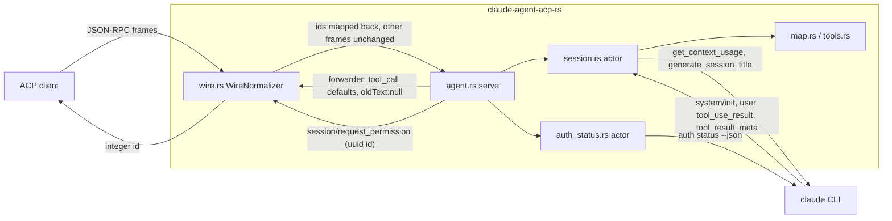

<!--
RULES — read before writing or implementing:
1. FORMAT: Bullets, tables, code, diagrams ONLY — no prose paragraphs
2. REQUIREMENTS: One crisp line each — no verbose descriptions
3. CHECKLIST: Mark items [x] as you complete them — this is your persistent todo list
4. READING TIME: Optimize for fast human scanning — if it's hard to skim, rewrite it
-->

# Plan: rust-live-divergences

> Port every divergence of the 2026-10-23 live run (real `claude`, haiku, vst-shaped client) so the Rust adapter's wire output equals Node 0.94.0; each fix is proven by a Node-captured corpus script (fake-claude transcript) or a hermetic unit test, never by prose.

## Goal

- vibe-station's context meter shows `size` 1000000 from the FIRST `usage_update` (D1, HIGH) — proven by a Node-captured script plus a unit test over the real `get_context_usage` reply shape.
- Tool frames carry Node's materialised defaults (`status`, `content`, `kind`, `locations`), `oldText:null`, integer request ids, relative titles, rebuilt Read/Bash output, subagent attribution, `nonExecutionKind` (D2, D3, D4, D7, D8, D14, D15).
- Slash-command list is re-published after `system/init` (`terminal_slash_commands`), `/context` chunks all carry `messageId`, `session_info_update` titles are published, the auth probe schedule is 3 probes / 3 pushes, the child env holds `CLAUDE_AGENT_SDK_VERSION` (D5, D11, D6, D10, D9).
- The session-account `_auth/status_update` push precedes the `session/new` result (never waiting on a probe) and the probes carry Node's env (D17, D10).
- The two live coverage gaps (permission deny path, cancel while a tool runs) become corpus scripts.
- The differential's `normalize_tool_call_defaults` AND `normalize_request_permission_id` are DELETED; no new `JsonPath::new`; no weakened differential.
- Done = 3 phases verified (`bash rust/scripts/rust-gate.sh` ends `==> gate OK` plain AND polluted; differential green 3x per phase) plus the orchestrator's final live matrix (3.9).

## Precondition (before Phase 1)

- The in-flight fix turns (`permission.rs`, `permission_options.rs`, `session.rs`, `tests/env_guard.rs`, `acp-recorder/src/{recorder,script}.rs`) are committed; `git status --short -- rust porting` is empty; HEAD contains `rust-parity-fixes/root implement phase 3` item 3.6 or later.
- If not: STOP and report (this plan edits `session.rs` and `permission.rs` heavily).
- `porting/parity/LIVE-FINDINGS-2026-10-23.md` is committed by the orchestrator (it lists the rows this plan turns into tests).

## Hard constraints (every phase)

- Implementers edit files ONLY with the Write / Edit tools — no `sed -i`, heredoc, redirect or `perl -pi` edits; read with Read.
- G7: only `rust/`, `porting/`, `skills/`, `.vibekit/`, root `.gitignore` may change — NEVER `src/`, `dist/`, `package.json`, `scripts/`, `.github/`, `docs/`, root `*.md`; NEVER touch anything under `/Users/gb/.vibe-station/projects/vibe-station/worktrees/vs-275`.
- G9: `cfg(unix|windows|target_*)` only in `rust/claude-agent-acp-rs/src/process.rs`; G10: `agent-client-protocol` stays 2.1.0.
- No new ignore paths: `git diff -U0 8a28082 -- rust | grep '^+' | grep -c 'JsonPath::new'` must print `0`; a divergence visible in a regenerated fixture MUST be ported — if it cannot be, STOP and report (a PARITY row never turns a red differential green).
- Fixtures ONLY via `bash porting/capture.sh <names>` (never hand-edited); `porting/record-real.sh` is human-only; never run `npm` in the repo root.
- `rust/claude-agent-acp-rs/src/turn.rs` and `src/turn/turn_tests.rs` stay UNTOUCHED; if a fix proves it needs them: STOP, report, extra review (run `--lib turn` before and after any such edit; hazards in `.vibekit/feature-plans/pending/claude-acp-rust/review-04-turn.md`, `review-05-turn.md`).
- The adapter reads env ONLY through `env_snapshot.rs` (`EnvSnapshot`) and `process.rs` (guard test `tests/env_guard.rs`); the orchestrator's shell exports ~15 `CLAUDE_*` / `ANTHROPIC_*` vars, so every new test is hermetic (temp dirs, explicit `EnvSnapshot::from_pairs`, no host env reads).
- Never print, log or write env VALUES — compare key NAMES only.
- No commit / push / tag / `git stash`; no killing processes by name; cargo always `--manifest-path rust/Cargo.toml`; filter `grep -E "test result|FAILED"`; success = `test result: ok` / `==> gate OK`.
- `rust/clippy.toml` bans `std::sync::Mutex|RwLock`, `tokio::sync::Mutex|RwLock|broadcast`; state lives in actors / sequential handlers; INV-27: no actor awaits a client or CLI round-trip inline (spawn + re-enter via a `Command`).
- New tests are `inv_NN_<slug>` with NN from 70 (69 is `env_guard.rs`); differential tests `inv_24_<script>`; every test runs under the gate's 180 s timeout.
- Order inside every phase: pure function + unit test FIRST, then wiring, then corpus script + `capture.sh` + differential test TOGETHER; if the Node capture disagrees with an expectation, fix the transcript / expectation, never the Node fixture.
- Transcript-authoring rules for every NEW assistant / result frame: assistant frames carry `parent_tool_use_id:null` (or a string for subagents), a message `id` and a `model`; every `result` carries `modelUsage` (`{"<model>":{"contextWindow":N}}`) once an assistant named a model; `$CWD` expands inside fake-claude strings.
- Early stop rule: if a turn ends early the implementer finishes the item in progress (port + script + capture + differential TOGETHER), leaves later items unticked, and a fresh retry resumes at the first unticked box.
- The final live matrix (3.9) is run by the ORCHESTRATOR, not an implementer turn.

## Requirements — divergences with root cause (all verified against Node source and a real-`claude` probe)

| # | Sev | Root cause (one line) | Phase |
|---|-----|-----------------------|-------|
| D1 | HIGH | Rust unwraps the wrong level of the `get_context_usage` reply: `send_request` returns the FULL `control_response` frame, `rawMaxTokens` is at `/response/response/rawMaxTokens` (Rust reads `/response/rawMaxTokens` and `/rawMaxTokens`), so the background refresh (`agent.rs:722-740`, `session.rs:1727`) never applies; Node's refresh (`acp-agent.js:7873-7894`) sets 1000000 + `authoritative` ~20 ms after session/new (real CLI answers in 20 ms, probe-verified) | 1 |
| D2 | MED | The ACP crate skips default `status` / empty `content` / `ToolKind::Other` / empty `locations` on a typed `tool_call`; Node's `toolCall()` always spreads `status:"pending", content:[]`, `kind`, and `locations` for Read / Write / Edit / NotebookEdit / Glob (`renderer.js:98-141`, `reporters/{read,file-edit,search}.js`) — but NOT every tool_call (memory recall omits empty content / locations, `renderer.js:407-425`; native subagent cards differ, `native-subagents.js:1180`); the differential hid it in `normalize_tool_call_defaults` (`tests/common/mod.rs:410`) | 3 |
| D3 | MED | `display_path` is a stub (`tools.rs:451`): no cwd reaches `tool_shape`; Node `toDisplayPath(filePath, cwd)` (`tool-calls/content.js:6`) returns the cwd-relative path for files under `session.cwd` | 2 |
| D4 | MED | Message-level `tool_use_result` is never read by Rust (`map.rs:781` feeds only `block.content`); Node rebuilds Read (`reporters/read.js:22-48`) and Bash (`reporters/bash.js:53-80`) from it (`acp-agent.js:9962-9971,10218`) | 2 |
| D5 | MED | Rust never handles `system/init` `terminal_slash_commands` (array of NAMES); `emit_commands_changed` (`session.rs:2917`) reads a nonexistent `terminal_commands` key and treats entries as objects; Node latches the list and re-publishes (`acp-agent.js:4064-4075`) | 1 |
| D6 | MED | No title generation: Node `SessionTitles.onTurnEnd` (`session-titles.js:127-190`) sends `generate_session_title {description, persist:true}` at `session_state_changed idle` and publishes `session_info_update {title, updatedAt}`; Rust skips it (`map.rs:13`). COST of the port: every new session makes one real small-model call (~2 s) and `persist:true` writes the title into the session file; `updatedAt` is `info.lastModified` for an adopted stored title and `Date.now()` for a generated one | 3 |
| D7 | LOW | The crate assigns `RequestId::Str(uuid_v4)` to every agent->client request (`agent-client-protocol-2.1.0/src/jsonrpc.rs:4089`); Node's SDK counts integers from 0; a dropped `SentRequest` also sends `$/cancel_request {requestId:<uuid>}` (`jsonrpc.rs:5528-5537`) that must be rewritten with the same map | 3 |
| D8 | LOW | The crate's `Diff.old_text: Option<String>` skips `None`; Node writes `oldText:null` for a new file | 3 |
| D9 | LOW | The Node SDK sets `CLAUDE_AGENT_SDK_VERSION="0.3.303"` on the child; `query()` first assigns `process.env.CLAUDE_AGENT_SDK_VERSION` UNCONDITIONALLY, then defaults the child env only if absent — so the FIRST session spawn keeps a host value, every LATER spawn and every later auth probe carries `0.3.303` (unless `options.env` sets it); `compute_claude_env_defaults` (`process.rs:536`) sets it never | 1 |
| D10 | LOW | Node probes `claude auth status` at initialize, at session create when `useAuthStatusSettings` sees a change (cwd OR api-key helper OR `JSON.stringify(options.env)`, `acp-agent.js:1737-1750`) and at EVERY prompt (`:2151-2152`), each probe running with `{...process.env, ...options.env}` (`:1815`, live: create and prompt probes carry `CLAUDE_CODE_ARTIFACT` and `CLAUDE_AGENT_SDK_VERSION`); Rust probes at initialize and at create only when cwd differs (`auth_status.rs:609-619`), never per prompt, and its probes carry neither env key | 1 |
| D11 | LOW | A local-command turn's second chunk is the `result` text (`TurnEvent::FinalText`, `session.rs:2703`) built without `messageId`; Node stamps `messageIdForGrouping(result)` = the result frame's `uuid` (`acp-agent.js:5301`) | 1 |
| D12 | n/a | `agentInfo.version` `0.1.0+upstream.0.94.0` — deliberate, user-required | - |
| D13 | n/a | steer reply wording — model nondeterminism | - |
| D14 | LOW | Rust never stamps `_meta.claudeCode.parentToolUseId` on `tool_call` / `tool_call_update` made by a subagent frame (no occurrence in `map.rs`; Node `stampParentToolUseId`, `acp-agent.js:552,9958,10060,10224,10363`); no fixture holds one; the permission-request and hook paths ALREADY stamp it (`permission.rs:328,376`, `hooks.rs:247`, `transcript.rs`) — reuse that helper, never stamp twice | 2 |
| D15 | MED (new) | `tool_result_meta` on the user frame (`non_execution_kind`, `user_feedback`) is never read; Node adds `_meta.claudeCode.nonExecutionKind` / `userFeedback` to the result update (`acp-agent.js:10124,10162`, `tool-result-meta.js`) — this is exactly the deny and cancel-during-tool path | 2 |
| D16 | MED (claimed) | Reported: Node's backgrounded Bash result has `rawOutput` and NO `content`, Rust emits a console block. NOT reproduced in live-0519: bun `background.transcript.json` item 17 and Rust item 15 both carry `[_meta,content,rawOutput,status]`; the only diff is Rust's extra `Read` of the output file (model variance). Handled as a root-cause VERIFICATION item (2.6) with a deterministic script | 2 |
| D17 | LOW (new) | Node awaits the SESSION-ACCOUNT `_auth/status_update` before the `session/new` result (live-0519 plain items 3,4,5; the probe push is only incidentally earlier, nothing waits on a probe); Rust's session-account push lands after the prompt starts (items 3,4,6) because `publish_session_account` is fire-and-forget (`agent.rs:639`) | 1 |
| G-deny | gap | Live Bash was auto-allowed; no corpus script denies a FILE tool (Edit / Write) with the CLI's real rejection result | 2 |
| G-cancel | gap | Live `sleep` was blocked before the cancel; no corpus script cancels while a tool_call is open | 2 |

## Change Map

```
rust/claude-agent-acp-rs/src/
  wire.rs                 + request ids, cancel ids
  agent.rs                ~ wraps transport, forwarder
  usage.rs                ~ raw_max_tokens extractor
  session.rs              ~ ctx refresh, init, titles
  session_ext.rs          ~ commands, terminal list
  map.rs                  ~ cwd, structured, defaults
  tools.rs                ~ display_path, read/bash rebuild
  permission.rs           ~ cwd for title
  process.rs              ~ SDK version env default
  auth_status.rs          ~ prompt probe, env change
  session_titles.rs       + title state machine
  lib.rs                  ~ pub mod wire, session_titles
rust/fake-claude/src/lib.rs   ~ env allowlist
rust/claude-agent-acp-rs/tests/
  common/mod.rs           ~ delete two normalisers
porting/corpus + fixtures     + ~16 scripts
porting/PARITY.md INVARIANTS.md ~ rows
```

| Today | After this plan |
|-------|-----------------|
| `usage_update.size` 200000 until the final result | 1000000 from the first frame (refresh applied, authoritative) |
| initial `tool_call` omits status / content / kind / locations | renderer-shaped `tool_call`s carry them (per-call-kind rule in map.rs / forwarder), other tool_calls untouched |
| permission request id is a uuid string | integer id, assigned by the wire layer (ids only), mapped back for replies and `$/cancel_request` |
| session account push lands after the prompt starts | the session-account push precedes the `session/new` result (probe pushes are never awaited) |
| titles `Edit /abs/path/a.txt` | `Edit a.txt` for files under cwd |
| Read content = raw numbered text (+ `4\t`, system-reminders) | rebuilt from the structured result |
| command list stays 83 | second `available_commands_update` without terminal-bound commands |
| no `session_info_update` | AI title published after the first turn |
| 1 auth probe / 2 pushes | 3 probes / 3 pushes with vst's `options.env` |
| deny / cancel only covered for Bash and text | Edit deny, cancel with an open tool_call, `nonExecutionKind` covered |

## Research (evidence cited by the Decisions)

- R1 reply shape: `Control::send_request` returns the whole frame (`control.rs:213`); a real `claude` (probe run in scratch, `probe-ctx.mjs`) answers `get_context_usage {detail:"summary"}` in ~20 ms with `{type:"control_response", response:{subtype,request_id,response:{model:"claude-haiku-5-5",rawMaxTokens:1000000,maxTokens:1000000,…}}}`; the beta header is ignored for non-API-key users yet the window is already 1M, so the window comes ONLY from this reply / `result.modelUsage`, never from `betas`.
- R2 fake auto-ack: `fake-claude` auto-acks `get_context_usage` WITHOUT `rawMaxTokens` (`fake-claude/src/lib.rs:220`), which is why the broken path never failed a test.
- R3 Node seeding order: model-row heuristic (`\b1m\b`, `acp-agent.js:10495`) -> `refreshContextWindowInBackground` (`:7873`) -> `result.modelUsage` (`:4976`); the cross-session `contextWindowCache` is only an optimisation and stays a PARITY pending row (Open question 2).
- R4 wire shape: live Node `tool_call` keys = `_meta,toolCallId,sessionUpdate,name,rawInput,status,title,kind,content[,locations]`; Rust omitted `status,content,kind[,locations]` (key-set diff over all 16 live scenarios, only `U:tool_call`, `U:agent_message_chunk`, `U:session_info_update` differ).
- R5 request ids: Node ids are sequential integers over ALL agent->client requests (fixtures show `"id":0` for the first `session/request_permission`); responses echo the id.
- R6 `tool_use_result` is the top-level field of the CLI `user` frame (`message.tool_use_result` in `acp-agent.js`), honoured only when the message holds exactly one `tool_result` block (`:9962-9971`); `tool_result_meta` is the top-level array `[{id, non_execution_kind, user_feedback?}]` (`:3502,5902`).
- R7 SDK env: `process.env.CLAUDE_AGENT_SDK_VERSION="0.3.303"` and `if(!Ct.CLAUDE_AGENT_SDK_VERSION)Ct.CLAUDE_AGENT_SDK_VERSION="0.3.303"` in `sdk.mjs`; `@anthropic-ai/claude-agent-sdk/package.json` version = `0.3.303`.
- R8 auth probe sequence (live, vst env): bun spawns `auth status` 3x (initialize, create, prompt), pushes 3x (`plan:max`, session account `Claude Max`, probe `max` again) and the session-account push precedes the `session/new` result (the probe push does only because Node's create takes ~700 ms; nothing waits for it); Rust 1 probe, 2 pushes, the second after the prompt started.
- R10 probe env: probes run with `{...process.env, ...options.env}` (`acp-agent.js:1815`) and `query()` has already assigned `process.env.CLAUDE_AGENT_SDK_VERSION` when the create and prompt probes run (`useAuthStatusSettings` is called after `query()`, `:8654`); the initialize probe precedes any query, so it has no SDK-version key.
- R11 background Bash: live-0519 `background` shows the same `[_meta,content,rawOutput,status]` completing update on both adapters; `reporters/bash.js:53-58` skips the structured branch when `backgroundTaskId` is set, so the string content falls through to the console block (`renderer.js:262-272`).
- R9 titles: `SessionTitles.onPrompt/onAssistantText` collect up to 1000 trailing chars, `onTurnEnd` (at `session_state_changed idle`, `acp-agent.js:4332`) adopts a stored `customTitle`, else (context >= 10 chars, not cancelled) calls `generateSessionTitle` = control request `{subtype:"generate_session_title", description, persist:true}` -> `response.title`, publishes `{title: sanitizeTitle(t), updatedAt: ISO(now)}` once per session, `reset()` on `conversation_reset` (`:5992`).

## Architecture Diagram



## System Boundaries

| Boundary | Contract (new or changed) |
|----------|---------------------------|
| agent -> ACP client (wire.rs, ids ONLY) | every outgoing REQUEST gets `id: i64` from a per-connection counter starting at 0 (Node order); the inbound RESPONSE with that integer is rewritten back to the crate's original `RequestId` before the agent sees it; an outgoing `$/cancel_request {requestId}` naming a mapped uuid is rewritten to the integer; unknown ids pass through; notifications and client-originated requests untouched |
| agent -> ACP client (forwarder in `agent.rs register_session`, typed updates only) | a typed `SessionUpdate::ToolCall` (the renderer-shaped `toolCall()` path of `map.rs:738` and `permission.rs:380`) is serialised and gets `status:"pending"`, `content:[]`, `kind:"other"` when absent and `locations:[]` when absent AND `_meta.claudeCode.toolName` is one of `Read,Write,Edit,NotebookEdit,Glob`; `RawUpdate` tool_calls (compaction `session.rs:2368`, plans, async tasks) and every `tool_call_update` keep their own shape |
| agent -> ACP client (same forwarder, and the Value builders `permission.rs build_tool_call`, `hooks.rs` final diff, `transcript.rs` replay) | any `{type:"diff"}` item inside a `content[]` of a tool_call / tool_call_update / permission `toolCall` lacking `oldText` gets `oldText: null` (pure fn `map::materialize_diff_old_text`) |
| session actor -> `claude` | `get_context_usage {detail:"summary"}` reply parsed by `usage::raw_max_tokens(frame:&Value)->Option<u64>` (`/response/response/rawMaxTokens`, fallback `/response/rawMaxTokens`, then `/rawMaxTokens`; `> 0` only); `generate_session_title {description:string, persist:true}` -> `response.title:string|null` |
| `claude` -> session actor | `system/init.terminal_slash_commands: string[]`; `user.tool_use_result: object`; `user.tool_result_meta: [{id:string, non_execution_kind:string, user_feedback?:string}]`; `result.uuid: string` |
| agent -> ACP client | `session/update` `available_commands_update` (re-sent after a changed `terminal_slash_commands`), `session_info_update {title:string, updatedAt:ISO8601}`, `_meta.claudeCode.{parentToolUseId, nonExecutionKind, userFeedback}` on tool updates |
| fake-claude | env allowlist gains `CLAUDE_AGENT_SDK_VERSION` (value recorded exactly); `auth status` keeps ONE fixed `{"auth_status_stdout":…}` (no per-probe counter: probes run concurrently and Node discards stale ones by epoch); existing contracts unchanged |

## Key Decisions

#### Decision 1: one pure extractor for the context window, both call sites use it (D1)
- **Decision:** add `usage::raw_max_tokens(frame:&Value)->Option<u64>` and use it at BOTH refresh sites; apply the answer only if the session is not authoritative AND (model-switch site) the model is unchanged since the request (Node `stillCurrent`, `acp-agent.js:7876-7880`).
- **Rationale:** the root cause is a wrong JSON pointer at two copies of the same code — see Research § R1, R2.
- **Where:** `rust/claude-agent-acp-rs/src/usage.rs` (new fn + `inv_70_raw_max_tokens_*`), `src/agent.rs:722-740` (`register_session`), `src/session.rs:1727-1735` (model switch), `Command::UpdateContextWindow` (`session.rs:1275`, already sets `authoritative` via `update_window_if_positive`).
- Unit fixtures use the REAL shape (full frame) plus the two legacy shapes and `0` / missing / string values.

#### Decision 2: the fake CLI must answer `get_context_usage` with the real shape in the new script
- **Decision:** script `usage-context-refresh` has a `{"expect":{"type":"control_request","request":{"subtype":"get_context_usage"}},"emit":[control_response with response {model, rawMaxTokens:1000000, maxTokens:1000000}, {"sleep_ms":150}]}` step right after `initialize`; the prompt follows; the Node fixture must show `size:1000000` on the first `usage_update`.
- **Rationale:** otherwise the auto-ack hides the bug again — see Research § R2; the sleep makes the refresh land before the stream starts on both adapters.
- **Where:** `porting/corpus/usage-context-refresh.{acp.json,transcript.jsonl}`, `tests/differential.rs` (`inv_24_usage_context_refresh`); the init model row must NOT contain `1m` (so only the refresh can explain 1M).

#### Decision 3: the transport wrapper does request IDS ONLY (D7)
- **Decision:** `wire::WireNormalizer<T>` implements `ConnectTo<R>` for any `T: ConnectTo<R>` (public API: `ConnectTo`, `into_channel_and_future`, `Channel`, `TransportFrame` — G10-safe); `serve()` wraps its transport with it; it bridges the two `Channel`s mutating `TransportFrame` messages with the pure functions `normalize_outgoing` / `normalize_incoming`; it touches NOTHING but request ids.
- **Rationale:** the crate-assigned id (Research § R5) is only visible at the transport; tool_call shape is NOT blanket-defaultable because Node itself omits fields on some calls (memory recall, native subagent cards, D2) — those rules live with the typed update (Decision 4).
- **Where:** `src/wire.rs` (new), `src/agent.rs:527-563` (`serve`: `.connect_to(WireNormalizer::new(transport))`), `src/lib.rs`, `Cargo.toml` (+ `futures = "0.3"` direct dependency, already in `Cargo.lock`).
- Id map: `next: i64`, `by_wire: HashMap<i64, RequestId>`; outgoing Request -> `wire = next; next += 1`, remember the original; incoming Response with `Number(n)` found in the map -> restore the original (and remove the entry); an outgoing `$/cancel_request` notification whose `params.requestId` is a mapped original gets the integer (a dropped `SentRequest` sends it, `jsonrpc.rs:5528-5537`); batches: iterate `entries_mut()`.
- Test: `inv_79_*` units plus a script with TWO permission requests (`permission-two-requests`, ids 0 and 1 in the Node fixture) so a counter bug cannot hide behind a single `"id":0`.
- Drain: the bridge must forward every frame the client already sent before returning `Ok(())` (trait doc, `component.rs:114-120`); `tests/shutdown.rs` and `tests/control_transport.rs` must stay green.
- STOP rule: if graceful drain or the shutdown tests cannot be kept green with the Channel bridge, STOP and report (fallback = the same pure functions over raw lines in a `Lines` transport built only in the binary, losing in-process coverage).

#### Decision 4: defaults and `oldText:null` are applied to the TYPED update, per call kind (D2, D8)
- **Decision:** pure `map::materialize_tool_call_defaults(update:&mut Value)` applies to a serialised typed `SessionUpdate::ToolCall` only (the `renderer.toolCall()` shape: `map.rs:738`, `permission.rs:380`): `status:"pending"`, `content:[]`, `kind:"other"` when absent, `locations:[]` when absent AND `_meta.claudeCode.toolName` ∈ `Read,Write,Edit,NotebookEdit,Glob` (the reporters that always define it: `read.js:17`, `file-edit.js:14,80,167`, `search.js:13`); the other tool_call producers keep their own shape (compaction `session.rs:2368` and plans are `RawUpdate`; memory recall omits empty content / locations, `renderer.js:407-425`; native subagent cards, `native-subagents.js:1180`, are not produced by Rust); pure `map::materialize_diff_old_text(&mut Value)` adds `oldText:null` to every `{type:"diff"}` item without `oldText`.
- **Rationale:** a blanket wire rule would add keys Node deliberately omits — see Research § R4; the typed-vs-raw split mirrors the renderer's call kinds.
- **Where:** `src/map.rs` (both fns + `inv_79_*` units, list pinned with reporter line numbers in comments), `src/agent.rs:745-760` (`register_session` forwarder: serialise `SessionOutbound::Update`, apply, send as `UntypedMessage` `session/update`; apply `materialize_diff_old_text` to `RawUpdate` values too), `src/permission.rs` `build_tool_call` (Value builder), `src/hooks.rs:191-219` (final diff), `src/transcript.rs` replay values (apply BOTH fns to replayed tool_calls, which are renderer-shaped in Node).
- If the typed/raw split leaves a divergence in a regenerated fixture, port the call kind; never re-add a normaliser.

#### Decision 5: delete the differential's normalisers as an explicit item (D2, D7, D8)
- **Decision:** after the wrapper and the typed-update rules are wired, DELETE `normalize_tool_call_defaults` (it also hides `kind` and `oldText:null`) and `normalize_request_permission_id` and their two call sites in `diff_frames`; rewrite the `base_ignore()` doc comment (`tests/differential.rs:253-265`); no replacement normaliser. The `agentInfo` version normaliser (`tests/common/mod.rs:584-650`, D12) STAYS untouched.
- **Rationale:** the whole corpus (50+ differentials, every `permission-*` script with its literal `"id":0`) then proves the wire layer and the typed rules byte-for-byte.
- **Where:** `tests/common/mod.rs:324,336,405-470`, `tests/differential.rs:253-265`; check `grep -c "normalize_tool_call_defaults\|normalize_request_permission_id" rust/claude-agent-acp-rs/tests/common/mod.rs rust/claude-agent-acp-rs/tests/differential.rs` prints `0` for both files.
- If a reply-matching or id-order difference remains (Node's counter also counts other client requests), port the wire layer; do NOT re-add a normaliser.

#### Decision 6: relative titles need the session cwd in MapState and permission.rs (D3)
- **Decision:** `tools::tool_shape(name,input)` becomes `tool_shape(name,input,cwd:Option<&Path>)`; `display_path(path,cwd)` ports `toDisplayPath` (resolve both, relative iff under cwd or equal, else unchanged; no symlink canonicalisation); `MapState` stores the cwd for EVERY client (today `cwd` is set only by `configure_air`); `permission::build_tool_call` / `ensure_tool_call_emitted` take `cwd`.
- **Rationale:** Node passes `session.cwd` at every site (`acp-agent.js:7448,10098,10361`, permission `:7519`) — see Requirements D3.
- **Where:** `src/tools.rs:451,457` (+ call sites in `map.rs:714,832,1271`), `src/map.rs` (`MapState::set_cwd`, called from `session.rs:912` before `configure_air`), `src/permission.rs:289-358`, `src/session.rs` callers.
- Streamed `partialRefinement` titles (`map.rs:1265`) use the same cwd; the corpus script covers `Read`, `Edit`, `Write` inside cwd, one outside cwd, and `Read` with `offset`/`limit` suffixes.

#### Decision 7: structured results are plumbed once, Read and Bash consume them (D4)
- **Decision:** a new `map::map_user_frame(frame,state)` extracts `tool_use_result` (only when the message holds exactly ONE `tool_result` block, R6) and passes it as `structured:Option<&Value>` to `tools::tool_result_content`; Read: `structured.type=="text" && file.content` non-empty string -> numbered lines from `file.startLine ?? input.offset ?? 1`, trailing `\n` dropped, `[File truncated: showing N of M lines]` when `truncatedByTokenCap`, then `markdown_escape`; Bash (non-terminal): stdout+stderr joined, `[Command was aborted before completion]` when `interrupted`, `[Output truncated (N bytes total): full output saved to P]` when `persistedOutputPath`, skipped for `isImage` / `backgroundTaskId`.
- **Rationale:** both ports are line-for-line from `reporters/read.js:22-48` and `reporters/bash.js:53-80`; Bash is included because `interrupted` is exactly the cancel-during-tool content (G-cancel).
- **Where:** `src/map.rs:781` (+ new `map_user_frame`), `src/session.rs:2170` (user arm calls it), `src/tools.rs:804-860`; units `inv_75_*` with goldens produced by running `dist/tool-calls/reporters/{read,bash}.js` via `node -e` against the installed package.
- Agent / WebSearch / WebFetch / ExitPlanMode also read `structured` — NOT ported here (Out of scope, PARITY pending row with consequence).

#### Decision 8: `tool_result_meta` and subagent attribution are stamped in map.rs (D14, D15)
- **Decision:** `MapState` carries a per-call `ResultCtx {parent_tool_use_id:Option<String>, non_execution:HashMap<String,NonExec>}`; `tool_call`, `tool_call_update` (refine and result) get `_meta.claudeCode.parentToolUseId` when the SOURCE frame has a string `parent_tool_use_id`; result updates get `nonExecutionKind` (+ `userFeedback`) from `tool_result_meta`; key order inside `claudeCode`: `toolName`, then non-execution keys, then `parentToolUseId`.
- **Rationale:** Node stamps both via `stampParentToolUseId` and the spread in `acp-agent.js:10162` — see Requirements D14, D15; status stays `failed` for non-v2 clients (v2 `cancelled` is out of scope).
- **Where:** `src/map.rs:66-130,697,752,825,1075,1265`, `src/tools.rs:97` (`tool_meta`), `src/session.rs` (assistant / user / stream arms pass the frame's parent id); units `inv_76_*`, `inv_77_*`.
- Reuse the existing stampers (`permission.rs:328,376`, `hooks.rs:247`, `transcript.rs`) via one shared helper `tools::stamp_parent(meta, parent)`; the three existing paths are refactored onto it and must not stamp twice (unit `inv_76_no_double_stamp`).
- The AIR `ChangedMetaFilter` (`map.rs` `filter_updates`) must keep working: AIR metas also carry `parentToolUseId` (`changed-meta-filter.js:17`).

#### Decision 9: terminal slash commands are actor state; the command list is actor state too (D5)
- **Decision:** `SessionExt` gains `commands: Vec<Value>` (seeded from the initialize handshake via a new `Command::InitCommands`, replaced by every `commands_changed`) and `terminal_slash_commands: Vec<String>`; a `system/init` frame whose `terminal_slash_commands` differs (JSON compare) from the stored list stores it and re-publishes `available_commands_update` built from `ext.commands`; `commands_changed` uses the stored terminal list; `map_commands_changed` takes `&[String]` names (not objects).
- **Rationale:** Node `getAvailableSlashCommands(commands, terminalCommands)` filters by NAME (`acp-agent.js:9640`); see Requirements D5.
- **Where:** `src/session.rs:581` (send `InitCommands` after `InitConfig`), `:2242` (new `"init"` arm), `:2377,2917` (`emit_commands_changed`), `src/session_ext.rs`, `src/map.rs:952` (+ the tests at `map.rs:1823-1910`); units `inv_73_*`.

#### Decision 10: result-text chunks carry the result frame's uuid without touching turn.rs (D11)
- **Decision:** `handle_events` / `settle_events` (session.rs) get `final_message_id:Option<&str>`; only the `"result"` arm passes `line["uuid"]` (non-empty string); the `FinalText` chunk gets `.message_id(..)`.
- **Rationale:** `TurnEvent::FinalText` is created in `turn.rs`; the result line is in scope in session.rs where the event is consumed — see Requirements D11.
- **Where:** `src/session.rs:2175-2215` (result arm), `:2684-2710` (`handle_events`), `:2884` (`settle_events`) and its other callers (pass `None`).
- STOP rule: if `FinalText` can reach `handle_events` from a path without the result line, STOP (would need turn.rs).

#### Decision 11: the SDK version env follows Node's latch, checked against the pinned SDK (D9)
- **Decision:** `process::CLAUDE_AGENT_SDK_VERSION: &str = "0.3.303"`; the rule has two states, held per connection in `agent.rs` `Registry.sdk_version_latched: bool` (set when the first session's `query()` equivalent starts): BEFORE the latch the child env gets the constant only when absent from `extra_env` AND the host env (first session keeps a host value, like `Ct.X ||= …`); AFTER the latch every later session spawn AND every later auth probe gets the constant unconditionally, overridden only by `options.env` (Node's `process.env.X = "0.3.303"` assignment, Research § R7, R10); `compute_claude_env_defaults(parent, extra, latched)` implements it; fake-claude records the key with its exact value; test `inv_71_sdk_version_constant_matches_pinned_sdk` reads `<repo>/rust/target/upstream/<pin>/node_modules/@anthropic-ai/claude-agent-sdk/package.json` (skips with a message when the cache is absent; the gate prewarms it).
- **Rationale:** Node sets it (Research § R7); the recorder runs the adapter under `env_clear` (`tests/common/mod.rs:900`), so the exact value is hermetic even under the polluted shell.
- **Where:** `src/process.rs:536`, `src/agent.rs` (latch in `Registry`), `fake-claude/src/lib.rs:150` (`ARGV_ENV_ALLOWLIST` 5 -> 6), every `porting/fixtures/*.argv.json` regenerated by `capture.sh` (all names; ONLY argv fixtures may change), fake-claude unit test.
- Units: `inv_71_sdk_version_first_session_keeps_host_value`, `inv_71_sdk_version_later_session_overrides_host_value`, `inv_71_sdk_version_options_env_wins`.

#### Decision 12: auth probe schedule, probe env and push ORDER are ported inside the auth actor (D10, D17)
- **Decision:** `AuthCmd::SessionCreated` gains `env: Option<Value>` (the `options.env` JSON), `api_key_helper` and `done: oneshot::Sender<()>`; it re-probes (`fresh`) when cwd OR helper OR `to_string(env)` differs from the previous context (first call: previous = initial cwd, no helper, no env), exactly like `useAuthStatusSettings`; the session-account push is sent through the forwarder FIRST and `done` resolves behind an `AuthPush::Barrier`, and `agent.rs` awaits it (spawned, re-entering via the responder, INV-27) BEFORE answering `session/new|load|resume|fork` (D17: the barrier covers the SESSION-ACCOUNT push only; NEVER wait on a probe, whose push ordering is timing-dependent in Node too); new `AuthCmd::PromptStarted {cwd, env}` does the same change check then a non-fresh `Probe`; `agent.rs` sends it at the start of every `session/prompt`.
- Probe env (D10, Research § R10): `ProbeFn` takes `(cwd, env: Vec<(String,String)>)`; every probe runs with `host env + options.env`, plus `CLAUDE_AGENT_SDK_VERSION` once `sdk_version_latched` (Decision 11); the initialize probe has neither; `probe_cli` keeps its existing timeout / parse logic.
- **Rationale:** see Research § R8, R10; pushes stay change-only via `same_status`.
- **Where:** `src/auth_status.rs:454-625` (`AuthCmd`, `ProbeFn`, `probe_cli`), `src/agent.rs:610-660,895-905,1237` (`spawn_auth`, `publish_session_account`, initialize, prompt), script `auth-probe-schedule`, units `inv_78_*`.
- Acceptance script (deterministic, no counter file): ONE fixed probe stdout (`{"auth_status_stdout":{…subscriptionType:"pro"…}}`) and an `initialize` `account` whose plan DIFFERS (e.g. `max`), `options.env` set in `session/new`, `sleep` 600 ms after `initialize`, one prompt, one trailing `sleep`; Node pushes 3x (probe, session account, probe again after the prompt probe); the fixture must hold exactly 3 pushes in total and the session-account push (the one whose plan equals the `initialize` account) BEFORE the `session/new` result; the positions of the two probe pushes relative to the `session/new` result are NOT asserted (racy); the 600 ms `sleep` after `initialize` keeps the first probe push before `session/new` in practice, and if the Node capture is not byte-stable 3x the STOP rule of Open question 5 applies. Probe env is asserted by the unit tests (`inv_78_probe_env_*` with a stub `ProbeFn` capturing env KEY NAMES) and the final live matrix, not by the fixture.

#### Decision 13: session titles are a small actor-owned state machine (D6)
- **Decision:** `session_titles.rs` ports `SessionTitles` without the client-rename paths (nothing in 0.94.0 calls `setExplicitTitle`): `on_prompt(text)`, `on_assistant_text(text)`, `on_turn_end` (adopt stored `customTitle` via `session_store` info reader, else request generation when `settled==false && context.trim().len()>=10 && !cancelled`, else fall back to `summary`), `reset()`; title requests are spawned (INV-27) and publish through a `Command::TitleGenerated`; `sanitize_title` already exists (`session_store.rs:304`).
- **Rationale:** see Research § R9; drop `map.rs:13` "skipped" note.
- **Where:** `src/session_titles.rs` (new), `src/session.rs` (prompt arm, assistant text, `session_state_changed idle` at `:2360`, `conversation_reset`), `src/session_ext.rs`, `src/session_store.rs` (info reader reuse), script `session-title` (+ `sleep` step after the prompt so the late push is recorded), units `inv_80_*`.
- STOP rule: the push must arrive after the prompt response on both adapters; if ordering differs between runs of the Node capture, add a `sleep` step instead of editing expectations.

#### Decision 14: coverage-gap scripts mirror the live driver's prompts but fake the CLI (G-deny, G-cancel)
- **Decision:** `permission-deny-edit` (policy `deny`, Edit tool, `tool_result` `is_error:true` content `"The user doesn't want to proceed with this tool use. The tool use was rejected (eg. if it was a file edit, the new_string was NOT written to the file)."` + `tool_result_meta:[{id,non_execution_kind:"user-rejected"}]`) and `cancel-during-tool` (Bash tool_use, `cancel_after_updates` after the `tool_call`, fake answers `interrupt` with a `tool_result` `is_error:true` `"[Request interrupted by user for tool use]"` + `tool_result_meta [{id,non_execution_kind:"interrupted"}]` + structured `{stdout:"",stderr:"",interrupted:true}`, then `result stop_reason:cancelled`); a second variant `cancel-during-tool-no-result` where the CLI emits NO tool_result (Node closes the open call itself).
- **Rationale:** the live driver cannot force either path (Requirements G-deny, G-cancel); the real CLI strings are taken from the live transcripts / CLI.
- **Where:** `porting/corpus/{permission-deny-edit,cancel-during-tool,cancel-during-tool-no-result}.*`, `tests/differential.rs` (`inv_24_*`); an optional live check is in 3.9.

## Open Questions / Risks

| # | Question | Recommendation |
|---|----------|----------------|
| 1 | The Channel bridge may change shutdown / drain behaviour (Decision 3), and `$/cancel_request` ids must follow the map | Keep the STOP rule + the `$/cancel_request` mapping (unit `inv_79_cancel_request_id_rewritten`); run `--test shutdown --test control_transport --test transport_parity` in 3.T2 |
| 2 | Cross-session `contextWindowCache` (Node seeds a repeated model synchronously) | Out of scope: the refresh closes the gap in ~20 ms for both adapters; keep the PARITY pending row, state it in 1.7 |
| 3 | Node's request-id counter also counts non-permission requests (fs, terminal) | Rust numbers ALL outgoing requests in order; if a differential shows a count difference, port the order, never normalise |
| 4 | `tool_use_result` for tools other than Read / Bash (Agent, Web*, ExitPlanMode) | Out of scope with PARITY pending rows; plumbing from Decision 7 makes each a small follow-up |
| 5 | D10 acceptance without a racy probe counter (probes run concurrently, Node drops stale ones by epoch) | ONE fixed probe stdout + an `initialize` account that differs from it gives 3 pushes deterministically (Decision 12); if the Node capture is still flaky, STOP and fall back to `inv_78_*` units + the live matrix, recording a PARITY note |
| 9 | D16 (background Bash without `content`) is not reproducible from live-0519 | Item 2.6 re-derives it from the live frame through `node -e` over `dist/tool-calls/reporters/bash.js`; if Node truly omits `content`, port the branch and keep the script as the regression test, else record "not a divergence" in PARITY with the evidence |
| 6 | D6 timing: the title update lands after the prompt response | `sleep` step in the script (Decision 13); unit tests cover the state machine |
| 7 | Capturing all argv fixtures for D9 changes many committed files | Expected and mechanical; `capture.sh` with no names regenerates them; review the diff shows only the added env key |
| 8 | D14 live proof is impossible (model chooses tools) | Corpus script is the proof; the final live matrix only records whether the model happened to use a subagent child tool |

## Implementation Phase 1 — context window, SDK env, local-command ids, terminal commands, auth schedule (D1, D9, D11, D5, D10, D17)

Risk order: D1 first (feeds vibe-station's context meter). Phase constraints: Hard constraints above apply; edit files ONLY with Write/Edit; no `turn.rs` edit; start by confirming the Precondition.

- [ ] 1.0 Read `rust/AGENTS.md`, this plan §Hard constraints + Decisions 1, 2, 9, 10, 11, `agent.rs:700-760`, `session.rs:575-590,1275-1290,1720-1740,2063-2070,2175-2215,2242-2260,2377-2380,2684-2720,2884-2935` (HEAD), `usage.rs:140-215`, `map.rs:944-1070`, `process.rs:530-575`, `fake-claude/src/lib.rs:140-200,215-225`, Node `acp-agent.js:4064-4075,5296-5305,7855-7895,9601-9660`
- [ ] 1.1 D1 pure + units FIRST: `usage::raw_max_tokens` + `inv_70_raw_max_tokens_full_frame_shape` (the real captured shape), `inv_70_raw_max_tokens_legacy_shapes`, `inv_70_raw_max_tokens_rejects_zero_missing_string`
- [ ] 1.2 D1 wiring: `agent.rs:722-740` and `session.rs:1727-1735` call it (model-switch site also checks the model is unchanged); actor test `inv_70_refresh_applies_once_and_sets_authoritative` (feed `Command::UpdateContextWindow` twice: first applies and sets `authoritative`, then a later `result.modelUsage` still overrides, a second refresh is ignored when authoritative)
- [ ] 1.3 D1 corpus (Decision 2): script `usage-context-refresh` (init model row WITHOUT `1m`, refresh reply `rawMaxTokens:1000000`, `sleep_ms:150`, then a prompt with stream `message_start`/`message_delta` and a `result` WITHOUT `modelUsage.contextWindow` change); `bash porting/capture.sh usage-context-refresh`; `grep -c '"size":1000000' porting/fixtures/usage-context-refresh.frames.jsonl` >= 2 and the FIRST `usage_update` is already 1000000; `inv_24_usage_context_refresh` green; prove it RED first by running it before 1.2 and recording the diff (`size` 200000 vs 1000000)
- [ ] 1.4 D9 (Decision 11): `process::CLAUDE_AGENT_SDK_VERSION` + `compute_claude_env_defaults(parent, extra, latched)` + `Registry.sdk_version_latched` + units `inv_71_sdk_version_default_when_absent`, `inv_71_sdk_version_first_session_keeps_host_value`, `inv_71_sdk_version_later_session_overrides_host_value`, `inv_71_sdk_version_options_env_wins`, `inv_71_sdk_version_constant_matches_pinned_sdk`; `fake-claude` allowlist + its unit test; `bash porting/capture.sh` (ALL names) and confirm only the env key was added: `git diff -U0 -- porting/fixtures/*.argv.json | grep '^[+-]' | grep -v '^+++\|^---' | sort | uniq -c` shows only `+    "CLAUDE_AGENT_SDK_VERSION": "0.3.303",` lines (plus its comma-neighbour re-flow) AND `git diff --stat -- porting/fixtures ':!*.argv.json'` is EMPTY (no non-argv fixture changed)
- [ ] 1.5 D11 (Decision 10): unit `inv_72_final_text_carries_result_uuid` (+ `…_without_uuid_has_none`) on `handle_events`; wiring; script `local-command-message-id` (`/context` prompt; fake emits `system/local_command_output` with `uuid` THEN `result` with `uuid` and `result` text); capture; every `agent_message_chunk` in the fixture has `messageId` (`grep -c agent_message_chunk` equals `grep -c messageId` for that file); `inv_24_local_command_message_id`; the existing `context-echo-less` fixture (result without uuid) stays unchanged
- [ ] 1.6 D5 (Decision 9): `map_commands_changed(commands, terminal:&[String])` + updated tests at `map.rs:1823-1910` + `inv_73_terminal_commands_filter_by_name`; `SessionExt.commands/terminal_slash_commands`, `Command::InitCommands`, the `"init"` arm, `emit_commands_changed` rewrite; actor tests `inv_73_init_frame_republishes_filtered_list`, `inv_73_unchanged_terminal_list_publishes_nothing`, `inv_73_commands_changed_uses_stored_terminal_list`; script `terminal-commands` (initialize `commands` = 4 entries incl. `doctor`,`color`; first frame of the prompt step is `system/init` with `terminal_slash_commands:["doctor","color"]`); capture; the fixture holds TWO `available_commands_update` frames (first 4+2 entries, second without `doctor`,`color`); `inv_24_terminal_commands`
- [ ] 1.7 D10 + D17 (Decision 12): pure `auth_context_changed(prev,next)` + `inv_78_context_change_rules` (cwd / helper / env JSON each trigger, equal does not); actor tests with stub `ProbeFn`s `inv_78_prompt_started_probes_once_nonfresh`, `inv_78_session_created_with_env_change_probes_fresh`, `inv_78_pushes_only_on_change`, `inv_78_probe_env_has_options_env_and_latched_sdk_version` (KEY NAMES only), `inv_78_session_account_push_precedes_session_result` (barrier for that push only), `inv_78_session_result_does_not_wait_for_probe` (a stub probe that never completes must not delay the result); wiring (`AuthCmd::PromptStarted`, `SessionCreated{env,api_key_helper,done}`, `ProbeFn` env arg, agent.rs awaits the barrier before answering `session/new|load|resume|fork`); script `auth-probe-schedule` (Decision 12 acceptance script); capture; fixture holds exactly 3 `_auth/status_update` frames in total, the session-account push BEFORE the `session/new` result (probe pushes unordered by assertion); `inv_24_auth_probe_schedule`; STOP rule Open question 5
- [ ] 1.8 Docs: PARITY rows D1, D5, D9, D10, D11, D17 (+ pending row for the cross-session window cache, Open question 2), INVARIANTS INV-70..INV-73, INV-78, header test count

**Verify phase 1:**

- [ ] 1.T1 `for i in 1 2 3; do cargo test --manifest-path rust/Cargo.toml -p claude-agent-acp-rs --test differential 2>&1 | grep -E "test result|FAILED"; done` -> three `test result: ok`
- [ ] 1.T2 `cargo test --manifest-path rust/Cargo.toml -p claude-agent-acp-rs --lib 'inv_70|inv_71|inv_72|inv_73|inv_78' 2>&1 | grep -E "test result|FAILED"` and `cargo test --manifest-path rust/Cargo.toml -p fake-claude 2>&1 | grep -E "test result|FAILED"` -> ok
- [ ] 1.T3 `cargo test --manifest-path rust/Cargo.toml -p claude-agent-acp-rs --lib turn 2>&1 | grep -E "test result|FAILED"` -> ok and `git diff 8a28082 --stat -- rust/claude-agent-acp-rs/src/turn.rs rust/claude-agent-acp-rs/src/turn/turn_tests.rs` is empty
- [ ] 1.T4 `grep -c '"size":1000000' porting/fixtures/usage-context-refresh.frames.jsonl` >= 2; `grep -c 'terminal_slash\|"doctor"' porting/fixtures/terminal-commands.frames.jsonl` shows the second update lacks `doctor` (`grep -c '"name":"doctor"' ...` == 1, the first update only); `grep -c '_auth/status_update' porting/fixtures/auth-probe-schedule.frames.jsonl` == 3 and `grep -n '_auth/status_update\|"result":{"sessionId"' porting/fixtures/auth-probe-schedule.frames.jsonl | cut -c1-40` lists the push carrying the `initialize` account's plan before the `session/new` result line (probe pushes may sit on either side)
- [ ] 1.T5 `env CLAUDE_CODE_ARTIFACT=1 ANTHROPIC_MODEL=opus CLAUDE_AGENT_SDK_VERSION=9.9.9 CLAUDE_CODE_ENTRYPOINT=host-test CLAUDE_CODE_EXECUTABLE=/nonexistent CLAUDE_CODE_MESSAGING_SOCKET=/nonexistent IS_SANDBOX=1 NO_BROWSER=1 SSH_CONNECTION=x MAX_THINKING_TOKENS=1 CLAUDE_CONFIG_DIR=/nonexistent cargo test --manifest-path rust/Cargo.toml --workspace 2>&1 | grep -E "test result|FAILED"` -> all ok
- [ ] 1.T6 `bash rust/scripts/rust-gate.sh 2>&1 | tail -4` ends `==> gate OK`; the same under the polluted prefix `env CLAUDE_CODE_ARTIFACT=1 ANTHROPIC_MODEL=opus CLAUDE_AGENT_SDK_VERSION=9.9.9 CLAUDE_CODE_ENTRYPOINT=host-test CLAUDE_CODE_EXECUTABLE=/nonexistent CLAUDE_CODE_MESSAGING_SOCKET=/nonexistent IS_SANDBOX=1 NO_BROWSER=1 SSH_CONNECTION=x MAX_THINKING_TOKENS=1 CLAUDE_CONFIG_DIR=/nonexistent bash rust/scripts/rust-gate.sh 2>&1 | tail -4` ends `==> gate OK`
- [ ] 1.T7 `git diff --stat -- . ':!rust' ':!porting' ':!skills' ':!.vibekit' ':!.gitignore'` is empty (G7); `git diff -U0 8a28082 -- rust | grep '^+' | grep -c 'JsonPath::new'` prints `0`

## Implementation Phase 2 — tool-call content and attribution, deny / cancel coverage (D3, D4, D14, D15, D16, G-deny, G-cancel)

Phase constraints: Hard constraints above apply; edit files ONLY with Write/Edit; no `turn.rs` edit; `map.rs` / `tools.rs` are shared by every tool differential, so run `--test differential` after EACH item.

- [ ] 2.0 Read Decisions 6, 7, 8, 14, Research R11, `map.rs:60-135,496-560,635-860,1075-1130,1265-1300`, `tools.rs:97-130,440-560,800-900`, `permission.rs:280-400`, `session.rs:2063-2215`, Node `tool-calls/content.js:1-16`, `reporters/{read,bash,file-edit}.js`, `renderer.js:60-80,225-335`, `tool-result-meta.js`, `acp-agent.js:9955-10000,10110-10260,5880-5910`
- [ ] 2.1 D3 pure + units FIRST: `tools::display_path(path,cwd)` + `inv_74_display_path_{inside,equal,outside,relative_input,no_cwd}` (goldens via `node -e` importing `dist/tool-calls/content.js`); thread `cwd` through `tool_shape` and its 5 call sites; `MapState::set_cwd` for every client; `permission.rs` callers; update existing unit tests that call `tool_shape(name,input)`; script `tool-display-paths` (`$CWD/a.txt` Read with `offset`/`limit`, Edit, Write inside cwd, plus `/tmp/outside.txt`; one streamed tool_use with empty input then refinement); capture; `inv_24_tool_display_paths`; the permission request title in the fixture is relative
- [ ] 2.2 D4 pure + units: `tools::read_result_content(structured,input,raw)` and `bash_result_content(structured,raw,is_error)` + `inv_75_read_*` (numbered lines, trailing newline, `startLine`, `offset`, `truncatedByTokenCap`, empty file keeps raw note, `type!="text"` falls back) and `inv_75_bash_*` (stdout+stderr join, `interrupted`, `persistedOutputPath`, `isImage`/`backgroundTaskId` skip); goldens via `node -e` over the installed reporters
- [ ] 2.3 D4 wiring: `map::map_user_frame` (single-`tool_result` guard), `session.rs:2170` calls it; scripts `read-structured-result` (raw text with `4\t`, a `<system-reminder>` suffix and `tool_use_result {type:"text",file:{content,startLine:1,numLines:4,totalLines:4}}`; plus a second Read with NO `tool_use_result`) and `bash-structured-interrupted`; capture; `inv_24_read_structured_result`, `inv_24_bash_structured_interrupted`
- [ ] 2.4 D14 + D15 (Decision 8): pure `meta_with_parent_and_nonexec` + `inv_76_parent_stamped_on_tool_call_and_updates`, `inv_77_non_execution_kind_and_feedback`, `inv_77_unknown_kind_preserved`; wiring through `map_consolidated_assistant` / `map_user_frame` / `map_stream_event` (frame's `parent_tool_use_id` string only; `null` / missing -> none); scripts `subagent-child-tool` (top-level Task tool_use, assistant frame with `parent_tool_use_id:"toolu_TASK"` holding a Read tool_use, user frame with the same parent and its tool_result, then the Task result) and `permission-deny-edit` (Decision 14); capture; `inv_24_subagent_child_tool`, `inv_24_permission_deny_edit`; AIR scripts (`air-tool-meta`, `async-task-air`) stay green
- [ ] 2.5 G-cancel (Decision 14): scripts `cancel-during-tool` and `cancel-during-tool-no-result`; capture; `inv_24_cancel_during_tool`, `inv_24_cancel_during_tool_no_result`; if Rust differs from Node here, port in `session.rs` / `unfinished.rs`; touching `turn.rs` is a STOP
- [ ] 2.6 D16 root-cause VERIFICATION: take the live frame (scratch `live-0519/bun094/background.transcript.json` items 14-17: tool_result text `Command running in background with ID: …` + `toolResponse.backgroundTaskId`), build the equivalent `tool_use` / `tool_result` / `tool_use_result` and run it through `dist/tool-calls/renderer.js` with `node -e` (`AcpToolCallRenderer.for({}).result(...)`), recording whether `content` is present; then script `bash-background-result` (Bash `run_in_background:true`, tool_result string, `tool_use_result {stdout:"",stderr:"",backgroundTaskId:"b1",…}`); capture; `inv_24_bash_background_result`; the Node fixture decides: equal -> record "not a divergence" in PARITY with the evidence (R11); different -> port the branch in `tools::bash_result_content`
- [ ] 2.7 Docs: PARITY rows D3, D4 (+ pending rows for Agent / Web* / ExitPlanMode structured), D14, D15, D16, G-deny, G-cancel; INVARIANTS INV-74..INV-77; header test count

**Verify phase 2:**

- [ ] 2.T1 `for i in 1 2 3; do cargo test --manifest-path rust/Cargo.toml -p claude-agent-acp-rs --test differential 2>&1 | grep -E "test result|FAILED"; done` -> three `test result: ok`
- [ ] 2.T2 `cargo test --manifest-path rust/Cargo.toml -p claude-agent-acp-rs --lib 'inv_74|inv_75|inv_76|inv_77' 2>&1 | grep -E "test result|FAILED"` and `cargo test --manifest-path rust/Cargo.toml -p claude-agent-acp-rs --lib 'air|tool|permission|map' 2>&1 | grep -E "test result|FAILED"` -> ok
- [ ] 2.T3 `cargo test --manifest-path rust/Cargo.toml -p claude-agent-acp-rs --lib turn 2>&1 | grep -E "test result|FAILED"` -> ok and the `turn.rs` / `turn_tests.rs` diff is empty (command as 1.T3)
- [ ] 2.T4 `grep -c '"title":"Edit a.txt"\|"title":"Read a.txt' porting/fixtures/tool-display-paths.frames.jsonl` >= 2; `grep -c 'parentToolUseId' porting/fixtures/subagent-child-tool.frames.jsonl` >= 2; `grep -c 'nonExecutionKind' porting/fixtures/permission-deny-edit.frames.jsonl porting/fixtures/cancel-during-tool.frames.jsonl` >= 1 each; `grep -c 'aborted before completion' porting/fixtures/bash-structured-interrupted.frames.jsonl` >= 1; `bash-background-result.frames.jsonl` exists and its `inv_24_bash_background_result` is green (2.6)
- [ ] 2.T5 `cargo test --manifest-path rust/Cargo.toml -p fake-claude -p acp-recorder 2>&1 | grep -E "test result|FAILED"` -> ok
- [ ] 2.T6 polluted workspace tests (command of 1.T5) -> all ok; plain and polluted `rust-gate.sh` (commands of 1.T6) both end `==> gate OK`
- [ ] 2.T7 G7 diff empty and `JsonPath::new` added count `0` (commands of 1.T7)

## Implementation Phase 3 — request ids, typed-update defaults, normaliser deletion, session titles, final matrix (D2, D7, D8, D6)

HIGH BLAST RADIUS: the wrapper touches every frame and the forwarder every tool update. Phase constraints: Hard constraints above apply; edit files ONLY with Write/Edit; no `turn.rs` edit; Decision 3 STOP rule.

- [ ] 3.0 Read Decisions 3, 4, 5, 13, `agent.rs:520-570`, `agent-client-protocol-2.1.0/src/{component.rs:100-180,jsonrpc.rs:56-130,6465-6560}` (`TransportFrame`, `RawJsonRpcMessage`, `Channel`), `tests/common/mod.rs:300-345,405-470`, `tests/differential.rs:250-265`, `tests/shutdown.rs`, `tests/control_transport.rs`, `session-titles.js`, `acp-agent.js:2205-2216,2855-2865,4325-4335,5985-5995`, `session_store.rs:300-460`
- [ ] 3.1 Pure functions + units FIRST: `map::materialize_tool_call_defaults`, `map::materialize_diff_old_text` (`inv_79_defaults_only_on_tool_call`, `inv_79_locations_only_for_listed_tools`, `inv_79_existing_values_untouched`, `inv_79_old_text_null_added_not_overwritten`, `inv_79_raw_tool_call_not_touched`) and `wire.rs` `IdMap::{assign,restore}`, `normalize_outgoing`, `normalize_incoming` (`inv_79_ids_sequential_from_zero`, `inv_79_response_id_restored_and_unknown_passes`, `inv_79_cancel_request_id_rewritten`, `inv_79_batch_entries_mapped`, `inv_79_notifications_and_client_requests_untouched`)
- [ ] 3.2 Wiring: `WireNormalizer<T>: ConnectTo<R>`; `serve()` wraps; `Cargo.toml` + `futures`; async test `inv_79_bridge_forwards_all_frames_before_close` over two `Channel::duplex()` pairs; `--test shutdown --test control_transport --test transport_parity` stay green; typed-update rules wired in the `register_session` forwarder (`agent.rs:745-760`), `permission.rs build_tool_call`, `hooks.rs:191-219`, `transcript.rs` replay (Decision 4)
- [ ] 3.3 Corpus for what the old normalisers hid: `tool-call-empty-locations` (streamed `content_block_start` tool_use Read / Edit / Write / Glob with `input:{}`, plus Bash and an MCP tool without locations), `write-new-file-diff` (Write to a nonexistent `$CWD/new.txt` with a permission request and a diff update), `permission-two-requests` (two sequential Bash permission requests: Node ids 0 and 1, both answered); capture; `inv_24_tool_call_empty_locations`, `inv_24_write_new_file_diff`, `inv_24_permission_two_requests`
- [ ] 3.4 DELETE `normalize_tool_call_defaults` and `normalize_request_permission_id` (Decision 5) and fix the `diff_frames` call sites + the `base_ignore()` comment; the `agentInfo` normaliser (`tests/common/mod.rs:584-650`) STAYS; run the FULL differential: it must be green with no re-added normaliser (port the typed-update / wire rule if red)
- [ ] 3.5 D6 pure + units: `session_titles.rs` (`inv_80_context_rolls_to_1000_chars`, `inv_80_generation_requires_10_chars_and_not_cancelled`, `inv_80_adopts_custom_title_and_latches`, `inv_80_publishes_once_per_title`, `inv_80_reset_releases_latch`, `inv_80_null_title_falls_back_to_summary`); wiring (Decision 13); fake-claude answers `generate_session_title` via a transcript step; script `session-title` (prompt with >= 10 chars of text, `generate_session_title` reply `{title:"Greeting test"}`, `sleep` step); capture; fixture holds one `session_info_update` with `title` and an `updatedAt` normalised like other timestamps; `inv_24_session_title`; PARITY: remove the `map.rs:13` "skipped" statement
- [ ] 3.6 Docs: PARITY rows D2, D6, D7, D8 (+ D12 / D13 unchanged, listed as deliberate), INVARIANTS INV-79, INV-80, header test count, update `porting/parity/LIVE-FINDINGS-2026-10-23.md` status column (each row: fixed + test name)
- [ ] 3.7 Clean-cache reproduction WITHOUT deleting the shared oracle (`rust/target/upstream/0.94.0` is used by other processes; never `rm` it): `UPSTREAM_CACHE_DIR="$PWD/rust/target/upstream-fresh" CAPTURE_OUT_DIR="$PWD/rust/target/upstream-fresh/out" bash porting/capture.sh >/dev/null 2>&1; diff -r porting/fixtures rust/target/upstream-fresh/out && echo STABLE` (the fresh cache is installed by `capture.sh`; `rust/target/` is git-ignored)
- [ ] 3.8 `bash rust/scripts/selftest-gate.sh 2>&1 | tail -3` shows no FAILED
- [ ] 3.9 FINAL LIVE MATRIX — run by the ORCHESTRATOR after Phase 3 verifies (`LIVE-SKIPPED` if `claude`, `bun` or `node` is missing): build `cargo build --manifest-path rust/Cargo.toml -p claude-agent-acp-rs`; run the driver (read-only) for ALL scenarios (`plain,perm_allow,perm_deny,edit_diff,write_new,cancel,steer,queued,resume,subagent,background,image,commands,model,ask_user,vst_meta_argv`) with `--label rust --cmd "$PWD/rust/target/debug/claude-agent-acp-rs"` and `--label bun094 --cmd "bun $PWD/rust/target/upstream/0.94.0/node_modules/@agentclientprotocol/claude-agent-acp/dist/index.js"`, `--model haiku`, outputs under scratch; then compare PER FRAME, not per union: for each scenario pair the `in` frames in order by (`method`, `sessionUpdate`, `toolCallId` position) and require an EMPTY per-frame key-set diff (top-level, `update`, and `_meta.claudeCode` keys; NAMES only; a union of key sets per update kind hid the earlier differences and is NOT accepted) — frames present on only one side because of model behaviour (extra tool call, message chunk counts, timing) are listed, never silently dropped; scratch helpers `<scratch>/rv/{rvcmp,rvseq}.py` may be reused; require `usage_update.size` 1000000 on the first frame of every scenario, 3 auth spawns whose env KEY NAMES equal Node's (`CLAUDE_CODE_ARTIFACT`, `CLAUDE_AGENT_SDK_VERSION` on the create and prompt probes), the session-account `_auth/status_update` push before the `session/new` result (probe push position not asserted), integer permission ids, the `background` Bash completing update equal on both sides, `session_info_update` in `background`, second `available_commands_update` of 79 entries in `commands`; optional extra: a scratch copy of the driver (NOT under vs-275) whose `perm_deny` prompt makes the model Edit an existing file and whose `cancel` prompt runs a non-`sleep` long command, to see the deny / cancel paths live

**Verify phase 3:**

- [ ] 3.T1 `for i in 1 2 3; do cargo test --manifest-path rust/Cargo.toml -p claude-agent-acp-rs --test differential 2>&1 | grep -E "test result|FAILED"; done` -> three `test result: ok`
- [ ] 3.T2 `cargo test --manifest-path rust/Cargo.toml -p claude-agent-acp-rs --lib 'inv_79|inv_80' 2>&1 | grep -E "test result|FAILED"`; `cargo test --manifest-path rust/Cargo.toml -p claude-agent-acp-rs --test shutdown --test control_transport --test transport_parity --test agent --test env_guard 2>&1 | grep -E "test result|FAILED"` -> ok
- [ ] 3.T3 `grep -c "normalize_tool_call_defaults\|normalize_request_permission_id" rust/claude-agent-acp-rs/tests/common/mod.rs rust/claude-agent-acp-rs/tests/differential.rs` prints `0` for both files; `git diff -U0 8a28082 -- rust | grep '^+' | grep -c 'JsonPath::new'` prints `0`
- [ ] 3.T4 `grep -c '"locations":\[\]' porting/fixtures/tool-call-empty-locations.frames.jsonl` >= 4; `grep -c '"oldText":null' porting/fixtures/write-new-file-diff.frames.jsonl` >= 1; `grep -c '"id":0,"method":"session/request_permission"' porting/fixtures/permission-allow.frames.jsonl` == 1; `grep -c '"id":1,"method":"session/request_permission"' porting/fixtures/permission-two-requests.frames.jsonl` == 1; `grep -c session_info_update porting/fixtures/session-title.frames.jsonl` == 1
- [ ] 3.T5 turn.rs untouched (command of 1.T3); 3.7 prints `STABLE`
- [ ] 3.T6 polluted workspace tests (command of 1.T5) -> all ok; plain and polluted `rust-gate.sh` (commands of 1.T6) both end `==> gate OK`
- [ ] 3.T7 G7 diff empty; every row D1-D11, D14-D17 has a PARITY row: `for k in D1 D2 D3 D4 D5 D6 D7 D8 D9 D10 D11 D14 D15 D16 D17; do grep -c "$k" porting/PARITY.md; done` prints no `0`
- [ ] 3.T8 the final live matrix report (3.9) is attached to the phase report (SAME / DIFF lists or `LIVE-SKIPPED`)

## Files & Phase Impact

| File | Status | Phase | Description / Contract Change |
|------|--------|-------|-------------------------------|
| `rust/claude-agent-acp-rs/src/wire.rs` | **New** | 3.1-3.2 | Contract: `WireNormalizer<T>: ConnectTo<R>`, `normalize_outgoing/incoming(&mut RawJsonRpcMessage,&mut IdMap)` — request ids and `$/cancel_request` only · Owns: `IdMap` (per connection) |
| `rust/claude-agent-acp-rs/src/session_titles.rs` | **New** | 3.5 | Contract: `SessionTitles{on_prompt,on_assistant_text,on_turn_end,reset}` · Owns: title context + latch (in `SessionExt`) |
| `rust/claude-agent-acp-rs/src/usage.rs` | **Modified** | 1.1 | Contract: `raw_max_tokens(&Value)->Option<u64>` |
| `rust/claude-agent-acp-rs/src/agent.rs` | **Modified** | 1.2, 1.4, 1.7, 3.2 | refresh uses extractor; `sdk_version_latched`; `PromptStarted` probe + session-created barrier; `serve` wraps transport; forwarder applies typed-update rules |
| `rust/claude-agent-acp-rs/src/session.rs` | **Modified** | 1.2, 1.5, 1.6, 2.1, 2.3-2.4, 3.5 | context refresh, `final_message_id`, `"init"` arm, `InitCommands`, cwd/structured/parent plumbing, title hooks |
| `rust/claude-agent-acp-rs/src/session_ext.rs` | **Modified** | 1.6, 3.5 | `commands`, `terminal_slash_commands`, `titles` |
| `rust/claude-agent-acp-rs/src/map.rs` | **Modified** | 1.6, 2.1-2.4, 3.1 | `map_commands_changed(&[String])`, `set_cwd`, `map_user_frame`, parent / nonExecution stamping, `materialize_tool_call_defaults`, `materialize_diff_old_text` |
| `rust/claude-agent-acp-rs/src/tools.rs` | **Modified** | 2.1-2.2, 2.4 | `tool_shape(..,cwd)`, `display_path(path,cwd)`, `read_result_content`, `bash_result_content`, shared `stamp_parent` |
| `rust/claude-agent-acp-rs/src/permission.rs`, `hooks.rs`, `transcript.rs` | **Modified** | 2.1, 2.4, 3.2 | `cwd` param; shared `stamp_parent`; `oldText`/defaults helpers applied to their Value builders |
| `rust/claude-agent-acp-rs/src/process.rs` | **Modified** | 1.4 | `CLAUDE_AGENT_SDK_VERSION` latch rule in `compute_claude_env_defaults(.., latched)` |
| `rust/claude-agent-acp-rs/src/auth_status.rs` | **Modified** | 1.7 | `AuthCmd::PromptStarted`, `SessionCreated{env,api_key_helper,done}`, `ProbeFn` env arg, `auth_context_changed` |
| `rust/claude-agent-acp-rs/src/lib.rs`, `Cargo.toml`, `rust/Cargo.lock` | **Modified** | 3.2, 3.5 | `pub mod wire; pub mod session_titles;` + `futures = "0.3"` |
| `rust/fake-claude/src/lib.rs` | **Modified** | 1.4 | allowlist +`CLAUDE_AGENT_SDK_VERSION`; unit test |
| `rust/claude-agent-acp-rs/tests/common/mod.rs` | **Modified** | 3.4 | DELETE `normalize_tool_call_defaults`, `normalize_request_permission_id` |
| `rust/claude-agent-acp-rs/tests/differential.rs` | **Modified** | 1.3-3.5 | new `inv_24_*` (16 scripts), comment rewrite; no ignore path |
| `rust/claude-agent-acp-rs/src/turn.rs`, `src/turn/turn_tests.rs` | **Unchanged** | - | HIGH-RISK; any edit is a STOP |
| `porting/corpus/*.acp.json`, `*.transcript.jsonl` | **New** | all | `usage-context-refresh`, `local-command-message-id`, `terminal-commands`, `tool-display-paths`, `read-structured-result`, `bash-structured-interrupted`, `subagent-child-tool`, `permission-deny-edit`, `cancel-during-tool`, `cancel-during-tool-no-result`, `bash-background-result`, `auth-probe-schedule`, `tool-call-empty-locations`, `write-new-file-diff`, `permission-two-requests`, `session-title` |
| `porting/fixtures/*` | **New / regenerated** | all | Node-captured via `capture.sh`; all `*.argv.json` regenerated once (1.4) |
| `porting/PARITY.md`, `porting/INVARIANTS.md`, `porting/parity/LIVE-FINDINGS-2026-10-23.md` | **Modified** | 1.8, 2.7, 3.6 | rows D1-D17, INV-70..INV-80 |

## Out of scope (with reason)

- D12 (`agentInfo.version`) and D13 (steer wording): deliberate / nondeterministic, stay documented.
- Cross-session `contextWindowCache`: optimisation only (Open question 2), PARITY pending.
- `tool_use_result` rebuilds for Agent, WebSearch, WebFetch, ExitPlanMode (`reporters/{agent,web,interaction}.js`): no live divergence observed; plumbing in place, PARITY pending rows.
- v2-client `cancelled` tool status and terminal-output clients: the port serves non-v2, non-terminal clients only.
- Client-set session titles (rename / archive): no caller exists in 0.94.0.
- Hand-editing or hand-regenerating any fixture; any change to `turn.rs`; any change outside `rust/`, `porting/`, `skills/`, `.vibekit/`, root `.gitignore`.
