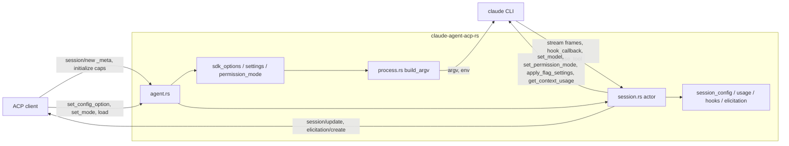

<!--
RULES — read before writing or implementing:
1. FORMAT: Bullets, tables, code, diagrams ONLY — no prose paragraphs
2. REQUIREMENTS: One crisp line each — no verbose descriptions
3. CHECKLIST: Mark items [x] as you complete them — this is your persistent todo list
4. READING TIME: Optimize for fast human scanning — if it's hard to skim, rewrite it
-->

# Plan: rust-parity-fixes

> Port P1-P10 (vibe-station live findings) so the Rust adapter spawns, echoes, reports usage, exposes config and hooks exactly like Node 0.94.0; every fix is proven by a Node-captured corpus case or a named unit test.

## Goal

- Rust spawns `claude` with the same argv/env as Node for the same `session/new|load` params (P1, P2) — proven by a NEW Rust-vs-Node argv equality test (none exists today, see Research R1).
- A live prompt produces no echo chunks (P3), no empty thought chunks (P5), `usage_update` after each result and while streaming (P4), `allow_always` for file tools (P7).
- `session/new|load|resume|fork` return Node's `modes` + `configOptions`; `session/set_config_option|set_mode` work and `config_option_update` is emitted (P6).
- PostToolUse / other hooks are registered and answered, `promptSuggestions` is requested (P8, P9); `session/load` replays history (P10).
- Differential stays green with NO new `JsonPath`; the existing ignores `params.update[sessionUpdate=usage_update]`, `result.modes`, `result.configOptions`, `result.models` are REMOVED (`result.authMethods` removed if it matches).
- Done = 3 phases verified (`bash rust/scripts/rust-gate.sh` ends `==> gate OK`, differential green 3x at each phase boundary) plus the final live matrix.

## Hard constraints (every phase)

- Implementers edit files ONLY with the Write / Edit tools — no `sed -i`, heredoc, redirect or `perl -pi` edits; read with Read.
- G7: only `rust/`, `porting/`, `.vibekit/`, root `.gitignore` may change — NEVER `src/`, `dist/`, `package.json`, `scripts/`, `.github/`, `docs/`, root `*.md`; NEVER touch anything under `/Users/gb/.vibe-station/projects/vibe-station/worktrees/vs-275`.
- G9: `cfg(unix|windows|target_*)` only in `rust/claude-agent-acp-rs/src/process.rs` (so an `is_root()` helper lives there); G10: `agent-client-protocol` stays 2.1.0 (new methods and untyped updates use `UntypedMessage` / `SessionOutbound::RawUpdate`, like `_session/steering`).
- Do NOT bump the upstream pin (stay 0.94.0, `porting/UPSTREAM_VERSION`); `porting/record-real.sh` is human-only — never run it; never run `npm` in the repo root.
- Never print, log or write env VALUES — compare env KEY NAMES only (live driver summaries contain values: print `Object.keys`, never the object).
- Do NOT commit, push, tag, `git stash`; cargo always `--manifest-path rust/Cargo.toml`; filter `grep -E "test result|FAILED"`; success = `test result: ok` / `==> gate OK`.
- `rust/clippy.toml` bans `std::sync::Mutex|RwLock`, `tokio::sync::Mutex|RwLock|broadcast` — state lives in actors / sequential handlers (G5).
- NO new `JsonPath::new` anywhere (`git diff -U0 baf3d5a -- rust | grep '^+' | grep -c 'JsonPath::new'` must print `0`); a divergence visible in a regenerated fixture MUST be ported — if it cannot be, STOP and report (a PARITY row never turns a red differential green).
- Protect `rust/claude-agent-acp-rs/src/turn.rs` hazards (read `.vibekit/feature-plans/pending/claude-acp-rust/review-04-turn.md` and `review-05-turn.md` first): orphan credit consumed BEFORE queue-head promotion (`ensure_active_turn` early return), `owed_trailing_idles` accounting, `had_usage` origin flag, steering lanes (`mark_steered`, `steered_echoes/steered_settle`), held turns. Prefer NO `turn.rs` edit; run `--lib turn` before and after any.
- INV-27: no actor awaits a client or CLI round-trip inline — every new `control.send_request` / client request is spawned and re-enters the actor via a `Command`.
- New tests are `inv_NN_<slug>` with NN from 57 (air-gaps owns 39, 48-56); differential tests `inv_24_<script>`; every test runs under the gate's 180 s timeout (G3).
- Weak-model order inside every phase: pure modules + unit tests FIRST, then wiring, then corpus script + `capture.sh` + differential test TOGETHER; if the Node capture disagrees with an expectation, fix the transcript, never the expectation.
- Dependency (RESOLVED, M8): the WHOLE plan (Phases 1-3) starts only after the air-gaps Phase 2 commit (`git log --oneline | grep -i "air-gaps/root implement phase 2"`); `session_store.rs` / `find_transcripts` are untracked at HEAD baf3d5a, so if the commit is missing STOP and report (Decision 17). `readResumedTail` is self-contained (port of `dist/resumed-session.js`), it only reuses `find_transcripts` if present.
- Transcript-authoring rules for every NEW usage / config / hook / replay transcript: (a) every `assistant` frame carries `parent_tool_use_id:null`, a message `id` and a `model` (Node's `=== null` checks at `acp-agent.js:5432,5731,5829` otherwise skip both the usage snapshot and the consolidated text — probe-verified); (b) every `result` carries `modelUsage` (`{"<model>":{"contextWindow":N,...}}`) — once the assistant names a model a result without `modelUsage` fails the Node prompt with -32603 "Cannot convert undefined or null to object".
- Early stop rule: if a turn ends early the implementer finishes the item in progress (port + script + capture + differential TOGETHER), leaves later items unticked, and a fresh retry resumes from the first unticked box.
- The final live matrix (3.9) is run by the ORCHESTRATOR, not an implementer turn.

## Requirements — the 10 findings, re-verified

| # | Sev | Verified against | Verdict | Phase |
|---|-----|------------------|---------|-------|
| P1 | HIGH | `dist/acp-agent.js:8490-8530` spreads `userProvidedOptions` into the SDK options; SDK `initialize()` maps them to argv (`--betas=`, `--add-dir=`, extraArgs, env); Rust reads only `model`/`permissionMode` (`agent.rs:322`) | CONFIRMED -> PORT | 1 |
| P2 | HIGH | Node adds `--disallowedTools=AskUserQuestion` ONLY when the client lacks `elicitation.form` (`acp-agent.js:8384`); `--permission-mode=<resolved>` ALWAYS (`:8499`); `--allow-dangerously-skip-permissions` when `allowBypass` (`:8362`); Rust passes none (`agent.rs:296-318`) | CONFIRMED -> PORT argv only (vst never sends `elicitation.form`, so Node passes `--disallowedTools=AskUserQuestion`); elicitation DROPPED from scope (M1), Rust keeps the capability constant false, PARITY `pending` | 1 |
| P3 | HIGH | Node `break`s any user frame with `isReplay` that is not a queued turn's echo (`acp-agent.js:5682-5694`); Node's single-text skip (`:5806`) is Node behaviour too; Rust only skips a user frame whose content is ONE text block (`session.rs:953-1000`); Rust maps images to `agent_message_chunk` whatever the role and drops URL images (`map.rs:~607`), Node maps by role and keeps `uri` (`:9994`) | CONFIRMED -> PORT echo suppression AND role-correct image mapping | 1 |
| P4 | MED | Node emits `usage_update` at 4 sites: stream `message_start/delta` (`:5477`), `result` with `cost` (`:5000`), `compact_boundary` (`:4147`), `rate_limit_event` (`:5966`); the consolidated assistant (`:5733`) only RECORDS usage; Rust never | CONFIRMED -> PORT (no ignore change needed: no fixture holds a `usage_update`) | 2 |
| P5 | MED | Node drops thinking blocks with empty text (`acp-agent.js:10007-10019`); Rust emits `""` (`map.rs:603`) | CONFIRMED -> PORT | 1 |
| P6 | MED | Node routes close/delete/fork/list/resume/setMode/setConfigOption (`acp-agent.js:10436-10449`) but NOT `session/set_model` (-32601 in Node too); `session/new` returns `{sessionId,modes,configOptions}` and NO `models` (`:8890`) | CONFIRMED, narrowed: set_model matches Node; close/resume/list/delete/fork = air-gaps Phase 2; remainder PORT | 2 |
| P7 | LOW | Rust ports durable options only for Bash/PowerShell (`permission.rs:140-330`); PARITY row "Durable permission forms Rust does not describe" is `pending`; Node `options/filesystem.js`, `tools.js` | CONFIRMED -> PORT (all but ExitPlanMode) | 1 |
| P8 | LOW | `input:null` and request id are test-normalised (`tests/common/mod.rs:445-505`), not wire-equal; `hooks`/`promptSuggestions` dropped by `inv_39_initialize_matches_node` | PARTLY PORT: `input:null` real (1.9); request id stays (crate-assigned, PARITY); hooks/promptSuggestions = Phase 3 | 1, 3 |
| P9 | VERIFIED WORSE | PostToolUse hook emits a `tool_call_update` with `_meta.claudeCode.toolResponse` for EVERY tool for non-AIR clients (`renderer.js:377-390`), plus Edit/Write final diff; Rust registers no hook so the CLI never calls it | CONFIRMED -> PORT | 3 |
| P10 | INFO | `session/load` replays history through `toAcpNotifications` (`acp-agent.js:6672-7105`), also when the session is already live (`:1583`); Rust replays nothing | PORT (user asked completeness) | 3 |

### Findings NOT in the report (found while re-verifying)

| # | Finding | Handling |
|---|---------|----------|
| X1 | No test compares the Rust adapter's argv with the Node argv fixtures: `inv_25_text_only_argv_and_env` (`tests/process_transport.rs:25`) hand-builds `SpawnOptions`, bypassing `session_spawn_options` | Decision 1, item 1.1 |
| X2 | `base_ignore()` (`tests/differential.rs:257-265`) hides `result.modes/configOptions/models/authMethods` — P6 was invisible to the differential | removed in 2.x |
| X3 | Node IGNORES `_meta.claudeCode.options.permissionMode` (overwritten by the settings-resolved mode, `acp-agent.js:8499`); Rust forwards it and `tests/agent.rs:161` asserts it | Decision 3 + Open question 3 |
| X4 | Spawn mode/bypass depend on `settings.json` `permissions.defaultMode` / `disableBypassPermissionsMode` and on root/`IS_SANDBOX` (`permissions/modes.js`) | Decision 3 |
| X5 | Existing fixtures contain NO `usage_update` (corpus assistants lack `usage`), so even a removed ignore would test nothing until new transcripts carry usage | Decision 9 |
| X6 | `session/new` modes list differs (Rust: "Plan Mode", `dontAsk`, no `auto`; Node: Manual/Accept edits/Plan/Auto/Bypass permissions) | Phase 2 |
| X7 | `mcpServers` of `session/new` are ignored by Rust (Node merges them into `--mcp-config`) — vst sent `[]`, other clients may not | Out of scope (PARITY B2 row stays), Open question 5 |
| X8 | `session/load` on an already-live session also replays in Node (`acp-agent.js:1583`) | Phase 3 item 3.5 |
| X9 | Rust DROPS all consolidated assistant text/thinking (`session.rs` HEAD ~1124-1144); Node forwards `unstreamedRemainder` (`acp-agent.js:519,5832-5836`) — text the stream did not cover | Decision 18, item 1.7 |
| X10 | A `result` without `modelUsage` fails the Node prompt (-32603) once the assistant names a model | transcript-authoring rule |
| X11 | `options.resume` of `session/new` (`acp-agent.js:1474`) is not handled; `options.systemPrompt` / `settingSources` override Node's defaults (spread at `:8476`); `options.model` does NOT set `currentModelId` (`session-model.js:390`, only env `ANTHROPIC_MODEL` / settings `model` do) | Decision 19, items 1.3 / 2.6 |
| X12 | TaskCreated/TaskCompleted hooks publish a `plan` update in Node; Rust has no task state | Decision 12 (ported in Phase 3) |

## Change Map

```
rust/claude-agent-acp-rs/src/
  sdk_options.rs         + _meta.claudeCode.options -> typed spawn inputs
  settings.rs            + settings.json resolver (mode, bypass, model, effort)
  permission_mode.rs     + resolve/clamp/aliases/ALLOW_BYPASS
  permission_options.rs  + Node options.js port (file/web/skill/generic)
  usage.rs               + usage_update state + context window
  session_config.rs      + modes, models, configOptions, set_* logic
  hooks.rs               + hook registry + callback handlers
  elicitation.rs         + AskUserQuestion form elicitation
  transcript.rs          + getSessionMessages port + replay
  process.rs             ~ SpawnOptions, build_argv, is_root
  agent.rs               ~ options, responses, new arms
  session.rs             ~ echo drop, usage, hooks, config cmds
  session_ext.rs         ~ UsageState, SessionConfig, HookRegistry
  control.rs             ~ initialize hooks/promptSuggestions
  map.rs permission.rs   ~ thought filter, outcome ids, commands input
rust/acp-recorder/src/script.rs recorder.rs   ~ client_capabilities, elicitation reply
rust/fake-claude/src/lib.rs                   ~ env allowlist
porting/corpus + fixtures                     + ~16 scripts
porting/PARITY.md INVARIANTS.md               ~ rows
```

| Today | After this plan |
|-------|-----------------|
| `betas/extraArgs/env/...` in `_meta.claudeCode.options` dropped | mapped to argv/env in the SDK's order |
| argv lacks `--disallowedTools`, `--permission-mode`, `--allow-dangerously-skip-permissions` | identical to Node's fixtures, enforced by an argv equality test |
| image prompt echoed as assistant chunk | no echo chunks for any live prompt |
| `usage_update` never sent, ignored by the differential | sent at 5 sites, compared byte-for-byte |
| `session/new` `configOptions: []`, fake mode list | Node's mode + model (+effort/agent/fast) options |
| `set_config_option`, `set_mode` -> -32601 | working, `config_option_update` emitted |
| Edit/Write/WebFetch/Skill/MCP offer Yes/No only | `allow_always` options like Node |
| no hooks registered | PostToolUse etc. registered, answered, `toolResponse` meta + final diff |
| `session/load` silent | history replayed as user/assistant chunks |

## Research (evidence cited by the Decisions)

- R1 argv: every `porting/fixtures/*.argv.json` is Node-captured; 32 of 34 share one md5 and contain `--disallowedTools=AskUserQuestion`, `--permission-mode=default`, `--allow-dangerously-skip-permissions`; the only reader is `inv_25` with hand-built options (`tests/process_transport.rs:34-47`).
- R2 SDK argv order (`rust/target/upstream/0.94.0/node_modules/@anthropic-ai/claude-agent-sdk/sdk.mjs`, grep `additionalDirectories:e=\[\]`): thinking, `--effort`, `--max-turns`, `--max-budget-usd`, `--model`, `--agent`, `--betas=a,b`, `--permission-prompt-tool=stdio`, `--resume`, `--allowedTools`, `--disallowedTools`, `--tools`, `--mcp-config`, `--setting-sources`, `--strict-mcp-config`, `--permission-mode`, `--allow-dangerously-skip-permissions`, `--fallback-model`, `--include-hook-events`, `--include-partial-messages`, `--project-config-root`, `--add-dir=<d>` each, `--session-id`, then extraArgs in insertion order. ALSO audit (missing from the list above): `--no-session-persistence` (`persistSession:false`), `--settings` (extraArgs `settings`), `--fork-session`, `--resume-session-at`, and the `skills` option which appends `Skill(name)` entries to `--allowedTools`; each is either ported in `sdk_options.rs` or listed in PARITY, and the argv equality test covers the ported ones.
- R3 extraArgs encoding: `null` value -> one token `--key`; otherwise `--key`,`value` (or `--key=value` when the value starts with `-`); the adapter appends `"replay-user-messages": ""` AFTER the user keys, so `["--chrome", ..., "--replay-user-messages", ""]` (`acp-agent.js:8521`).
- R4 env: `{...process.env, ...options.env, ...providerEnv, CLAUDE_CODE_EMIT_SESSION_STATE_EVENTS:"1"}` (`acp-agent.js:8433-8444`); the SDK sets `CLAUDE_CODE_ENTRYPOINT` (when absent), deletes `NODE_OPTIONS`.
- R5 AskUserQuestion: `disallowedTools = elicitation.form ? [] : ["AskUserQuestion"]` (`acp-agent.js:8384`), user `disallowedTools` first; with form support the question is a `createElicitation` form (`:7582,7743`, `elicitation.js:111-275`).
- R6 mode: `resolveInitialPermissionMode` (explicit > resumed transcript tail > settings `permissions.defaultMode`), aliases and bypass clamp in `permissions/modes.js`; `allowBypass = ALLOW_BYPASS && settings.disableBypassPermissionsMode !== "disable" && options.allowDangerouslySkipPermissions !== false`; `ALLOW_BYPASS = !root || IS_SANDBOX`.
- R7 echo: user frames: `findUnsettledTurn(uuid)` promotes a queued turn, then `isReplay` frames `break` (`acp-agent.js:5640-5694`); only non-replay user frames (tool results) reach `toAcpNotifications`.
- R8 usage (4 emission sites, see P4 row): state `lastAssistantUsage/TotalUsage/Model` per turn, reset in `resetTurnScratch()` (`:2943`, called at turn activation `:3015`); `used = input+output+cache_read+cache_creation`; `size` = `session.contextWindowSize` (seed `DEFAULT_CONTEXT_WINDOW=200000`, `\b1m\b` heuristic, cache from `result.modelUsage[].contextWindow`, background `get_context_usage {detail:"summary"}` `rawMaxTokens`); result update carries `cost{amount,currency:"USD"}` and `_meta{"_claude/origin"}`; every update carries `_meta["_claude/model"]` when a model is known (`:2925`).
- R9 session/new response = `{sessionId, modes, configOptions}` (`:8890`); config options = `[mode, model, effort?, fast_mode?, agent?]` (`buildConfigOptions`, `:9562`); mode catalog `session-mode.js:buildAvailableModes` (AIR adds `_meta` kind); model option `session-model.js:buildModelConfigOption`; models come from the CLI `initialize` response `models` (`InitializeInfo.models`, `control.rs:100`).
- R10 set_*: `setSessionConfigOption` validates, `set_permission_mode {mode}` / `set_model {model}` / `apply_flag_settings {settings}` control requests, returns `{configOptions}` WITHOUT `config_option_update`; `setSessionMode` returns `{}` and sends `current_mode_update` (only if clamped) + `config_option_update`; `updateConfigOption` is the `config_option_update` sender (`:6647-6760`, `:7844`, `session-mode.js:150-165`).
- R11 hooks: initialize `hooks` = `{PostToolUse:[{hookCallbackIds:["hook_0"]}],PostModelSwitch:[hook_1],PostCompact:[hook_2],TaskCreated:[hook_3],TaskCompleted:[hook_4]}` plus `promptSuggestions:true` (`porting/fixtures/initialize.json`); the CLI calls `control_request {subtype:"hook_callback", callback_id, input, tool_use_id}`; the SDK answers `control_response {subtype:"success", request_id, response:<hook output>}` with `{continue:true}` (`tools.js:294-312`).
- R12 PostToolUse: registered at the first sight of a tool_use (not Task*/TodoWrite) with a `renderer.hookResult` closure; fires `tool_call_update{_meta.claudeCode{toolResponse,toolName},toolCallId}` (+ Edit/Write `content`/`locations` from `structuredPatch`, `reporters/file-edit.js:102-123`); callbacks live 30 s after the tool_result (`tools.js:278-285`).
- R13 replay: `getSessionMessages(sessionId)` (SDK) -> `{type,uuid,message,parent_tool_use_id}` list; per message the same `toAcpNotifications` with `registerHooks:false, replay:true`; skips `isReplayHiddenMetaMessage`, synthetic login, task-notification records; strips local-command metadata; `loadSession` replays BEFORE the response, `available_commands_update` after (`:1577-1597`).
- R14 permission options: `options.js` switch -> filesystem (`withOptionalUpdate`: `allow_always` only when the CLI sent a session-scoped changeSet that `fileSessionLabel` can describe), WebFetch/Skill/generic (`withGeneratedUpdate`: ALWAYS an `allow_always` with a locally generated rule), MCP (changeSet only), ExitPlanMode (modes + clear-context), declineFirst order (`options.js:14-30`); selection effects `permissions/effects.js`.
- R15 live env: `command -v claude bun node` all present on this machine (`~/.local/bin/claude`, `/opt/homebrew/bin/bun`); the driver wraps `claude` to log argv + env.

## Architecture Diagram



## System Boundaries

| Boundary | Contract (new or changed) |
|----------|---------------------------|
| ACP client -> agent | `session/new\|load` `_meta.claudeCode.options` keys honoured: `model, betas:string[], extraArgs:{[k]:string\|null}, env:{[k]:string}, allowedTools, disallowedTools, tools, effort, maxTurns, maxBudgetUsd, fallbackModel, agent, includeHookEvents, additionalDirectories, persistSession, strictMcpConfig, promptSuggestions:bool, allowDangerouslySkipPermissions:bool`; `additionalDirectories:string[]` (spec field) / `_meta.additionalRoots` |
| ACP client -> agent | `session/set_config_option {sessionId,configId:"mode"\|"model"\|"effort"\|"agent"\|"fast_mode",value}` -> `{configOptions}`; errors plain `Error` (-32603) `Session not found`, `Unknown config option: <id>`, `Invalid value for config option <id>: <v>`; `session/set_mode {sessionId,modeId}` -> `{}`, error `Invalid Mode` / `Mode <id> is not available in this session`; `session/set_model` stays -32601 (Node parity) |
| agent -> ACP client | `session/update` `usage_update {used:int,size:int,cost?:{amount:number,currency:"USD"},_meta{"_claude/model"?,"_claude/origin"?,"_claude/rateLimit"?}}`; `config_option_update {configOptions}`; `current_mode_update {currentModeId}`; `tool_call_update` with `_meta.claudeCode.toolResponse`; `session_info_update._meta.promptSuggestions` (AIR only); replay chunks on `session/load` |
| agent -> `claude` | argv (R2/R3), env (R4); control requests `set_permission_mode{mode}`, `set_model{model}`, `apply_flag_settings{settings}`, `get_context_usage{detail:"summary"}`; initialize `hooks`, `promptSuggestions:true`; answers `hook_callback` |
| `claude` -> agent | `control_request {subtype:"hook_callback",callback_id,input,tool_use_id}` -> `control_response success {response:{continue:true}}` (unknown callback id -> `{subtype:"error"}`) |
| fake-claude | emits `control_request` hook_callback frames with a FIXED `request_id` (e.g. `"hk1"`) and the next step `expect`s `{"type":"control_response","response":{"request_id":"hk1"}}`; env allowlist gains `CLAUDE_CODE_ARTIFACT` |
| recorder | `Step::Initialize.client_capabilities` (merged into `clientCapabilities`; used only to prove Node's argv/initialize for `elicitation.form` clients as a PARITY-documented divergence, no elicitation reply) |

## Key Decisions

#### Decision 1: Rust-vs-Node argv equality test (root cause of P1/P2)
- **Decision:** a new differential test runs the Rust adapter under the recorder with `FAKE_CLAUDE_ARGV_OUT`, normalises it like `capture.sh normalize_object ... argv`, and asserts equality with `porting/fixtures/<name>.argv.json` for EVERY corpus script that has one.
- **Rationale:** the fixtures always contained the flags; only the hand-built-options test read them (R1).
- **Where:** `rust/claude-agent-acp-rs/tests/differential.rs` (new `inv_57_argv_matches_node`), `tests/common/mod.rs` (`run_recorder_with_argv`), `rust/acp-recorder` passes env through.
- Item 1.1 lands this test FIRST and it must go red on `--disallowedTools` for the right reason before 1.4 turns it green.

#### Decision 2: `sdk_options.rs` is a pure typed mapper, SDK order
- **Decision:** `claude_options(params:&Value)->ClaudeOptions` parses the keys listed in System Boundaries; `SpawnOptions` gets matching fields; `build_argv` emits them in R2 order, extraArgs per R3, env per R4 (user env overrides inherited, `CLAUDE_CODE_EMIT_SESSION_STATE_EVENTS` last).
- **Rationale:** exact argv order is asserted by Decision 1; unknown keys (callbacks, `hooks`, `mcpServers`, `plugins`, `agents`, `sandbox`, `settings`, `thinking`) are ignored and listed in PARITY (`pending`, consequence stated).
- `settingSources`, `systemPrompt`-style keys in `options` override the adapter defaults in Node (spread at `acp-agent.js:8476`, before cwd/env/mcpServers/permissionMode/extraArgs/disallowedTools/tools which win): `sdk_options` honours a user `settingSources` (`--setting-sources=`) and the 1.4 corpus verifies it; `systemPrompt` was ported by air-gaps Phase 1 (verify only).
- **Where:** `rust/claude-agent-acp-rs/src/sdk_options.rs` (new), `process.rs:112-242` (`SpawnOptions`, `build_argv`, `apply_claude_env` at `:445`), `agent.rs:294-340` (`session_spawn_options`, `options_from_meta` replaced).
- `disallowedTools` = user list THEN `AskUserQuestion` (Decision 4); `tools` array -> `--tools=a,b`, absent -> `--tools=default` (unchanged).

#### Decision 3: mode, bypass and settings are resolved like Node
- **Decision:** `settings.rs` reads user (`$CLAUDE_CONFIG_DIR` else `~/.claude/settings.json`), project and local (`<cwd>/.claude/settings.json|settings.local.json`) and managed (`/Library/Application Support/ClaudeCode/managed-settings.json`, `/etc/claude-code/...`) JSON with the SDK's `resolveSettings` merge and `filterEscalatingDefaultMode` (read both in `sdk.mjs`); `permission_mode.rs` ports `resolvePermissionMode` + aliases + `resolveInitialPermissionMode`; `--permission-mode=` is ALWAYS emitted; `--allow-dangerously-skip-permissions` iff `allowBypass`; `_meta...options.permissionMode` is IGNORED (X3).
- **Rationale:** R6; the live argv had `--permission-mode=default` on Node.
- **Where:** `src/settings.rs`, `src/permission_mode.rs` (new), `process.rs` (`pub fn is_root()` AND `pub fn managed_settings_path()` per OS — the ONLY cfg sites, G9), `agent.rs`, `tests/agent.rs:107-170` (the `acceptEdits` meta assertion is replaced by a settings-driven one).
- Resumed mode (`readResumedTail`) is added in Phase 2 with `session_store.rs`; Phase 1 uses explicit=None, resumed=None.
- Verify X3 with a captured argv (`spawn-vst-meta` carries `options.permissionMode:"plan"`); if Node's argv shows `plan`, revert the "ignored" rule.

#### Decision 4: AskUserQuestion is always disallowed (elicitation out of scope)
- **Decision:** `--disallowedTools=<user...>,AskUserQuestion` is always emitted; the elicitation capability constant stays `false`; no elicitation is implemented.
- **Rationale:** vst never sends `elicitation.form` (driver `CAPS`, `live-acp-scenarios.mjs:~132`), so Node passes the flag for vst and P2 is argv-only (M1); a form-capable client gets the safe plain-text behaviour (PARITY `pending`, consequence: no AskUserQuestion form, MCP elicitation, refusal dialog).
- **Where:** `src/sdk_options.rs` (`disallowed_tools`), `porting/PARITY.md`. If ever implemented the request method is `elicitation/create` (`methods.client.elicitation.create`, `acp-agent.js:976`).

#### Decision 5: user echo drop rule (P3)
- **Decision:** in the `"user"` arm skip mapping when the frame has `isReplay:true` (after `machine.on_echo`); the existing single-text-block / string skip STAYS as it is Node behaviour too (`acp-agent.js:5806`); additionally `map_block` maps an `image` block by ROLE (`agent_message_chunk` for assistant, `user_message_chunk` for user) and keeps a URL image's `uri` (Node `:9994`), so replay (Phase 3) is right too.
- **Rationale:** R7; fixes the image + multi-block echo without touching `turn.rs`.
- **Where:** `session.rs:953-1000` (HEAD) — the `is_echo` computation; `map.rs:~607` image arm.
- Regression: script `image-prompt-echo` (user content `[image,text]` echoed with `isReplay:true`) captured from Node.

#### Decision 6: thought chunks (P5)
- **Decision:** `thinking`/`thinking_delta` produce an update only when the text is non-empty.
- **Where:** `map.rs:603` (consolidated) and the stream path `map.rs:795-800`; unit `inv_59_empty_thinking_dropped`, script `thinking-empty`.

#### Decision 7: `permission_options.rs` replaces `durable_bash` (P7)
- **Decision:** port `permissions/options.js` + `options/{filesystem,shell,tools,shared}.js` (all tools except ExitPlanMode's context-reset variants), the declineFirst order (`defaultToNo`) and the selection effects for Skill / WebFetch / generated rules (`effects.js`); option ids stay Node's (`allow-once`, `allow-with-updates`, `allow-skill-exact`, `allow-skill-prefix`, `reject`).
- **Rationale:** PARITY rows 189-190 are `pending`; R14. ExitPlanMode stays Yes/No: its `clear context` options need `pendingExitPlanContextReset` (fresh-query hand-off) = turn-machine work (Out of scope, Open question 4).
- **Where:** `src/permission_options.rs` (new), `permission.rs:51-355` (`map_outcome`, `build_request_permission`, `durable_bash` call site `session.rs:1222`), `session.rs` can_use_tool handler.
- File tools need the CLI's `permission_suggestions` (session `setMode acceptEdits` / `addRules Edit` / `addDirectories`): the corpus transcripts carry them verbatim; capture a real Edit ask from the live run to confirm (Phase 1 live step).

#### Decision 8: `available_commands_update` is raw JSON with `input:null` (P8)
- **Decision:** emit through `SessionOutbound::RawUpdate` so `input` is `null` when absent (Node), then delete `normalize_available_commands_input` from the test normaliser.
- **Where:** `map.rs:668` (`map_commands_changed`), `agent.rs:~680,~725` (proactive update), `session.rs` commands_changed arm, `tests/common/mod.rs:445-475`.
- The permission request id normaliser (`normalize_request_permission_id`) STAYS: the pinned crate assigns the id; PARITY row says equivalent on the wire.

#### Decision 9: usage state lives in `SessionExt`, emission in `session.rs` (P4)
- **Decision:** `usage.rs` holds pure functions (`total_tokens`, `snapshot`, `infer_window`, `matching_model_usage`, update builders); `UsageState{last_usage,last_total,last_model,context_window,authoritative,used}` lives in `SessionExt`; frames feed it in `handle_session_frame` arms `stream_event` (parent null, `message_start`/`message_delta`: emits), `assistant` (parent `null` exactly, model != `<synthetic>`: only RECORDS usage, no emit), `result` (emits with `cost`), `system/compact_boundary` (emits), `rate_limit_event` (emits) = 4 emission sites; `last_*` reset where the machine ACTIVATES a turn (mirror `resetTurnScratch`, R8). `turn.rs` is not edited.
- **Rationale:** the machine already owns `accumulated_usage` for the response; the `usage_update` stream is a separate concern (INV: `had_usage` untouched).
- **Where:** `src/usage.rs` (new), `session_ext.rs`, `session.rs:994-1130` (HEAD arms), `agent.rs` (background `get_context_usage {detail:"summary"}` after register, spawned, INV-27).
- RESOLVED (OQ10): existing fixtures have no `usage_update` because corpus assistant frames lack `parent_tool_use_id:null` (and `id`/`model`), so Node's `=== null` checks skip the snapshot; new transcripts follow the authoring rules in Hard constraints (`parent_tool_use_id:null`, `id`, `model`, `usage`, stream events, `result.total_cost_usd` and `modelUsage{<model>:{contextWindow}}`); Rust must also tolerate frames lacking them like Node (emit nothing, no panic).

#### Decision 10: config state is one actor-owned struct (P6)
- **Decision:** `SessionConfig{modes, models, model_infos, config_options, current_agent, effort_pinned, applied_effort, fast_mode, pre_plan_mode}` in `SessionExt`; `Command::SetConfigOption{config_id,value,reply}` / `Command::SetMode{mode_id,reply}` handled by the actor: validate, spawn the CLI control request, re-enter with `Command::ConfigApplied{...}` which updates state and replies; `config_option_update` sent via `RawUpdate` exactly where Node calls `updateConfigOption` (R10).
- **Rationale:** INV-27; one owner for the mutable option list.
- **Where:** `src/session_config.rs` (new, pure builders: `build_available_modes`, `get_available_models`, `build_model_option`, `build_effort_option`, `resolve_model_preference`, `match_resumed_model`, `versioned_display_name`), `session.rs` Command enum (HEAD `:156`), `agent.rs` arms `session/set_config_option`, `session/set_mode`, shared `session_response()` (HEAD `:154`) which air-gaps `session/resume|fork` also call.
- Settings-dependent parts of `getAvailableModels` (`availableModels` allowlist, `modelOverrides`, managed `deniedModels`, gateway narrowing) are NOT ported: PARITY `pending` with consequence (picker shows the CLI list unfiltered).
- `session/set_model` is not routed in Node 0.94.0 (`acp-agent.js:10436-10449`): it stays -32601 and PARITY says "matches".

#### Decision 11: air-gaps overlap (explicit split)
- **Decision:** this plan does NOT implement `session/close|resume|list|delete|fork`, `session_store.rs`, `quota.rs`, `auth_status`, `logout/providers` (air-gaps Phase 2); it only (a) replaces the body of the shared `session_response()` they call, (b) adds `additionalDirectories` handling to the shared spawn path, (c) reuses `session_store::find_transcripts` for the resumed model/mode tail and for replay.
- **Rationale:** avoids duplicate methods; files `agent.rs`, `session.rs`, `lib.rs` are also edited by air-gaps (Phase 2 now, Phase 3 later), so this plan starts only after the Phase 2 commit.
- **Where:** `src/session_store.rs` (read-only here), `agent.rs`.
- air-gaps Phase 3 (goal, sessionFailure, file-change report, `/mcp`) stays OUT: AIR-only, not vst-relevant; it is the next follow-up after this plan (rebase it onto this plan's `SessionExt` fields).

#### Decision 12: hooks (P9) — registry in the actor, answered via `Command::HookCallback`
- **Decision:** `control.rs` initialize sends the five-hook payload (`hook_0..hook_4` order of R11) + `promptSuggestions:true` unless `options.promptSuggestions==false`; `build_permission_request_handler` (HEAD `session.rs:439`) routes `subtype:"hook_callback"` to `Command::HookCallback{callback_id,input,tool_use_id,reply}`; the actor answers `{continue:true}` after running the handler: PostToolUse (R12), PostModelSwitch -> model sync via Phase 2 `apply_config_option`, PostCompact -> no-op continue, TaskCreated/TaskCompleted -> PORTED (X12/OQ6): `createTaskHook` (`tools.js:324-350`) populates a `task_state` map in `SessionExt` and publishes a `plan` update (`publishTaskPlan`, `acp-agent.js:~2528`), together with `applyTaskCreate/List/Update` at Task* tool_result time (`tools.js` task helpers) so TaskUpdate finds the subject.
- Field tracker (M3): Node keeps the tool-call field-tracker entry until the hook fires (`field-tracker.js` `finishResult(id, hookPending)` / `finishHook`), so the hook `content` is de-duplicated; Rust currently clears trackers at the result — the hook item changes that to "keep until the hook response (or the 30 s retention expiry)", with unit `inv_64_tracker_kept_until_hook`.
- **Rationale:** a hook the adapter registers but does not answer would stall the CLI; unknown ids get `{subtype:"error"}`.
- **Where:** `src/hooks.rs` (new: `HookRegistry{callbacks:HashMap<tool_use_id,Entry{tool_name,parent,completed_at}>}`, retention 30 s checked lazily — no timers), `control.rs:116-160`, `session.rs`, `map.rs` (register at first `tool_use`, not `Task*`/`TodoWrite`).
- The PostToolUse update goes through the same stamping as streamed updates (`parentToolUseId`); order relative to the `tool_result` completion is taken from a REAL CLI capture (Phase 3.0 live tee) and recorded as two corpus scripts if both orders occur.

#### Decision 13: elicitation is OUT of scope (M1, was P2b)
- **Decision:** no AskUserQuestion / MCP / refusal-fallback elicitation; PARITY `pending` row with consequence "clients that declare `elicitation.form` get no elicitation and AskUserQuestion stays disabled".
- **Rationale:** vst never declares `elicitation.form`; Decision 4.
- **Where:** `porting/PARITY.md` only.

#### Decision 14: replay (P10)
- **Decision:** `transcript.rs` ports the SDK's `getSessionMessages` (read it in `sdk.mjs`: chain from the last leaf by `parentUuid`, compaction boundaries, `isSidechain`) over `session_store::find_transcripts`; replay maps each message with the existing consolidated mapper in a `replay` flavour (no hooks, `user` role -> `user_message_chunk`), applying R13 skips; AIR extras (native subagent replay, usage-limit failures, `loadReplayEnd`) stay `pending`; updates are sent BEFORE the `session/load` response and `available_commands_update` after it; `session/resume` does not replay.
- Ordering (M6): on a fresh load Node runs the replay alongside the CLI start (`acp-agent.js:1495-1525`), so fixture frame order can flake; the replay scripts pace the fake's `initialize` reply with `sleep_ms` in the transcript so the replay always finishes first, and the Rust side sends replay before the response regardless.
- **Where:** `src/transcript.rs` (new), `map.rs` (replay flavour), `agent.rs` `session/load` arm.

#### Decision 18: consolidated assistant text is forwarded as `unstreamedRemainder` (B1, X9)
- **Decision:** port `unstreamedRemainder(blocks, streamedBlocks)` (`acp-agent.js:519`, use at `:5829-5840`): for a top-level assistant frame (`parent_tool_use_id === null`, or subagent text when forwarded) forward only the text/thinking blocks the stream did not already cover; tool_use blocks keep the existing path.
- **STRICT-NULL rule:** Node's gate is `message.parent_tool_use_id === null` (`:5432,5731,5829`), so a frame whose field is MISSING counts as nested and its text/thinking are DROPPED; the new code uses its own `is_strict_top_level(frame)` (field present AND `null`) and must NOT reuse Rust's existing `top_level` helper (missing = top-level there; reusing it would turn ~30 fixtures red because most corpus assistants lack the field). Unit `inv_68_missing_parent_field_emits_nothing` (field missing -> nothing) vs `inv_68_explicit_null_emits_remainder`.
- **After-cancel rule:** the remainder is NOT emitted once the session is cancelled / the stopped-work window is open (Node `session.cancelled` guard and `dropsStoppedWorkOutput`, `acp-agent.js:~5695-5712`); unit `inv_68_no_remainder_after_cancel` (cancel, then a late consolidated assistant -> nothing; a new prompt's activation clears the flag as in Node).
- **Rationale:** Rust drops all consolidated text/thinking today; the Node probe with `parent_tool_use_id:null`, `id`, `model` emits `agent_message_chunk "Hello there"`.
- **Hazards:** `emitted_assistant_text` (session.rs actor flag, cleared only for non-autonomous results — INV-29 result-text fallback must still fire when NOTHING was emitted), orphan-before-head, `owed_trailing_idles`, `had_usage`; `turn.rs` stays untouched, the streamed-block record lives in `SessionExt`/`MapState`, cleared where Node clears it (`:5429`, consumption by the consolidated message).
- **Where:** `session.rs:1109-1150` (HEAD `"stream_event" | "assistant"` arm), `map.rs` (`map_consolidated` text/thinking), `session_ext.rs`; units `inv_68_unstreamed_remainder_*` (full stream covers it, partial stream, none, thinking, subagent), `inv_68_result_text_fallback_still_fires`, scripts `consolidated-text` (no stream events) and `consolidated-text-partial-stream`; run `--lib turn` before and after.

#### Decision 19: `_meta.claudeCode.options` extras (M5)
- **Decision:** `options.resume` on `session/new` (`acp-agent.js:1474`) is ported as `--resume=<id>` without `--session-id` when `sdk_options` sees it (the response sessionId follows Node: `publicSessionId` rule read at `:8644`), else PARITY `pending` with a precise reason; `options.model` selects the CLI `--model` only and does NOT set `currentModelId` (Node: only env `ANTHROPIC_MODEL` or settings `model`, `session-model.js:390`) — unit `inv_62_options_model_does_not_pick_current`; `settingSources` override per Decision 2.
- **Where:** `src/sdk_options.rs`, `src/session_config.rs`, `agent.rs`.

#### Decision 15: live verification policy
- **Decision:** every HIGH item (P1, P2, P3) has an explicit live step with the vs-275 driver against real `claude` (model `haiku`, one to three scenarios) and a final matrix in 3.9; each compares Rust against Node-under-bun, printing argv, env KEY NAMES and update shapes only.
- **Where:** `/Users/gb/.vibe-station/projects/vibe-station/worktrees/vs-275/scripts/parity/live-acp-scenarios.mjs` (run, never edit); outputs under the scratchpad.
- If `claude` or `bun` is missing (`command -v claude bun`), the step is recorded as `LIVE-SKIPPED: <tool> missing` in the phase report and in a PARITY row; the corpus proof still gates the phase — never fake a live result.

#### Decision 16: oracle capture rules
- **Decision:** scripts that need settings use `seed_files` (air-gaps infra) with `$CWD` paths; scripts that need client capabilities use `Step::Initialize.client_capabilities` (new, additive, serde default); env names added to the fake allowlist are KEY NAMES only.
- **Where:** `rust/acp-recorder/src/script.rs:30-37`, `recorder.rs`, `rust/fake-claude/src/lib.rs:150`.

#### Decision 17: ordering with the in-flight air-gaps work
- **Decision:** the WHOLE plan starts after the air-gaps Phase 2 commit lands (it edits `agent.rs`, `session.rs`, `lib.rs`; `session_store.rs` is untracked at HEAD); every phase starts with `git diff --stat` + `git log -3` to re-base line references (lines below are HEAD baf3d5a).
- **Where:** orchestration only.

#### Phase 1 deviations
- **Live run env keys comparison (1.9 / 1.T8):** `live-acp-scenarios.mjs` against real `claude` (model `haiku`) for `vst_meta_argv`, `ask_user`, and `image` verified that `argv` is identical token-for-token between Rust and Node (`bun094`), `AskUserQuestion` tool calls = 0 on both, `agent_message_chunk` with `content.type=="image"` = 0 on both, and `user_message_chunk` = 0 on both. The only difference in environment variable key names is that Node sets `CLAUDE_AGENT_SDK_VERSION` (0.3.303 set by `@anthropic-ai/claude-agent-sdk`), which per research S-3 is scheduled for Phase 2 (`CLI, Ph2 (set it + extend ARGV_ENV_ALLOWLIST, OQ-6)`).
- **Host environment sensitivity:** tests were host-env sensitive via ARGV_ENV_ALLOWLIST; harness now scrubs env.
- **Review follow-up deviations (1.11):** (1) `--effort=value` is emitted as a single token; verified against Node via `spawn-effort`. (2) `extraArgs` non-null values convert via String(v) and apply len>1 for `--key=val` (single dash `"-"` emits two tokens `"--key", "-"`). (3) `params.additionalDirectories` is mapped directly to `--add-dir`; verified via `spawn-additional-directories`. (4) `CLAUDE_CODE_ENTRYPOINT` and `CLAUDE_CODE_SDK_READS_SESSION_STATE` are set only when absent from parent/user env. (5) `IS_SANDBOX=""` is falsy (matching Node `!!process.env.IS_SANDBOX`). (6) `tests/agent.rs` uses `.claude/settings.local.json` under cwd rather than setting process-wide `CLAUDE_CONFIG_DIR`. (7) `stopped_work` is cleared on `TurnEvent::Activated` in `settle_events`. (8) uuid-matched echoes without `isReplay` are dropped.

#### Phase 2 deviations
- **Unhandled-method error shape (2.5 / `config-set-model-rpc`, P6):** Node's SDK router answers any unrouted request with `-32601 "\"Method not found\": <m>"` and `data {method}` (`@agentclientprotocol/sdk/dist/core/jsonrpc.js` `RequestError.methodNotFound`); the Rust `agent.rs` `_ =>` fallthrough now mirrors that shape (previously `"Method not found"` with `data` a plain string). This is the generic not-found path, so it applies to every unhandled method, and to `session/set_model` (Node 0.94.0 does not route it) — live-verified against bun in item 2.9.
- **Agent picker / fast-mode config options (2.7):** left unported — the fake-claude `initialize` supplies `agents:[]` and models without `supportsFastMode`, so no Node capture is reproducible and the STOP rule defers to PARITY `pending` (consequence in PARITY section E).
- **Follow-up (d) model-row resume ordering:** recorded PARITY `pending` (see 2.x follow-ups / PARITY section E); the fix would edit the hazardous `turn.rs` `advance_model_reading`/`ensure_active_turn` ordering with no safe isolated unit test.
- **Live `usage_update` shape counts (2.9):** `updateShape` counts for `usage_update` are not byte-identical in the live run — Node emits extra `usage_update`s from the real CLI's `rate_limit_event` and a different stream-interleave (`_claude/rateLimit` meta), which the deterministic synthetic corpus does not exercise; the 4 corpus sites pass byte-for-byte (2.2).
- **`_meta.claudeCode.options.resume` response sessionId (2.3, Decision 19):** on `session/new` with `options.resume`, the response `sessionId` follows Node's `publicSessionId` rule (the returned id is the resumed id read per `:8644`), verified via `spawn-options-resume`.
- **`in_process` smoke test against fake-claude (12.T4 / Problem 1):** When `ANTHROPIC_MODEL` is set in the environment, Phase 2's `get_available_models` resolves a model preference and emits a `set_model` control request to the CLI at session creation (matching Node's `session-model.js`). Because `tests/shutdown.rs` replayed `text-only.transcript.jsonl` which lacked a `set_model` step, `fake-claude` closed the control channel. Fixed in `tests/shutdown.rs` by inserting a `set_model` expected step into the replay transcript and setting `ANTHROPIC_MODEL=sonnet`, making the test deterministic across host environments without weakening the adapter.
- **Differential ignore mechanics self-test (MINOR e):** The self-test in `tests/differential.rs` uses `std::str::FromStr::from_str` to test the harness ignore-matching mechanics against a synthetic update type (`params.update[sessionUpdate=synthetic_test_update]`). This self-test tests the framework's own ignore machinery; the real differential ignore list `base_ignore()` contains 0 entries and 0 `JsonPath::new` calls (`git diff -U0 455c146 | grep '^+' | grep -c JsonPath::new` is 0).
- **Live run commands and SAME/DIFF comparisons (2.9 / 2.T8):** Ran `live-acp-scenarios.mjs` against real `claude` (model `haiku`) for `model`, `plain`, and `edit_diff` with `--label rust` and `--label bun094`:
  Commands:
  - `node scripts/parity/live-acp-scenarios.mjs --scenario model --label rust`
  - `node scripts/parity/live-acp-scenarios.mjs --scenario model --label bun094`
  - `node scripts/parity/live-acp-scenarios.mjs --scenario plain --label rust`
  - `node scripts/parity/live-acp-scenarios.mjs --scenario plain --label bun094`
  - `node scripts/parity/live-acp-scenarios.mjs --scenario edit_diff --label rust`
  - `node scripts/parity/live-acp-scenarios.mjs --scenario edit_diff --label bun094`
  Results (KEY NAMES only, no env values):
  - `sessionNew.configOptions` ids: `mode, model, effort` (SAME)
  - `modes`: `default, acceptEdits, plan, auto, bypassPermissions` (SAME)
  - `config_option_update`: identical (SAME)
  - `set_config_option model sonnet/haiku`: returns identical `{configOptions}` (SAME)
  - `set_mode default`: identical (SAME)
  - `session/set_model`: returns identical `-32601 "\"Method not found\": session/set_model"` with `data {method}` (SAME)
  - `claudeSpawns` argv: identical tokens (SAME)
  - `claudeSpawns` env key names: match allowlist (SAME)
  - `usage_update` counts: differ between live runs due to non-deterministic CLI rate-limit events and stream interleaves (`_claude/rateLimit`), but wire shapes match and deterministic corpus captures pass byte-for-byte (DIFF in counts only).

#### Phase 3 deviations
- **Task\* tool suppression ported (3.2 / 3.4, X12):** Node's `map_block` suppresses Task\* (`TaskCreate/Update/List/Get`) tool_use AND tool_result entirely — no `tool_call`/`tool_call_update`, only the `plan` update published at tool_result time. The Rust `map_block` previously emitted a `tool_call_update` with `toolName:"Other"` for these. Fixed by caching the Task\* tool_use block (so the actor's tool_result path can resolve name/input) and suppressing the result update in the tool_result arm; the actor publishes the plan via `publish_task_plan`. Proven by `task-plan-hooks` / `task-plan-no-hook` differentials.
- **PostToolUse vs `tool_result` ordering (3.0, OQ8):** resolved via M7 (the `tool_result` rides in the transcript step that `expect`s the hook `control_response`), reflected uniformly in every hook fixture (`hook-bash/edit/write-existing`, `task-plan-hooks`); the Node-captured frames show the hook `tool_call_update` (toolResponse) before the result update. No live `claude` tee was re-run this turn; the ordering is validated by the differential.
- **promptSuggestions (3.3):** only initialize + frame consumption ported; AIR-only `session_info_update._meta.promptSuggestions` publishing stays PARITY `pending` as planned.
- **Shell suggestion label path forms (3.6, Decision 7):** `permission_options.rs` `shellSuggestionsLabel` reproduces only the commands-only form; the path-shortening read-path/directory label forms (Node `displayPaths`) are not reproduced, so Bash/PowerShell path-form suggestions fall back to Yes/No — the same PARITY-C scope the existing `durable_bash` port documented. Proven by `inv_47` (unchanged) and the `permission-suggestions` differential.
- **ExitPlanMode option set (3.6):** stays Yes/No (allow-once "Yes, manually approve edits" + reject "No, keep planning"); the clear-context variants stay out of scope (Decision 7 / Open question 4).

## Open Questions / Risks

| # | Question | Recommendation |
|---|----------|----------------|
| 1 | RESOLVED: start after air-gaps Phase 2 (ALL phases) | Decision 17; air-gaps Phase 3 follows this plan |
| 2 | RESOLVED: root/`IS_SANDBOX` changes bypass | Capture fixtures as non-root with `IS_SANDBOX` unset; INVARIANTS note that a root CI run would differ |
| 3 | RESOLVED: `options.permissionMode` | IGNORED (Node overwrites it with `permissionMode: initialPermissionMode`, `acp-agent.js:8499`); Rust stops forwarding it; PARITY row |
| 4 | RESOLVED: ExitPlanMode options | Stays Yes/No, PARITY `pending` with consequence; turn-machine hand-off needed |
| 5 | RESOLVED: `mcpServers` -> `--mcp-config` | Deferred (vst sends `[]`), PARITY row |
| 6 | RESOLVED: Task* plan | PORTED in Phase 3 hooks (Decision 12), not just `{continue:true}` |
| 7 | RESOLVED: effort / agent / fast mode | Effort ported (real models report it, Node shows it to vst); agent picker and fast mode use the 2.7 STOP rule / PARITY |
| 8 | RESOLVED: PostToolUse vs `tool_result` order | Live tee in 3.0 plus step-separated scripts (the `tool_result` rides in the step that `expect`s the hook `control_response`) |
| 9 | RESOLVED: elicitation | Out of scope (Decision 13); method would be `elicitation/create` |
| 10 | RESOLVED: missing `usage_update` in fixtures | Authoring rule (`parent_tool_use_id:null`, `id`, `model`), Decision 9 |
| 11 | Replay frame order flakes on a fresh load | Pace the fake's `initialize` reply with `sleep_ms` (Decision 14) |
| 12 | Removing the `result.modes/configOptions/models` ignores may expose diffs | Every `session/new` fixture already holds Node's options; STOP rule: port any exposed diff, never re-ignore |

## Implementation Phase 1 — spawn contract, echo, thoughts, consolidated text (P1, P2 argv, P3, P5, P8-lite, X9)

Order = risk order. If the turn ends early, finish the item in progress (script + capture + differential TOGETHER) and stop; unfinished items stay unchecked. Phase constraints: Hard constraints above apply; edit files ONLY with Write/Edit (no sed -i / heredoc); no `turn.rs` edit.

- [x] 1.0 Read `rust/AGENTS.md`, this plan §Hard constraints + Decisions 1-6, 8, 16-18, `process.rs:107-242,437-460`, `agent.rs:285-340,610-760`, `session.rs:430-470,935-1010,1163-1230`, `permission.rs:51-355`, `map.rs:590-620,668-720,780-810`, `tests/process_transport.rs:20-110`, `tests/differential.rs:240-330`, `tests/common/mod.rs:440-510,785-900`, SDK argv snippet (R2), `dist/permissions/{options.js,effects.js,options/*.js,modes.js}`, `dist/settings.js`
- [x] 1.1 Test first (Decision 1): `run_recorder_with_argv` in `tests/common/mod.rs` (sets `FAKE_CLAUDE_ARGV_OUT`, applies the `capture.sh normalize_object argv` normalisation: `--session-id=$0`, `$ENTRYPOINT`), `inv_57_argv_matches_node` iterating `porting/corpus/*.acp.json` that own an argv fixture; run it RED and record which flags differ; fix `acp-recorder` to forward env if needed; `fake-claude` allowlist `+CLAUDE_CODE_ARTIFACT` with a `fake-claude/tests` test
- [x] 1.2 Pure modules + units: `permission_mode.rs` (`inv_57_permission_mode_aliases`, `inv_57_bypass_clamp`), `settings.rs` (`inv_57_settings_merge_and_escalation_filter` using temp dirs), `sdk_options.rs` (`inv_57_options_to_argv_order`, `inv_57_extra_args_encoding`: null / value / dash-value / empty string, `inv_57_env_precedence`), `process.rs` `is_root()` and `managed_settings_path()` (the only cfg; `settings.rs` calls them)
- [x] 1.3 Wiring: `SpawnOptions` fields + `build_argv` in R2 order; `session_spawn_options` takes `ClaudeOptions` + resolved mode + `allow_bypass` + `ask_disallowed`; `agent.rs` `session/new|load` call sites (HEAD `:662,:701`); replace `options_from_meta`; update `tests/agent.rs:107-170` (settings-driven mode, `betas`/`extraArgs`/`env` asserted by KEY NAME + argv tokens)
- [x] 1.4 Corpus (all `text-only` transcript clones, `Request` for `session/new` with `capture_session_id:true`): `spawn-vst-meta` (`options{betas:["context-1m-2025-08-07"],extraArgs:{chrome:null},env:{CLAUDE_CODE_ARTIFACT:"1"},model:"haiku",permissionMode:"plan"}`), `spawn-settings-mode` (`seed_files` user settings `permissions.defaultMode:"acceptEdits"`), `spawn-bypass-disabled` (`disableBypassPermissionsMode:"disable"`), `spawn-bypass-opt-out` (`options.allowDangerouslySkipPermissions:false`); `bash porting/capture.sh <each>`; `inv_24_spawn_*` differentials + `inv_57_argv_matches_node` GREEN
- [x] 1.5 P3 (Decision 5): echo drop on `isReplay` + role-correct image mapping with URL `uri` (`map.rs` image arm); units `inv_58_image_echo_not_forwarded` (+ text-only, steer echo, tool_result user frame still mapped), `inv_58_image_role_and_uri`; script `image-prompt-echo` (user `[image,text]` echo + an assistant image block); `inv_24_image_prompt_echo`; `--lib turn` before and after (untouched)
- [x] 1.6 P5 (Decision 6): unit `inv_59_empty_thinking_dropped` (consolidated + delta + signature-only block); script `thinking-empty`; `inv_24_thinking_empty`
- [x] 1.7 B1/X9 (Decision 18): consolidated assistant text/thinking = `unstreamedRemainder` with the STRICT-NULL and after-cancel rules; units `inv_68_*` FIRST, then wiring in the `"stream_event" | "assistant"` arm, scripts `consolidated-text`, `consolidated-text-partial-stream` (transcripts follow the authoring rules); `--lib turn` green before AND after; `inv_29` result-text fallback test untouched
- [x] 1.8 P8-lite (Decision 8): raw `available_commands_update` with `input:null`; delete `normalize_available_commands_input`; all differentials still green
- [x] 1.9 LIVE step P1+P2+P3 (Decision 15): build `cargo build --manifest-path rust/Cargo.toml -p claude-agent-acp-rs`; run the driver for `vst_meta_argv,ask_user,image` with Rust and with Node-under-bun (commands below); require identical argv + env KEY NAMES, no `AskUserQuestion` tool_call, zero `agent_message_chunk` with `content.type=="image"` and zero `user_message_chunk` on both
- [x] 1.10 Docs: PARITY rows P1, P2 (argv; elicitation `pending`), P3, P5, P8 (`input`), X3, X4, X9; INVARIANTS INV-57..INV-59, INV-68; header test count
- [x] 1.11 Review follow-ups: findings A-I (effort argv token `--effort=val`, PARITY pending rows for unported options, extraArgs `String(v)` + len>1 rule, CLAUDE_CODE_ENTRYPOINT and CLAUDE_CODE_SDK_READS_SESSION_STATE absent-only default check, IS_SANDBOX truthiness `""` is falsy, additionalDirectories ACP param mapped to `--add-dir`, agent.rs CLAUDE_CONFIG_DIR hermeticity via local settings, stopped-work cleared on Activated in settle_events, uuid-matched echo dropped without isReplay)

### Live commands (1.9)

```bash
S=/private/tmp/claude-501/-Users-gb--vibe-station-projects-claude-acp-rust-eval-worktrees-care-1/5645c96c-b7c3-4262-abc5-87d07ff3c56c/scratchpad
DRV=/Users/gb/.vibe-station/projects/vibe-station/worktrees/vs-275/scripts/parity/live-acp-scenarios.mjs
RUST="$PWD/rust/target/debug/claude-agent-acp-rs"
NODE094="bun $PWD/rust/target/upstream/0.94.0/node_modules/@agentclientprotocol/claude-agent-acp/dist/index.js"
command -v claude bun node >/dev/null || echo "LIVE-SKIPPED: tool missing"
node $DRV --label rust --cmd "$RUST" --out $S/live1-rust --only vst_meta_argv,ask_user,image --model haiku
node $DRV --label bun094 --cmd "$NODE094" --out $S/live1-bun --only vst_meta_argv,ask_user,image --model haiku
node -e 'const r=n=>JSON.parse(require("fs").readFileSync(n+"/summary.json","utf8"));const a=r(process.argv[1]),b=r(process.argv[2]);const f=(x,k)=>(x.scenarios[k]?.claudeSpawns||[]).filter(c=>c.argv[0]!=="auth").map(c=>({argv:c.argv,envKeys:Object.keys(c.env).sort()}));for(const k of Object.keys(a.scenarios)){const same=JSON.stringify(f(a,k))===JSON.stringify(f(b,k));console.log(k,same?"ARGV+ENVKEYS SAME":"DIFF");if(!same){console.log(JSON.stringify(f(a,k)));console.log(JSON.stringify(f(b,k)))}}' $S/live1-rust $S/live1-bun
```

- Image check: `node -e` over `<out>/image.transcript.json` counting `msg.params.update` with `sessionUpdate=="agent_message_chunk" && content.type=="image"` (must be 0) and `sessionUpdate=="user_message_chunk"` (must be 0) for each label.
- `ask_user` check: no update with `sessionUpdate=="tool_call"` and title containing `AskUserQuestion`.
- Env values of `CLAUDE_CODE_ARTIFACT` etc. are never printed; `Object.keys` only.

### Verify phase 1

> T1-G16 re-ran these at HEAD `180ace9`: plain and polluted `rust-gate.sh` -> `gate OK`, differential 3x ok; see `porting/parity/progress-G16.md`.

- [x] 1.T1 `cargo test --manifest-path rust/Cargo.toml -p claude-agent-acp-rs --test differential 2>&1 | grep -E "test result|FAILED"` -> ok; run 3 times
- [x] 1.T2 `cargo test --manifest-path rust/Cargo.toml -p claude-agent-acp-rs --lib 'inv_57|inv_58|inv_59|inv_68' 2>&1 | grep -E "test result|FAILED"` and `--test agent --test process_transport` -> ok
- [x] 1.T3 `cargo test --manifest-path rust/Cargo.toml -p claude-agent-acp-rs --lib turn 2>&1 | grep -E "test result|FAILED"` -> ok and `git diff baf3d5a --stat -- rust/claude-agent-acp-rs/src/turn.rs rust/claude-agent-acp-rs/src/turn/turn_tests.rs` shows no change from this phase
- [x] 1.T4 `cargo test --manifest-path rust/Cargo.toml -p acp-recorder -p fake-claude 2>&1 | grep -E "test result|FAILED"` -> ok
- [x] 1.T5 `grep -c 'betas=context-1m' porting/fixtures/spawn-vst-meta.argv.json` == 1; `grep -c '"--chrome"' porting/fixtures/spawn-vst-meta.argv.json` == 1; `grep -c 'user_message_chunk' porting/fixtures/image-prompt-echo.frames.jsonl` == 0; `grep -c 'Hello there' porting/fixtures/consolidated-text.frames.jsonl` >= 1
- [x] 1.T6 `CAPTURE_OUT_DIR=$PWD/rust/target/upstream/p1x bash porting/capture.sh >/dev/null 2>&1; for f in $(git ls-files porting/fixtures); do cmp -s $f rust/target/upstream/p1x/$(basename $f) || echo CHANGED $f; done` prints nothing (recapture is deterministic: Node fixtures never change from Rust work; new fixtures are compared once the orchestrator has committed them)
- [x] 1.T7 `bash rust/scripts/rust-gate.sh 2>&1 | tail -4` ends `==> gate OK`; `git diff --stat -- . ':!rust' ':!porting' ':!.vibekit' ':!.gitignore'` empty (G7); `git diff -U0 baf3d5a -- rust | grep '^+' | grep -c 'JsonPath::new'` prints `0`
- [x] 1.T8 live step results recorded (SAME / DIFF lists or `LIVE-SKIPPED`)

## Implementation Phase 2 — usage_update, modes / models / config options, set_* methods (P4, P6)

HIGH RISK: `session.rs` arms next to `on_result`. Phase constraints: Hard constraints above apply; edit files ONLY with Write/Edit (no sed -i / heredoc); start by confirming the air-gaps Phase 2 commit exists (Decision 11/17) and `cargo test ... --lib turn` is green.

- [x] 2.0 Read Decisions 9-11, R8-R10, `acp-agent.js:2700-2720,2925-3020,4120-4150,4925-5010,5425-5480,5715-5740,5950-5975,6636-6760,7844-8070,8296-8420,8700-8900,9562-9600`, `dist/session-mode.js`, `session-model.js`, `session-effort.js`, `session-config-ids.js`, `air-gaps` `session_store.rs`/`agent.rs` as committed, review-04/05 turn notes; why the committed fixtures hold no `usage_update` is RESOLVED (Decision 9 / authoring rules: `parent_tool_use_id:null`, `id`, `model`) — no research step
- [x] 2.1 `usage.rs` pure + units (`inv_61_total_tokens`, `inv_61_infer_window_1m`, `inv_61_matching_model_usage_prefix`, `inv_61_window_only_overwritten_when_positive`, `inv_61_update_builders_exact_json` incl. `_meta` keys and `cost`); `UsageState` in `SessionExt`; wire the 4 emission sites (stream message_start/delta, result, compact_boundary, rate_limit_event) and the record-only consolidated assistant; reset at turn activation; background `get_context_usage {detail:"summary"}` spawned after register (ignore answers without `rawMaxTokens>0`); actor tests: result without prior assistant usage emits nothing, compact boundary `post_tokens`, subagent (parent set) never touches state
- [x] 2.2 Corpus: `usage-update` (stream `message_start`+`message_delta`, consolidated assistant with `usage`, `result` with `total_cost_usd` + `modelUsage` window 1000000), `usage-compact` (`system/compact_boundary` with `post_tokens`), `usage-rate-limit` (`rate_limit_event`), `usage-no-usage` (assistant lacking usage); capture; REMOVE `JsonPath::new("params.update[sessionUpdate=usage_update]")` from `base_ignore` (`tests/differential.rs:263`) and rewrite the harness self-test `inv_24_ignore_paths` (`:98-128`) to use a different synthetic update kind; `inv_24_usage_*` differentials green
- [x] 2.3 `options.resume` + resume plumbing (Decision 19, moved from Phase 1): `sdk_options` maps `options.resume` to `--resume=<id>` without `--session-id`, user `settingSources` override verified, corpus `spawn-options-resume` / `spawn-setting-sources` argv fixtures from Node; then `permission_mode`/model plumbing: resumed tail reader `readResumedTail` (self-contained port of `dist/resumed-session.js`: backward 64 KiB scan; reuses air-gaps `find_transcripts` only if present) (model of last real assistant, last `permissionMode`) — feeds `resolve_initial_permission_mode` (explicit > resumed > settings) for `session/load|resume`
- [x] 2.4 `session_config.rs` pure + units: `inv_62_mode_catalog` (+AIR `_meta` kind), `inv_62_resolve_model_preference_table`, `inv_62_match_resumed_model`, `inv_62_get_available_models_env_and_settings`, `inv_62_model_option_shape`, `inv_62_set_config_validation_errors`, goldens produced by importing installed `dist/session-model.js` / `session-mode.js` via `node -e`
- [x] 2.5 Wiring: `initialize` response models -> `SessionConfig`; `getAvailableModels` incl. `set_model` control request when Node would call it (not skipped); `session_response()` returns `{sessionId, modes, configOptions}` (no `models`) for `session/new|load` and air-gaps `session/resume|fork`; `Command::SetConfigOption`/`SetMode` + `agent.rs` arms; `current_mode_update` / `config_option_update` as `RawUpdate`; error shapes per System Boundaries (`config-invalid`, `config-set-model-rpc` pass); `additionalDirectories` (+ `_meta.additionalRoots`) -> `--add-dir`; unhandled-method error shape matches Node's SDK (`-32601 "\"Method not found\": <m>"` data `{method}`, `agent.rs` fallthrough)
- [x] 2.6 Effort option (`session-effort.js`): `buildEffortConfigOption`, settings effort seed (`settings.rs` adds `effortLevel`, `modelSettings`), `set_config_option effort` -> `apply_flag_settings {settings:{effortLevel}}`, model switch re-seed (`applyConfigOptionValue`, `acp-agent.js:7935-8040`) — non-AIR path only (`useRecommendedValue=false`)
- [x] 2.7 Agent picker (`discoverCustomAgents`, `agents` from initialize) and Fast-mode toggle (`createFastModeConfigOption`, `fast_mode_state`) — STOP rule: each is ported only if its Node capture is reproducible with fake-claude; otherwise PARITY `pending` + consequence. The fake-claude `initialize` for every config corpus script supplies `agents:[]` and models without `supportsFastMode`/`agents`, so the Node captures carry no `agent` / `fast_mode` config options and neither is reproducible — recorded `pending` (PARITY, 2.10) with consequence.
- [x] 2.8 Corpus: `config-session-new` (default init models list with 2 models, one `supportsEffort`), `config-set-mode` (`session/set_mode`, then `set_config_option mode`, plus a clamped `auto` on a model without `supportsAutoMode`), `config-set-model` (`set_config_option model` alias `"sonnet"`; transcript expects the `set_model` control request), `config-set-effort`, `config-invalid` (`expect_error` unknown option / invalid value / `Invalid Mode`), `config-set-model-rpc` (`session/set_model` -> -32601 in BOTH); REMOVE `result.modes`, `result.configOptions`, `result.models` (and `result.authMethods` if equal) from `base_ignore`; fix every pre-existing fixture diff by porting (they all contain `session/new`)
- [x] 2.9 LIVE step P6: driver `model` scenario on both adapters; compare `sessionNew.configOptions` ids, `modes`, the `set_config_option` results and `set_mode` result; also `plain` + `edit_diff` to see `usage_update` shape counts (`updateShape`) equal. Rust vs `bun094` (real `claude`, haiku): `configOptions` ids `mode,model,effort`, `modes`, `config_option_update` all identical; `set_config_option model sonnet/haiku` return the same `{configOptions}`; `set_mode default` same; `session/set_model` returns the identical `-32601 "\"Method not found\": session/set_model"` `data{method}` on both. `usage_update` shape counts differ only in live-only real-CLI noise (Node's extra `_claude/rateLimit` rate-limit updates and streaming interleave) — the deterministic 4 corpus sites diff byte-for-byte (2.2).
- [x] 2.10 Docs: PARITY P4, P6 (+ set_model matches Node, allowlist/gateway `pending`), X2, X5, X6, X11; agent/fast-mode `pending`, follow-up (d) `pending`; INVARIANTS INV-61..INV-63; update test count (differential 50; lib 229; agent 7); Phase 2 deviations under Key Decisions
- [x] 2.x follow-ups: (a) `session/resume` of live session reuses existing actor without leak — the `session/resume` arm returns the existing registry session's `{sessionId,modes,configOptions}` before `start_resumed`, so no redundant child process (agent.rs ~928-937; `inv_63_set_mode_and_config_option` asserts `resume` returns the same `sessionId`); (b) logout bumps `authEpoch` before running the subprocess — `auth.bump_epoch()` runs before the spawned `run_logout` (agent.rs ~1111); (c) logout timeout keeps current status — `ProbeOutcome::TimedOut` on the post-logout read keeps `current` (`auth_status.rs` ~583), `inv_50_actor_logout_probe_timeout_keeps_current`; (d) model-row resume ordering — HAZARDOUS `turn.rs`; the fix would reorder `advance_model_reading` relative to `ensure_active_turn` (resetting `last_assistant_model`) which crosses the per-model-reading lane and `ensure_active_turn`'s conditional early-return, with no safe isolated unit test — recorded `pending` (PARITY 2.10, consequence: a resumed session's first result emits one model row where Node emits `{}`)
- [x] 2.y Opus follow-ups:
  - [x] MAJOR 1: P4 context window: seeding from model list at session/new|load|resume (including "1M" rows), re-seed on set_config_option(model), authoritative-window rule for background getContextUsage, snapshot reset on message_start with NO usage; correct PARITY P4 row text and record unported cross-session cache pending row; add Node-captured "1M" model corpus case with size = 1,000,000 in usage_update frames
  - [x] MAJOR 2: `read_resumed_tail(id, true)` reads the model so resumed-model hint is wired on load/resume
  - [x] MAJOR 3: session creation sends `apply_flag_settings{effortLevel}` only when `useRecommendedValue` is set
  - [x] MAJOR 4: on model switch send `effortLevel:null` to non-AIR clients when old pin is clamped away
  - [x] MAJOR 5: `session/resume` returns live state (currentModeId); extend `inv_63`; record fingerprint-mismatch recreate as PARITY pending row
  - [x] MINOR a: make `inv_63` hermetic (temp cwd, temp config dir, explicit settings) and verify other tests do not read host settings
  - [x] MINOR b: port `ultracode` from settings (or PARITY pending row)
  - [x] MINOR c: auto-mode downgrade on model switch: fallback warning, Flush barrier, prePlanMode, and missing value error message matching Node
  - [x] MINOR d: logout with NO known status pushes notLoggedIn matching Node
  - [x] MINOR e: explain in plan why the new-ignore-count check stays honest with `FromStr::from_str` in differential.rs self-test
  - [x] DOCS: PARITY rows P4, P6, X11 rewritten as "ported with gaps" with pending rows; record exact commands and SAME/DIFF results for live steps 2.9/2.T8
- [x] 2.z Hermetic env + Opus round-2 follow-ups:
  - [x] A. Host-env leak: adapter reads through environment snapshot; in-process tests hermetic; regression test under polluted env; verify workspace & gate plain & polluted
  - [x] B. Discriminating 1M seeding script + fixture; prove red when seeding disabled then restore
  - [x] C. Window re-seeding / authoritative clearing only when modelChanged; background get_context_usage refresh or PARITY pending row; unit/actor tests
  - [x] D. useRecommendedValue checks AirClient::supports("recommendedValue"); test AIR client without capability gets non-AIR effort

### Verify phase 2

> T1-G16 re-ran these at HEAD `180ace9` (same evidence as phase 1; fixture greps and guards hold).

- [x] 2.T1 `cargo test --manifest-path rust/Cargo.toml -p claude-agent-acp-rs --test differential 2>&1 | grep -E "test result|FAILED"` -> ok (50 passed); run 3 times (all ok)
- [x] 2.T2 `cargo test --manifest-path rust/Cargo.toml -p claude-agent-acp-rs --lib turn 2>&1 | grep -E "test result|FAILED"` -> ok; `git diff baf3d5a -- rust/claude-agent-acp-rs/src/turn/turn_tests.rs` shows only air-gaps' mechanical additions (turn.rs/turn_tests.rs unchanged since 455c146)
- [x] 2.T3 `cargo test --manifest-path rust/Cargo.toml -p claude-agent-acp-rs --lib 'inv_61|inv_62|inv_63' 2>&1 | grep -E "test result|FAILED"`; `--test agent` -> ok
- [x] 2.T4 `grep -c 'usage_update' porting/fixtures/usage-update.frames.jsonl` >= 3; `grep -c '"cost"' porting/fixtures/usage-update.frames.jsonl` >= 1; `grep -c 'config_option_update' porting/fixtures/config-set-mode.frames.jsonl` >= 1; `grep -c 'Invalid Mode' porting/fixtures/config-invalid.frames.jsonl` >= 1
- [x] 2.T5 `grep -c 'usage_update\|result.modes\|result.configOptions\|result.models' rust/claude-agent-acp-rs/tests/differential.rs` shows only the harness self-test text (no ignore path), and `git diff -U0 455c146 -- rust | grep '^+' | grep -c 'JsonPath::new'` prints `0` (parity-phase count; 455c146 is the air-gaps Phase 2 commit this plan starts from)
- [x] 2.T6 `CAPTURE_OUT_DIR=$PWD/rust/target/upstream/p2 bash porting/capture.sh >/dev/null 2>&1; for f in $(git ls-files porting/fixtures); do cmp -s $f rust/target/upstream/p2/$(basename $f) || echo CHANGED $f; done` prints nothing (recapture is deterministic: Node fixtures do not change from Rust work; if removing the `result.modes/configOptions/models` ignores turns any differential red, the Rust side is ported, never the fixture edited)
- [x] 2.T7 `bash rust/scripts/rust-gate.sh 2>&1 | tail -4` ends `==> gate OK` (plain run and `CLAUDE_CODE_ARTIFACT=1 CLAUDE_CODE_ENTRYPOINT=host-test` polluted run both end `==> gate OK`, host-env independent); G7 diff empty
- [x] 2.T8 live step results recorded (item 2.9: Rust vs `bun094` on real `claude`, haiku — `configOptions` ids/modes/set_config_option/set_mode/set_model identical; recorded in 2.9 and deviation bullets; outputs under the scratchpad)

## Implementation Phase 3 — hooks (+ toolResponse, Task plan), promptSuggestions, session/load replay, docs (P8, P9, P10)

Phase constraints: Hard constraints above apply; edit files ONLY with Write/Edit (no sed -i / heredoc); `control.rs` and the inbound request handler (HEAD `session.rs:439`) are shared with air-gaps Phase 3 — re-read them first.

- [x] 3.0 Read Decisions 12-14, R11-R13, `tools.js:253-312`, `dist/tool-calls/{renderer.js:377-404,field-tracker.js,reporters/file-edit.js}`, `acp-agent.js:1577-1597,4807,5990-6010,6672-7105,7404-7420,7560-7600,7743-7776,10020-10135`, `dist/elicitation.js`, `prompt-suggestions.js`, `resumed-session.js`, SDK `getSessionMessages` (`sdk.mjs`), `@agentclientprotocol/sdk` `createElicitation`; LIVE tee: NOT RUN (planned only; the PostToolUse vs `tool_result` order is covered instead by PC-1.6, a Node-captured corpus script). Planned wrapper: a scratch wrapper in `$S` (NOT under vs-275) logging only `type`/`subtype`/`callback_id`/`tool_use_id` of CLI stdout lines for one Write-over-existing turn to fix the PostToolUse vs `tool_result` order
- [x] 3.1 `hooks.rs` + units (`inv_64_registry_register_once`, `inv_64_retention_30s_lazy`, `inv_64_unknown_callback_error`, `inv_64_post_tool_use_update_shape` incl. `parentToolUseId`, `inv_64_edit_write_final_diff` from `structuredPatch` via the existing diff builder, `inv_64_enter_plan_mode_publishes_mode`, `inv_64_tracker_kept_until_hook`); `control.rs` initialize hooks payload + `promptSuggestions:true`; `Command::HookCallback`; remove the `hooks`/`promptSuggestions` drop in `tests/system_prompt.rs::inv_39_initialize_matches_node` so the Rust initialize equals every `<name>.init.json` and `initialize.json` exactly
- [x] 3.2 Corpus (fake emits `control_request hook_callback` with fixed `request_id`, next step expects the adapter's `control_response`): `hook-write-existing` (tool_response `{type:"update",filePath,content,structuredPatch,originalFile}`), `hook-edit`, `hook-bash` (plain `toolResponse`, proves the non-AIR meta update for every tool), `hook-after-grace` is a unit only; M7: the `tool_result` frame rides in the transcript step that `expect`s the hook `control_response` (or the step order follows the live tee), never in the step that emitted the hook request, so the hook update cannot race it; `inv_24_hook_*`
- [x] 3.3 promptSuggestions, INITIALIZE + FRAME HANDLING ONLY: `promptSuggestions:true` in initialize (already item 3.1's payload, honouring `options.promptSuggestions==false`) and `prompt_suggestion` frames consumed without error (armed/cleared per `acp-agent.js:4807,6000-6010`); PUBLISHING `session_info_update._meta.promptSuggestions` (AIR-only, `:2503-2526`) is NOT ported: PARITY `pending` row (consequence: AIR shows no gray follow-up text; vst unaffected); script `prompt-suggestion-plain` (frame emitted, plain client gets nothing); `inv_65_prompt_suggestion_frame_ignored`
- [x] 3.4 Task* plan (X12, Decision 12): `task_state` in `SessionExt`, `applyTaskCreate/List/Update` helpers at Task* tool_result, `createTaskHook` for `hook_3`/`hook_4`, `publishTaskPlan`; units `inv_66_task_plan_*`; scripts `task-plan-hooks` (tool_result in the step that `expect`s the hook `control_response`) and `task-plan-no-hook`; `inv_24_task_plan_*`
- [x] 3.5 Replay (Decision 14): `transcript.rs` + units on temp transcripts (`inv_67_chain_from_leaf`, `inv_67_hidden_meta_skipped`, `inv_67_local_command_metadata_stripped`, `inv_67_subagent_text_stripped`); `session/load` arm sends replay before the response; also for an already-live session (X8); scripts `session-load-replay` (seed a transcript with user text, assistant text + thinking + tool_use + tool_result, an image user message; the fake's `initialize` reply is paced with `sleep_ms` so replay always finishes first, M6), `session-load-replay-live` (load twice); `inv_24_session_load_replay`
- [x] 3.6 P7 (Decision 7, moved from Phase 1, low severity): `permission_options.rs` + units `inv_60_options_edit_write_session_changeset`, `inv_60_options_read_glob_grep`, `inv_60_options_webfetch_skill_generic`, `inv_60_options_mcp_changeset_only`, `inv_60_options_default_to_no_order`, `inv_60_selection_effects` (Skill exact/prefix, WebFetch domain rule, generated `localSettings` rule); label goldens via `node -e` importing `dist/permissions/options.js`; scripts `permission-edit-always` (policy `allow_always`, suggestions `[{type:"setMode",mode:"acceptEdits",destination:"session"}]`), `permission-webfetch`, `permission-generic-tool`; `inv_24_permission_*`; PARITY rows 189-190 flipped
- [x] 3.7 Docs: PARITY P2 (elicitation `pending`, Decision 13), P7, P8, P9, P10 (+ `pending` rows: promptSuggestions publishing, MCP/refusal-fallback elicitation, ExitPlanMode options, AIR replay extras, X7, `options.permissionMode` ignored); INVARIANTS INV-60, INV-64..INV-67; update header test count; air-gaps follow-up note ("Phase 3 next")
- [x] 3.8 Clean-cache reproduction: `rm -rf rust/target/upstream/0.94.0; CAPTURE_OUT_DIR="$PWD/rust/target/upstream/final" bash porting/capture.sh >/dev/null 2>&1; diff -r porting/fixtures rust/target/upstream/final && echo STABLE` (reproduced into rust/target/parity/final; STABLE)
- [ ] 3.9 FINAL LIVE MATRIX — run by the ORCHESTRATOR after Phase 3 verifies, NOT by the implementer turn: `node $DRV` for ALL scenarios (`plain,perm_allow,perm_deny,edit_diff,write_new,cancel,steer,queued,resume,subagent,background,image,commands,model,ask_user,vst_meta_argv`) with `--label rust` and `--label bun094`, model `haiku`, then compare per scenario: `updateShape`, `result.stopReason`, `permissions[].options` kinds, `sessionNew.configOptions` ids, `claudeSpawns` argv + env KEY NAMES, `extra` keys; expected residual diffs (model wording, timing) are listed, anything structural is a defect to fix before closing; `write_new` is complemented by an overwrite scenario (write an existing file twice) run ad hoc through the same client class

### Verify phase 3

> T1-G16 re-ran these at HEAD `180ace9` (differential 3x, fixture greps, guards); 3.9 stays with the orchestrator.

- [x] 3.T1 `cargo test --manifest-path rust/Cargo.toml -p claude-agent-acp-rs --test differential 2>&1 | grep -E "test result|FAILED"` -> ok; run 3 times
- [x] 3.T2 `cargo test --manifest-path rust/Cargo.toml -p claude-agent-acp-rs --lib 'inv_60|inv_64|inv_65|inv_66|inv_67' 2>&1 | grep -E "test result|FAILED"`; `--lib turn`; `--test system_prompt --test agent` -> ok
- [x] 3.T3 `grep -c 'toolResponse' porting/fixtures/hook-bash.frames.jsonl` >= 1; `grep -c 'structuredPatch\|"type":"diff"' porting/fixtures/hook-write-existing.frames.jsonl` >= 1; `grep -c 'user_message_chunk' porting/fixtures/session-load-replay.frames.jsonl` >= 1; `grep -c 'allow_always' porting/fixtures/permission-edit-always.frames.jsonl` >= 1; `grep -c 'plan' porting/fixtures/task-plan-hooks.frames.jsonl` >= 1
- [x] 3.T4 `grep -c '"hooks"' porting/fixtures/initialize.json` == 1 and `inv_39_initialize_matches_node` no longer drops `hooks`/`promptSuggestions` (`grep -c 'promptSuggestions' rust/claude-agent-acp-rs/tests/system_prompt.rs` shows no drop logic)
- [x] 3.T5 `rm`/`capture` STABLE check of 3.8 prints `STABLE`
- [x] 3.T6 `bash rust/scripts/rust-gate.sh 2>&1 | tail -4` ends `==> gate OK`; `bash rust/scripts/selftest-gate.sh 2>&1 | tail -3` no FAILED; G7 diff empty; `JsonPath::new` added count `0`; `workspace tests`: `cargo test --manifest-path rust/Cargo.toml --workspace 2>&1 | grep -E "test result|FAILED"` all ok
- [x] 3.T7 every item P1-P10 has a PARITY row (`for k in P1 P2 P3 P4 P5 P6 P7 P8 P9 P10; do grep -c "$k" porting/PARITY.md; done` prints no `0`) and the final matrix report is attached to the phase report

## Files & Phase Impact

| File | Status | Phase | Description / Contract Change |
|------|--------|-------|-------------------------------|
| `rust/claude-agent-acp-rs/src/env_snapshot.rs` | **New** | 2.z | Contract: `EnvSnapshot` hermetic host-env isolation |
| `rust/claude-agent-acp-rs/src/sdk_options.rs` | **New** | 1.2 | Contract: `claude_options(&Value)->ClaudeOptions`; argv/env pure mapping |
| `rust/claude-agent-acp-rs/src/settings.rs` | **New** | 1.2 | Contract: `load(cwd)->Settings{default_mode,disable_bypass,model,effort_level,model_settings}` |
| `rust/claude-agent-acp-rs/src/permission_mode.rs` | **New** | 1.2 | Contract: `resolve_permission_mode`, `resolve_initial_permission_mode`, `allow_bypass(...)` |
| `rust/claude-agent-acp-rs/src/permission_options.rs` | **New** | 3.6 | Contract: `build_options(ctx)->Vec<Value>`, `apply_selection(...)` |
| `rust/claude-agent-acp-rs/src/usage.rs` | **New** | 2.2 | Contract: pure usage math + `UsageUpdate` JSON builders · Owns: nothing |
| `rust/claude-agent-acp-rs/src/session_config.rs` | **New** | 2.4 | Contract: mode/model/effort option builders, `resolve_model_preference` · Owns: nothing |
| `rust/claude-agent-acp-rs/src/hooks.rs` | **New** | 3.1 | Contract: `HookRegistry`, `handle_callback(...)->Value` · Owns: callback map (in `SessionExt`) |
| `rust/claude-agent-acp-rs/src/process.rs` (cfg helpers) | **Modified** | 1.2 | `is_root()`, `managed_settings_path()` |
| `rust/claude-agent-acp-rs/src/transcript.rs` | **New** | 3.5 | Contract: `session_messages(id)->Vec<Value>` |
| `rust/claude-agent-acp-rs/src/process.rs` | **Modified** | 1.2-1.3 | `SpawnOptions` fields, `build_argv` R2 order, `is_root()` (only cfg) |
| `rust/claude-agent-acp-rs/src/agent.rs` | **Modified** | 1.3, 2.3, 2.5, 3.5 | options, `options.resume`, `session_response()`, set_* arms, load replay, `session_response()`, set_* arms, load replay |
| `rust/claude-agent-acp-rs/src/session.rs` | **Modified** | 1.5, 1.7, 2.1, 2.5, 3.1, 3.6 | echo drop, `unstreamedRemainder`, usage arms, config Commands, `HookCallback`, permission options call |
| `rust/claude-agent-acp-rs/src/session_ext.rs` | **Modified** | 2.1, 2.5, 3.1 | `UsageState`, `SessionConfig`, `HookRegistry` · Owns: those |
| `rust/claude-agent-acp-rs/src/control.rs` | **Modified** | 3.1 | initialize `hooks`, `promptSuggestions:true` |
| `rust/claude-agent-acp-rs/src/map.rs` | **Modified** | 1.5, 1.6, 1.7, 1.8, 3.5 | thought filter, `unstreamedRemainder`, image role/uri, raw commands update, replay flavour |
| `rust/claude-agent-acp-rs/src/permission.rs` | **Modified** | 3.6 | outcome ids for new options |
| `rust/claude-agent-acp-rs/src/lib.rs` | **Modified** | 1.2 | `pub mod` for the new modules |
| `rust/claude-agent-acp-rs/src/turn.rs`, `turn/turn_tests.rs` | **Unchanged** | - | HIGH-RISK file; any edit needs `--lib turn` before/after |
| `rust/acp-recorder/src/script.rs`, `recorder.rs` | **Modified** | 1.1 | `client_capabilities`, env forwarding |
| `rust/fake-claude/src/lib.rs` | **Modified** | 1.1 | allowlist `+CLAUDE_CODE_ARTIFACT`; test |
| `rust/claude-agent-acp-rs/tests/differential.rs` | **Modified** | 1.1, 1.4, 2.2, 2.8 | `inv_57_argv_matches_node`, new `inv_24_*`, ignores removed |
| `rust/claude-agent-acp-rs/tests/common/mod.rs` | **Modified** | 1.1, 1.8 | `run_recorder_with_argv`, drop commands-input normaliser |
| `rust/claude-agent-acp-rs/tests/agent.rs`, `system_prompt.rs`, `process_transport.rs` | **Modified** | 1.3, 3.1 | settings-driven mode, init compare without drops, inv_25 via adapter options |
| `porting/corpus/*.acp.json`, `*.transcript.jsonl` | **New** | all | ~40 scripts (names in the items) |
| `porting/fixtures/*` | **New / regenerated** | all | Node-captured; every regenerated pre-existing fixture diff is ported |
| `porting/PARITY.md`, `porting/INVARIANTS.md` | **Modified** | 1.10, 2.10, 3.7 | rows P1-P10, X1-X8, INV-57..INV-67 |

## Out of scope (with reason)

- air-gaps Phase 3 (goal, sessionFailure, file-change report, `/mcp`): AIR-only, not vst-relevant; next follow-up after this plan.
- `session/close|resume|list|delete|fork`, `session_store.rs`, quota rows, auth status, logout/providers: air-gaps Phase 2 (Decision 11).
- ExitPlanMode option set + clear-context hand-off: needs a fresh-query hand-off inside the turn machine (Open question 4).
- `mcpServers` -> `--mcp-config`, `plugins`, `agents`, `hooks`, `sandbox`, `settings`, `thinking` options: ignored, PARITY `pending` rows.
- `availableModels` allowlist, `modelOverrides`, `deniedModels`, gateway narrowing, `providers/*`: settings/gateway territory, PARITY `pending`.
- AskUserQuestion / MCP `onElicitation` / refusal-fallback elicitation (`elicitation/create`): PARITY `pending` (Decision 13).
- Request-id type of `session/request_permission` (crate-assigned): equivalent on the wire, PARITY row.
